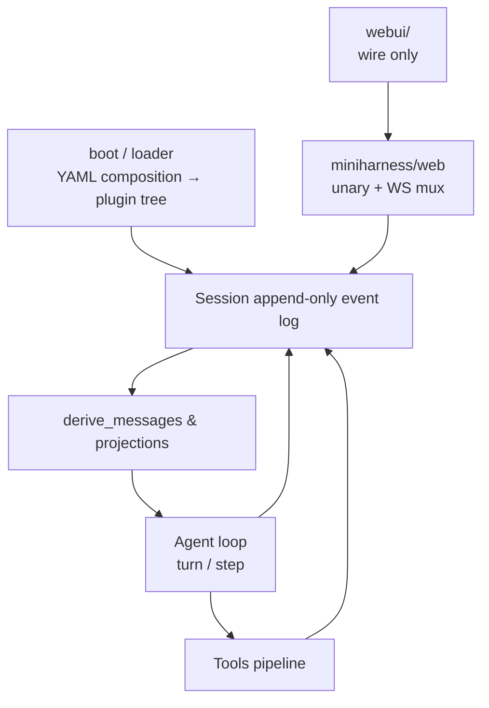

# Mini DeepSeek Harness (Python)

English | [中文](README.zh.md)

Full docs (MkDocs): https://zzkeepcurious.github.io/mini-deepseek-harness-python/ · In-repo hub [docs/index.md](docs/index.md)

**Mini DeepSeek Harness** is a Python agent runtime that re-implements the core contracts of [DeepSeek Harness](https://github.com/deepseek-ai/deepseek-harness) (`dsh`, the open-source harness by [DeepSeek AI](https://deepseek.com)), aiming to be production-ready. It depends on `httpx`, `filelock`, `watchdog`, and `pyyaml`; the web transport layer is an optional extra: `pip install ".[web]"` (`fastapi` + `uvicorn`).

Upstream is built on **everything is a plugin** and [Cordis](https://github.com/cordiverse/cordis) ([_A Programming Paradigm for Spatiotemporal Composability_](https://github.com/cordiverse/paper)). This repo rebuilds the event-sourced session log, plugin event bus, turn/step agent loop, and the capability-seam triangle (Service Definition / Provider / Consumer).

> **Production-oriented re-implementation, not a byte-for-byte port.** Not affiliated with DeepSeek AI. Wire, session log, and reliability/security/interop semantics target production readiness; deviations from upstream are documented explicitly.
>
> **Disclaimer:** much of the analysis report and handbook was written with AI assistance and may misread upstream sources; treat the upstream `deepseek-harness` repo as authoritative.

## Architecture

At runtime the spine is: `boot` loads composition and plugins → the session appends events only → projections such as `derive_messages` build model-visible history → the agent runs turn/step loops over the model and tools → when you need a browser or automation, `web/` exposes upstream-compatible wire and `webui/` consumes only that contract.



The repo splits into three layers (dependency rules: [docs/architecture.md](docs/architecture.md), section 3):

| Layer | Path | Role |
|---|---|---|
| Core | `miniharness/core/`, `llm/`, `boot/`, `loader/`, … | Domain logic; no HTTP/CLI coupling |
| Web backend | `miniharness/web/`, `protocol/` | Consumes core; publishes the wire contract |
| Frontend | top-level `webui/` | Wire-only; must not import Python internals |

Per-module upstream mapping lives in [docs/architecture.md](docs/architecture.md). For how the upstream monorepo itself is layered, see [docs/report/01-overview.md](docs/report/01-overview.md).

## Run it

Python 3.10+. `pip install -e .` for core deps; add `pip install ".[web]"` for the web host.

```sh
python -m unittest discover -s tests -t .          # all tests
python -m miniharness.demo                           # fake model + crash recovery (no key)
python examples/chat_demo.py
python examples/plan_goal_demo.py --approve   # plan review + goal rounds (fake model)
python -m miniharness.cli --profile headless "task"  # one-shot task (needs DEEPSEEK_API_KEY)
python -m miniharness.cli --profile web              # web host (needs [web] extra)
python -m miniharness.cli --dump-config              # read-only composition dump
python -m miniharness.cli sessions                   # list / resume / delete (teaching-extension CLI)
python -m miniharness.cli presets list               # preset roster (teaching-extension CLI)
```

```sh
export DEEPSEEK_API_KEY=sk-...
python examples/real_api_demo.py
```

```sh
pip install -e .
miniharness    # same as python -m miniharness.cli
```

CLI state lives under `MINIHARNESS_HOME` (default `~/.miniharness`): sessions in `sessions/`, user presets in `.agent-presets/`.

## Documentation

| If you need… | See |
|---|---|
| Handbook home + 16-chapter map | [docs/index.md](docs/index.md) |
| Module ↔ upstream package table | [docs/architecture.md](docs/architecture.md) |
| Web unary, Remote frames, error codes | [docs/interface-wire.md](docs/interface-wire.md) (`WebApi.ROUTES` in `miniharness/web/api.py`) |
| Upstream analysis (with Mermaid) | [docs/report/index.md](docs/report/index.md) |
| Step-by-step implementation chapters | [docs/chapters/](docs/chapters/) |
| Build `webui/` | [webui/README.md](webui/README.md) |
| Roadmap and registered simplifications | [ROADMAP.md](ROADMAP.md) |

## Entry points

| Use | Command / form | Notes |
|---|---|---|
| Demo | `python -m miniharness.demo` | No API key; includes persistence demo |
| Headless | `--profile headless "…"` | One-shot; final assistant text on stdout |
| Web | `--profile web` | FastAPI + gateway-shaped wire; UI in `webui/` |
| Protocols | `protocol/{acp,sdk,hooks}.py` | Minimal ACP / JSON-RPC SDK / hooks (handbook ch.07) |
| Composition | `--dump-config` / `--patch` | Aligns with upstream profile-boot semantics |

## Capability map

This file groups capabilities by domain so you can orient quickly; per-module notes, carrier differences, and closure status stay in the [docs/architecture.md](docs/architecture.md) mapping table.

| Domain | Summary | Upstream family (entry) |
|---|---|---|
| Session & persistence | Event envelope, V4 JSONL(zstd), migration chain, flush, `interrupted` repair | `core/session`, `session-persistence*` |
| Plugins & composition | emit/waterfall, loader live tree, boot/YAML/`!!js` | `vendor/cordis`, `boot`, `vendor/loader` |
| Agent & LLM | turn/step, DeepSeek Messages SSE, pi-ai, retry, token/compaction | `core/agent-loop`, `llm/*` |
| Tools & runtime | Registry pipeline, fs sandbox, bash/pwsh/terminal, PTC `run_code`, workflow | `core/tools`, `fs/*`, `shell/*`, `ptc-runtime` |
| Interaction & planning | plan/goal, approval, user-questions, schedule, jobs, skills | `interaction/*`, `plan`, `goal`, `schedule`, `jobs` |
| Web & host Remote | session/workspace/terminal/settings/credentials/account, plugin market | `api/gateway`, `api/*-controller` |
| Extensions | Subagent, seams (sandbox/credentials/auth), MCP, dynamic plugins, preset | `subagent`, `mcp/*`, `extensions/*`, `preset` |

`--profile web` uses two-envelope unary RPC, a single `/api/remote.mux` WebSocket, and `$events/result` settlement—matching upstream gateway. Frames and errors: [docs/interface-wire.md](docs/interface-wire.md). Product UI: `webui/`; `web/static/` is a legacy SSE teaching page and does not work against the current backend.

Deeper product topics and seams: [docs/report/04-product-surface.md](docs/report/04-product-surface.md), [docs/chapters/06-advanced-seams.md](docs/chapters/06-advanced-seams.md), [docs/chapters/07-external-entry-points.md](docs/chapters/07-external-entry-points.md).

## Layout

```
mini-deepseek-harness-python/
├── miniharness/     # core package (family layout; full tree in architecture.md §1.2)
│   ├── core/        # session, scope, tools, agent_loop
│   ├── llm/ boot/ loader/ compaction/ …
│   ├── web/         # wire transport (L3)
│   ├── cli/ protocol/ preset/ seams/ jobs/ goal/ …
│   └── demo.py
├── webui/           # React frontend (standalone, wire-only)
├── tests/ examples/
└── docs/            # architecture · interface-wire · report · chapters
```

File-level tree and dependency rules: [docs/architecture.md](docs/architecture.md).

## Acknowledgements

- [DeepSeek AI](https://deepseek.com) and [DeepSeek Harness](https://github.com/deepseek-ai/deepseek-harness)
- [Cordis](https://github.com/cordiverse/cordis)

## License

[MIT](LICENSE)
