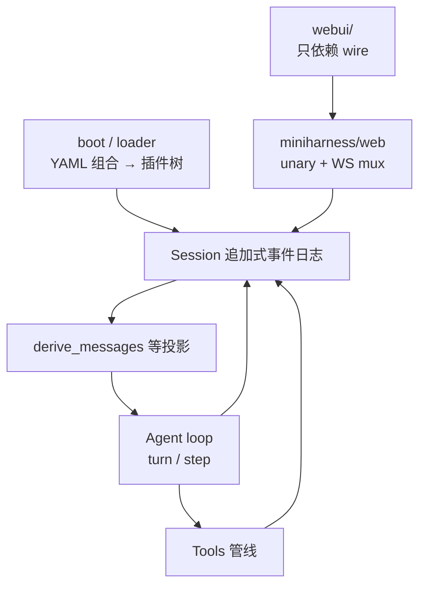

# Mini DeepSeek Harness（Python）

[English](README.md) | 中文

完整文档（MkDocs）：https://zzkeepcurious.github.io/mini-deepseek-harness-python/ · 仓库内入口 [docs/index.md](docs/index.md)

**Mini DeepSeek Harness** 用 Python 复现 [DeepSeek Harness](https://github.com/deepseek-ai/deepseek-harness)（`dsh`，[DeepSeek AI](https://deepseek.com) 开源 Agent 运行时）的核心约定，目标是可直接上生产。依赖 `httpx`、`filelock`、`watchdog`、`pyyaml`；Web 传输层为可选 extra：`pip install ".[web]"`（`fastapi` + `uvicorn`）。

上游建立在「一切皆插件」与 [Cordis](https://github.com/cordiverse/cordis) 之上（论文：[_A Programming Paradigm for Spatiotemporal Composability_](https://github.com/cordiverse/paper)）。本仓库重建：事件溯源会话、插件事件总线、turn/step Agent Loop、能力扩展口三角色（Service Definition / Provider / Consumer）。

> **面向生产的复现，不是逐字节移植**；与 DeepSeek AI 官方无关联。wire、会话日志、可靠性/安全/互操作以生产就绪为准；与上游偏差显式登记。
>
> **免责声明**：分析报告与教程等在 AI 辅助下撰写，可能有误读；上游 `deepseek-harness` 源码与文档为唯一权威。

## 架构与分层

运行时围绕一条主链：`boot` 加载组合与插件 → 会话只追加事件 → 投影出模型可见历史 → Agent 在 turn/step 里调模型与工具 → 需要浏览器或自动化时，由 `web/` 暴露与上游一致的 wire，`webui/` 只消费这份约定。



代码按三层拆开（依赖方向见 [docs/architecture.md](docs/architecture.md) 第 3 节）：

| 层 | 路径 | 职责 |
|---|---|---|
| 核心能力 | `miniharness/core/`、`llm/`、`boot/`、`loader/` 等 | 领域逻辑；不感知 HTTP/CLI 载体 |
| 后端 Web | `miniharness/web/`、`protocol/` | 消费 core，对外发布 wire 约定 |
| 前端工程 | 顶层 `webui/` | 只耦合 wire，禁止 import Python 内核 |

目录与上游包的逐项对照在 [docs/architecture.md](docs/architecture.md)；上游 monorepo 自身如何分层，见 [docs/report/01-overview.md](docs/report/01-overview.md)。

## 跑起来

Python 3.10+。`pip install -e .` 安装核心依赖；要用 Web 宿主再装 `pip install ".[web]"`。

```sh
python -m unittest discover -s tests -t .          # 全部测试
python -m miniharness.demo                           # 假模型 + 崩溃恢复（无 key）
python examples/chat_demo.py
python examples/plan_goal_demo.py --approve   # plan 审查 + goal 自动续跑（假模型）
python -m miniharness.cli --profile headless "task"  # 一次性任务（需 DEEPSEEK_API_KEY）
python -m miniharness.cli --profile web              # Web 宿主（需 [web] extra）
python -m miniharness.cli --dump-config              # 只读组合树
python -m miniharness.cli sessions                   # 会话 list / resume / delete（教学扩展 CLI）
python -m miniharness.cli presets list               # 预设 roster（教学扩展 CLI）
```

```sh
export DEEPSEEK_API_KEY=sk-...
python examples/real_api_demo.py
```

```sh
pip install -e .
miniharness    # 同 python -m miniharness.cli
```

CLI 写入的状态在 `MINIHARNESS_HOME`（默认 `~/.miniharness`）：会话在 `sessions/`，用户预设在 `.agent-presets/`。

## 文档

| 若需要… | 见 |
|---|---|
| 手册首页与 16 章学习地图 | [docs/index.md](docs/index.md) |
| 模块与上游包的对照表 | [docs/architecture.md](docs/architecture.md) |
| Web unary、Remote 帧与错误码 | [docs/interface-wire.md](docs/interface-wire.md)（端点以 `miniharness/web/api.py` 的 `WebApi.ROUTES` 为准） |
| 上游解读报告（含 Mermaid） | [docs/report/index.md](docs/report/index.md) |
| 分章实现教程 | [docs/chapters/](docs/chapters/) |
| 构建 `webui/` | [webui/README.md](webui/README.md) |
| 规划与登记简化 | [ROADMAP.md](ROADMAP.md) |

## 入口

| 用法 | 命令 / 形态 | 说明 |
|---|---|---|
| 演示 | `python -m miniharness.demo` | 无 API key，含持久化演示 |
| Headless | `--profile headless "…"` | 一次性任务，stdout 最终 assistant 文本 |
| Web | `--profile web` | FastAPI + gateway 形态 wire；UI 用 `webui/` |
| 协议 | `protocol/{acp,sdk,hooks}.py` | ACP / JSON-RPC SDK / hooks 最小子集（手册 07 章） |
| 组合 | `--dump-config` / `--patch` | 对齐上游 profile-boot 语义 |

## 能力地图

README 只按域归类；每个模块的备注与载体差异在 [docs/architecture.md](docs/architecture.md) 映射表里维护。

| 域 | 概要 | 上游包族（入口） |
|---|---|---|
| 会话与持久化 | 事件信封、V4 JSONL(zstd)、迁移链、flush、`interrupted` 修复 | `core/session`、`session-persistence*` |
| 插件与组合 | emit/waterfall、loader 活树、boot/YAML/`!!js` | `vendor/cordis`、`boot`、`vendor/loader` |
| Agent 与 LLM | turn/step、DeepSeek Messages SSE、pi-ai、retry、token/compaction | `core/agent-loop`、`llm/*` |
| 工具与执行环境 | 注册表管线、fs 沙箱、bash/pwsh/terminal、PTC `run_code`、workflow | `core/tools`、`fs/*`、`shell/*`、`ptc-runtime` |
| 交互与计划 | plan/goal、审批、user-questions、schedule、jobs、skills | `interaction/*`、`plan`、`goal`、`schedule`、`jobs` |
| Web 与宿主 Remote | session/workspace/terminal/settings/credentials/account、插件市场 | `api/gateway`、`api/*-controller` |
| 子系统与扩展 | 子代理、seams（沙箱/凭据/授权）、MCP、动态插件、preset | `subagent`、`mcp/*`、`extensions/*`、`preset` |

`--profile web` 走两信封 unary、单 WebSocket `/api/remote.mux` 与 `$events/result` 结算，与上游 gateway 一致；帧与错误码见 [docs/interface-wire.md](docs/interface-wire.md)。产品 UI 在 `webui/`；`web/static/` 是旧 SSE 教学页，不能对接当前后端。

产品面、扩展口与子代理的展开叙述：[docs/report/04-product-surface.md](docs/report/04-product-surface.md)、[docs/chapters/06-advanced-seams.md](docs/chapters/06-advanced-seams.md)、[docs/chapters/07-external-entry-points.md](docs/chapters/07-external-entry-points.md)。

## 仓库布局

```
mini-deepseek-harness-python/
├── miniharness/     # 核心包（家族布局，全树见 architecture.md 第 1.2 节）
│   ├── core/        # 会话、scope、tools、agent_loop
│   ├── llm/ boot/ loader/ compaction/ …
│   ├── web/         # wire 传输层（L3）
│   ├── cli/ protocol/ preset/ seams/ jobs/ goal/ …
│   └── demo.py
├── webui/           # React 前端（独立工程，只依赖 wire）
├── tests/ examples/
└── docs/            # architecture · interface-wire · report · chapters
```

更细的文件树与依赖规则：[docs/architecture.md](docs/architecture.md)。

## 致谢

- [DeepSeek AI](https://deepseek.com) 与 [DeepSeek Harness](https://github.com/deepseek-ai/deepseek-harness)
- [Cordis](https://github.com/cordiverse/cordis)

## 许可

[MIT](LICENSE)
