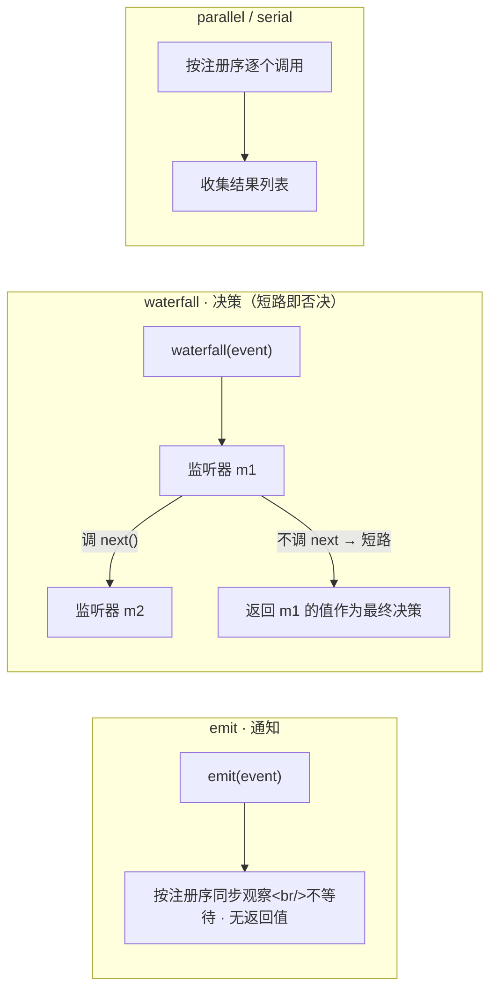

# 第 2 章：插件上下文与事件总线

> 对应 dsh 真实源码：`vendor/cordis`（见 `docs/cordis-primer.md`）+ `packages/core/scope`
> 前置：第 1 章。本章产出：`miniharness/core/scope.py`；测试 `tests/test_bus.py`、`tests/test_fiber.py`

## 2.1 这一章要做什么

第 1 章解决"事实怎么存"——一条只追加的事件日志。这一章解决"功能怎么插"。

一个可扩展的 agent 运行时，绕不开三个问题。任何一个没答好，"一切皆插件"就立不住：

1. **插件之间怎么互相取用，而不互相 import。**
   工具插件要用文件系统能力。如果它 `import` 某个具体的本地实现，那么把文件系统换成沙箱实现时，所有工具插件都得改。正确的做法是让插件只认一个稳定的名字，实现放在名字背后。
2. **插件做过的改动怎么撤销。**
   插件会注册工具、挂监听器、提供服务。卸载或热重载时，这些改动必须精确回滚——不能留下半截注册，也不能误删别人的东西。
3. **插件怎么否决一个决策，而不只是旁听。**
   权限插件需要在工具调用之前把它拦下来，这就要求事件总线既能广播，也能把控制权和返回值一路传下去。

本章按这三条线索实现四件东西：

- `Context`——按名字存取服务的仓库；
- 事件总线——四种派发模式，其中 `waterfall` 能行使否决权；
- `Fiber`——承载一个上下文全部副作用的栈与生命周期；
- `RegistryService`——按依赖关系激活插件，而不是靠手写启动顺序。

先把后面反复出现的词定下来：

| 术语 | 含义 |
|---|---|
| 服务（service） | 挂在上下文上的一个对象，按字符串 key 存取，如 `ctx.get("fs")` |
| 插件（plugin） | 一段 `apply(ctx, config)` 代码；装载时它注册服务、挂监听器 |
| 副作用（effect） | 插件登记的一处可撤销改动；每处都附带逆操作 |
| fiber | 承载"一个上下文名下全部副作用 + 生命周期状态"的单元 |
| waterfall | 一条监听器链；每个监听器可以调 `next()` 继续，或直接返回从而短路 |
| 隔离标签（isolate label） | 服务存储的命名空间；同一个 key 换标签就是另一份服务 |

## 2.2 概念：服务仓库与四种派发

### 服务仓库

`Context` 是一个服务仓库：`provide(key, value)` 把实现挂上去，`get(key)` 按名字取回来。两边都不提具体类型，只认 key。

存储本身是一张按**隔离标签**键控的全局表（上游 `reflect.ts` 的 `ctx[isolate][name]`）。一个上下文提供 `key` 时，真正写入的键是"这个 key 在当前隔离标签下"的位置。默认标签是根标签，所以根上提供的服务（`fs`、`tools`、`jobs` 等进程级服务）对所有作用域可见；某个 agent 想用自己那一套 `tools`，就换一个隔离标签，两者互不冲撞。

这里有一条反直觉但重要的规定：**同一标签下重复提供同一个 key 直接报错**，而不是"后者覆盖前者"。覆盖看着方便，实际会让"到底谁生效"变成难查的谜。要多个实例，用 `isolate()` 换标签，而不是指望覆盖。

### 四种派发

事件总线有四种模式，选哪种取决于"这次要的是通知、决策、还是变换"：

| 模式 | 语义 | 典型用途 |
|---|---|---|
| `emit` | 同步广播；不等待返回值，谁都能看 | 通知类：`session/event`、`agent/status` |
| `waterfall` | 监听器链；调 `next()` 继续，不调就短路，返回值即决策 | 决策类：`agent/pre-step`、`tools/pre-execute` |
| `parallel` | 全部执行并收集结果，彼此独立 | 横切动作，每一条都必须跑 |
| `serial` | 依次执行并收集结果，顺序有意义 | 后一步依赖前一步结果的变换 |



`waterfall` 是这里唯一能"否决"的模式。权限插件拿到 `(payload, next)` 后，如果认为该拒绝，就不调 `next()`、直接返回 `{kind:'deny'}`——链条到此为止，这个返回值就是最终决策。普通广播没有返回通道，做不到这件事。

!!! warning "同步实现里 parallel 与 serial 是同一个东西"
    Cordis 本体的 `parallel` 和 `serial` 是异步的：`parallel` 用 `Promise.all` 并发，`serial` 逐个 `await`，两者行为不同。mini 的教学实现是同步的——同步代码无法真正并发，所以 `parallel` 与 `serial` 都退化成"按注册序逐个调用、收集结果"，代码完全相同。并发与顺序的区别只体现在异步变体上——`aparallel`（`asyncio.gather`）与 `aserial`（逐个 `await`）语义不同；`aemit` / `awaterfall` 则是 `emit` / `waterfall` 的 async 版。仓库实现同时提供四套异步变体，`agent/pre-step` 等流水线走的是异步那套。

## 2.3 代码 step-by-step

### 步骤 1：Context 骨架与服务仓库

```python
class Context:
    def __init__(self, parent=None, name="root", *, _fiber=None):
        self.parent = parent                 # 作用域链：子找父
        self.name = name
        self._services = {}                  # 本上下文自己的服务视图（教学简化）
        self._listeners = {}                 # event -> 监听器列表
        # 每根 fiber 承载一个上下文的副作用栈
        self.fiber = _fiber or Fiber(parent, name=name, is_root=parent is None)

    def provide(self, key, value, check=None):
        """提供服务，返回 disposer。同一隔离标签下重复提供 = 冲突。"""
        self._assert_alive()
        label = self._label_of(key)          # 解析该 key 的隔离标签
        root = self.root
        if label in root._reflect_store:
            owner = root._reflect_store[label]["fiber"].name
            raise RuntimeError(f'service "{key}" has been registered at <{owner}>')
        root._reflect_store[label] = {
            "name": key, "value": value, "fiber": self.fiber, "check": check,
        }
        if self.fiber.state == FiberState.ACTIVE:
            root._notify([(key, label)])     # 通知依赖这个服务的待激活插件
        return self.effect(lambda: (
            lambda: root._reflect_store.pop(label, None)
        ), f"ctx.provide({key})")

    def get(self, key, strict=True):
        """按 key 取服务。strict 只返回提供者已 ACTIVE 的实现；未提供 → None。"""
        impl = self._find_impl(key)
        if impl is None:
            return None
        if strict and impl["fiber"].state != FiberState.ACTIVE:
            return None
        return impl["value"]
```

写法上，`provide` 返回的是一个 disposer：调用它就把服务摘掉。这个 disposer 通过 `self.effect(...)` 登记进 fiber；下一节会讲 `effect` 为什么这么设计。

`get(..., strict=True)` 默认只认"提供者已经激活"的服务。服务还在装载中或已卸载时，取到 `None` 而不是拿到一个半成品。这条规则让"依赖还没就绪"和"依赖已消失"变成同一种可观察状态，调用方只需处理 `None`。

### 步骤 2：事件监听与四种派发

```python
def on(self, event, fn):
    self._assert_alive()
    self._listeners.setdefault(event, []).append(fn)
    def disposer():
        lst = self._listeners.get(event)
        if lst and fn in lst:
            lst.remove(fn)
    return self.effect(lambda: disposer, f"ctx.on({event})")

def _listeners_for(self, event):
    """收集自身 + 祖先链的监听器（子先于父，各层保持注册序）。"""
    chain = []
    node = self
    while node is not None:
        chain = list(node._listeners.get(event, [])) + chain
        node = node.parent
    return chain

def emit(self, event, payload=None):
    for fn in self._listeners_for(event):
        fn(payload)

def waterfall(self, event, payload=None, *, base=None):
    listeners = self._listeners_for(event)
    idx = 0
    def step(cur):
        nonlocal idx
        if idx >= len(listeners):
            return base(cur) if base is not None else cur
        fn = listeners[idx]
        idx += 1
        return fn(cur, lambda new=cur: step(new))   # 传入 next：调它才继续
    return step(payload)

def parallel(self, event, payload=None):
    return [fn(payload) for fn in self._listeners_for(event)]

def serial(self, event, payload=None):
    return [fn(payload) for fn in self._listeners_for(event)]
```

`waterfall` 的全部机关就是这一行：

```python
return fn(cur, lambda new=cur: step(new))
```

它把"继续"做成了一个回调 `next` 交给监听器。监听器调 `next(new)`，就用 `new` 作为新的 payload 递归进入下一位；不调 `next`，`fn` 就直接返回，`step` 原样把这个返回值交回调用方——链条短路。所谓"否决权"，不过是"拿到了 `next` 却选择不用"。

测试里能看到这个语义：

```python
ctx.on("w", lambda p, nxt: {"kind": "deny"})       # 不调 next → 短路
ctx.on("w", lambda p, nxt: nxt({"kind": "allow"}))
assert ctx.waterfall("w", {}) == {"kind": "deny"}   # 第一位的 deny 就是决策
```

`parallel` 与 `serial` 的同步版按前面 warning 说的，是同一段代码；真正的区分在异步变体：

```python
async def aparallel(self, event, payload=None):
    coros = [fn(payload) for fn in self._listeners_for(event)]
    return await asyncio.gather(*coros)      # 同时启动，全部跑完

async def aserial(self, event, payload=None):
    results = []
    for fn in self._listeners_for(event):
        results.append(await fn(payload))    # 逐个等待，顺序有意义
    return results
```

### 步骤 3：可逆副作用与 fiber

`effect(execute)` 的参数是**执行体**，不是 disposer——注册的那一瞬间执行体就被调用：

```python
def effect(self, execute, label="anonymous"):
    self._assert_alive()
    return self.fiber.effect(execute, label)
```

执行体的返回值决定收集什么：

- 返回 `None` → 没有需要清理的东西；
- 返回可调用对象 → 它就是 disposer，拆解时逆序调用；
- 返回 awaitable / 生成器 → 异步 setup；拆解时先等 setup 结束再清理（setup barrier）；
- 返回其它 → `TypeError: Invalid effect`（响亮失败）。

所以 `provide`、`on` 的写法都是"包一层 lambda，里面返回真正的清理函数"——lambda 立刻执行，它返回的那个内层函数被收集为 disposer。

为什么执行体要立即执行，而不是等到某个统一时机？因为执行体自己可能继续登记别的东西（再挂监听器、再开一个 effect）。这些登记必须当场生效，拆解时才能"装了什么就拆什么"。配套的规则是**注册先于执行**：登记表先记下这条 effect，再跑执行体。这样即使执行体跑到一半触发拆解，拆解器也能看到这条"还没 setup 完"的记录，先挂一个 barrier 等它结束再清理。

承载这些的是 **fiber**（上游 `vendor/cordis/src/fiber.ts`）。每个上下文对应一根 fiber，`fiber._disposables` 就是它名下的 effect 列表，`fiber.dispose()` 逆序回滚全部：

```
FiberState: PENDING → LOADING → ACTIVE → UNLOADING → DISPOSED
```

- 新作用域的 fiber 走 `pending → loading → active`；
- `dispose()` 走 `active → unloading → disposed`；
- 每次状态转换派发 `internal/status` 事件，携带新旧状态；
- 处于 `unloading` / `disposed` 的 fiber 拒绝一切新注册（抛 `INACTIVE_EFFECT`）。

`dispose()` 幂等：重复调用会 join 已经在跑的拆解（fiber 的 `inertia` 记录在途转换，竞态调用共享同一完成）。拆解时全部同步 disposer 先逆序执行；遇到异步 disposer 就并发卸载，并返回一个可 `await` 的完成对象。异步拆解里冒出的错误被记为 fiber 的错误并记日志，既不会静默吞掉，也不会把拆解本身炸停。

### 步骤 4：作用域与依赖驱动激活

作用域是"带独立 fiber 的子上下文"。中间件为每个 agent 开一个作用域，per-agent 的服务与监听器就各归各家：

```python
def create_scope(self, name="scope", parent=None):
    key = ScopeKey()
    if parent is None:
        parent = scope_of(self)
    return _dsh_create_scope(self, key, parent=parent, name=name)
```

它返回一个 `Scope` 包装（代理到子上下文），底层经 `ctx.plugin(noop)` 铸一枚独立 fiber，并自动成为父 fiber 的一条 effect——父拆解时按序收回全部子作用域。默认 `parent` 取最近的 enclosing scope，所以嵌套 `create_scope` 自然形成祖先链。

最后一块是插件的激活顺序。mini 的真实装载器是 `RegistryService`（`ctx.plugin(...)`）。插件把需要的服务写进 `inject`，装载器在依赖就绪时才调 `apply`：

```python
fiber = root.plugin({"name": "consumer", "inject": ["svc"],
                     "apply": lambda ctx, cfg: ...})
assert fiber.state == FiberState.PENDING      # 依赖缺失 → 挂起等待，不报错

provider = root.plugin({"name": "provider",
                        "apply": lambda ctx, cfg: ctx.provide("svc", 42)})
assert fiber.state == FiberState.ACTIVE       # 提供方装载 → 依赖者被唤醒
```

提供方一挂上服务，装载器就通知所有 `inject` 了它的插件（`_notify` → 依赖者 `_check_impl` + `_refresh`）：重估依赖、满足则激活。依赖变化（服务被卸载或替换）会触发重新装载（epoch 重载：卸载旧版 → 装载新版）。这样一来，加载顺序由依赖关系本身决定，不再依赖启动脚本里手工排列的行序。

两个边界要记住：

- 卸载 = 回滚该插件 `apply` 期间登记的全部副作用（fiber disposer 栈逆序）。服务随之消失，依赖者据 `strict get` 的 `None` 重新挂起。
- 环依赖或依赖永远不出现 → 插件保持 `PENDING`（静默等待，不会半激活）。装配结束时检查所有 fiber 是否到达终态、并点名未激活者，是启动层（第 5、8 章）的责任，不是注册表的。

## 2.4 验收：硬性规定

以下规定各有对应测试，集中在 `tests/test_bus.py` 与 `tests/test_fiber.py`：

1. 服务按隔离标签提供/查找；同一标签重复提供 = 冲突；未提供返回 `None`；`strict` 过滤非 ACTIVE 提供者。
2. `waterfall` 短路语义：不调 `next` 的监听器，其返回值就是最终决策。
3. 监听器按注册序执行；作用域内子先于父。
4. `effect` 约定：执行体立即执行，返回值按形态收集为 disposer；返回 `None` 则无 disposer；返回非法值响亮失败。
5. `dispose` 逆序回滚全部副作用；销毁后拒绝注册（`INACTIVE_EFFECT`）。
6. disposer 单发、可 `await`；异步拆解逆序 + 并发。
7. fiber 状态机与 `internal/status` 派发。
8. setup barrier：执行体跑到一半触发拆解不丢 disposer；执行体抛错则回滚已收集项后重抛。
9. 插件激活由依赖驱动；依赖始终缺失时保持 `PENDING`。

```bash
python -m unittest tests.test_bus tests.test_fiber -v
```

## 2.5 检查点练习

1. **写一个权限插件**：挂到 `tools/pre-execute`（waterfall），对 `name == "rm"` 的调用返回 `{"kind": "deny", "reason": "blocked"}`（不调 `next`），其余调 `next`。写测试断言拒绝路径。
2. **验证隔离**：root → scopeA → scopeB；在 root 提供 `svc`，断言 A、B 都取得到；再让 A 用另一个隔离标签提供同名 `svc`，断言 B 仍取到 root 的那份、A 取到自己的那份。
3. **模拟热重载**：装载一个插件 → 确认服务在场 → dispose → 断言服务消失，且重新装载同名插件不发生冲突。

## 2.6 回到 dsh：真实源码对照

打开 `deepseek-harness/vendor/cordis/src`：

- `context.ts` + `reflect.ts`：`provide`/`get`/`set`/`isolate`/`effect`/`dispose` 的完整实现。重点是 `effect` 的 execute 形态、注册先于执行、`disposeAfter(waitForSetup())` 重入保护、按隔离标签键控的全局 store、`notify` 的标签过滤。
- `fiber.ts`：fiber 状态机、`internal/status`、`internal/plugin`、`_setEpoch` 依赖重载、`inertia` 在途转换、`_unload` 的并发拆解。mini 复现了装载半边与依赖驱动注册表；epoch 热重载在 mini 走 HMR 与 `watch_user_patches` 路径（第 13 章）。
- `events.ts`：四种派发模式的异步版本——`parallel`/`serial` 的并发与顺序差异在这里才成立。
- `vendor/README.md`：18 项本地加固清单。挑 3 项对照测试读一遍，就能看清"框架被 vendored 且可审计"到底意味着什么。

## 2.7 收尾

Context 同时是三样东西：服务仓库、事件总线、副作用栈。插件装进去的每样贡献都能被精确拆出来；装的时间点由依赖关系决定，不由启动脚本决定。下一章的工具管线就建在这个底座上——你会看到 `tools/pre-execute` 的否决权，正是这里 `waterfall` 的短路语义。
