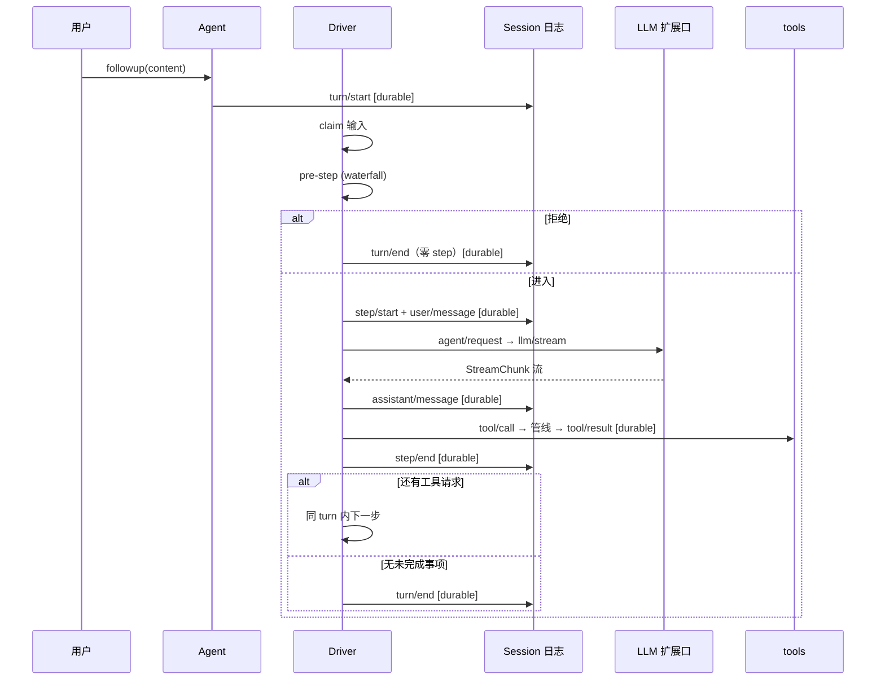

# 第 4 章：Agent Loop 与 LLM 流式

> 对应 dsh 真实源码：`packages/core/agent-loop` + `packages/llm/llm` + `packages/llm/llm-deepseek`
> （`docs/agent-lifecycle.md`、`docs/subsystems/llm-streaming.md`）
> 前置：第 1~3 章。本章产出：`miniharness/llm/`、`miniharness/core/agent_loop/`；测试 `tests/test_loop.py`

## 4.1 这一章要做什么

前三章备好了三样东西：一条事件日志（第 1 章）、一个插件底座（第 2 章）、一条工具管线（第 3 章）。这一章把它们串起来，让一个对话回合真正跑完：

1. **`llm.py`** —— 统一流协议 `StreamChunk` + 适配器接口 `LlmAdapter` + DeepSeek 的 Messages SSE 适配器（经 `httpx` 异步传输，不装厂商 SDK）；
2. **`loop.py`** —— turn/step 状态机：输入排队、pre-step 拒绝、工具结果回灌后续步、turn 括号闭合。

用内置的 `FakeLlmAdapter` 不需要 API key 就能跑通"文本 + 工具调用"的完整回合，测试和 demo 都靠它。

## 4.2 概念：turn、step 与"落日志"

先厘清两个词：

- **step** = 一次模型请求，加上它要求调用的工具。模型如果调了工具，把结果回灌后再问一次，就是下一个 step；
- **turn** = 零个或多个 step。它是一次对话回合的完整括号：在认领第一条输入**之前**打开，在没有任何未完成事项时关闭。

时序图里用 `[durable]` 标注事件。**`[durable]` 的意思是"写入了会话日志"**——它是模型可见历史（第 1 章 `derive_messages`）的唯一来源。落日志不等于立刻落盘（磁盘写入由持久化订阅者异步完成，第 5 章），但一旦落日志，这条事实就进入了唯一数据源，崩溃恢复时也还在。本章只关心"什么时候落日志"，不关心"什么时候落盘"。



三个要点：

1. **turn 在认领输入之前打开。** 所以哪怕 pre-step 拒绝了这次输入，日志里也会留下 `turn/start + turn/end` 一对——"发生过一次尝试"本身是要审计的事实，即使它什么都没做。
2. **工具结果回灌后会自动续步。** 同一个 turn 里可能发生多次模型请求，这是 agent 循环和普通一次性聊天 API 的根本差别：聊天 API 一次请求一次回答，agent 循环要一直转到"无事可做"。
3. **模型可见 ⟺ 已记录。** `user/message` 在 pre-step 通过后才落日志；模型永远看不到没进日志的输入。第 1 章的这条约束，在循环这一层靠"先决策、后落日志"的次序来维持。

另外，`step/end` 与 `turn/end` 都写在 `finally` 里：哪怕中途抛错，括号也一定会闭合。这是第 1 章"括号平衡"基座在循环这一层的落实。

## 4.3 实现：`llm.py`

### 1. 统一流协议 StreamChunk

不同厂商的流式格式各不相同（Anthropic 是事件流，OpenAI 是 `choices[].delta`，还有各种原生 SSE）。让循环去关心这些差异是错的——它是整个系统里最不该感知厂商细节的地方。所以在适配器和循环之间插一层统一协议：

```python
STREAM_CHUNK_KINDS = frozenset({
    "block-start", "text-delta", "reasoning-delta",
    "tool-call-delta", "block-end", "usage", "finish",
})

class StreamChunk(dict):
    def __init__(self, kind, **payload):
        if kind not in STREAM_CHUNK_KINDS:
            raise ValueError(f"未知 chunk kind: {kind}")
        super().__init__({"type": kind, **payload})
```

一次流被拆成三类信息：

- **块的边界**：`block-start` / `block-end`，`block-end` 携带组装好的完整块（文本块、推理块、工具调用块……）；
- **块内的增量**：`text-delta` / `reasoning-delta` / `tool-call-delta`，都带 `index` 指明属于哪个块（多个块可能交错到达，靠 `index` 区分）；
- **收尾**：`usage` 在 `finish` 之前，`finish` 之后不再有值；`finish` 的 reason 是对象，如 `{"kind": "stop"}`、`{"kind": "tool-calls"}`、`{"kind": "max-tokens"}`。

约定这样定，循环就只认这几类 chunk。换厂商 = 换一个适配器，循环一行不改。

### 2. 适配器接口与错误收口

```python
class LlmFailure(Exception):
    """统一错误收口，携带上游错误码。"""
    def __init__(self, code, message, status=None,
                 provider_retry_after_ms=None, request_id=None):
        super().__init__(message)
        self.code = code
        self.status = status
        self.provider_retry_after_ms = provider_retry_after_ms   # 429 的 Retry-After
        self.request_id = request_id

class LlmAdapter:
    """Service Definition：循环只依赖这个协议。"""
    provider = "base"

    async def stream(self, messages, tools, signal=None,
                     session_id=None, purpose=None):
        raise NotImplementedError
```

错误处理的自然写法是"哪个 SDK 抛什么就 catch 什么"，可每个厂商的报错对象都不一样。dsh 把授权失败、HTTP 错误、上下文溢出都收敛成同一个 `LlmFailure(code, message)`，再附带几个恢复决策需要的事实字段（HTTP 状态、`Retry-After`、供应商请求 id）。循环捕获的永远只有这一个异常类型。

错误码是闭集，`AUTH`、`RATE_LIMIT`、`CONTEXT_WINDOW_EXCEEDED`、`EMPTY_RESPONSE` 等各有含义。其中 `EMPTY_RESPONSE`（模型返回了空响应）按规范错误处理，默认允许重试——§4.9 会用到。

### 3. FakeLlmAdapter —— 无 key 也能跑通

```python
class FakeLlmAdapter(LlmAdapter):
    provider = "fake"

    def __init__(self, tool_call=None, final_text="任务完成。"):
        self._tool = tool_call
        self._text = final_text
        self.calls = 0

    async def stream(self, messages, tools, signal=None,
                     session_id=None, purpose=None):
        self.calls += 1
        if self._tool and self.calls == 1:
            arguments_text = json.dumps(self._tool.get("arguments", {}), ensure_ascii=False)
            yield StreamChunk("block-start", index=0, blockType="tool-call")
            yield StreamChunk("tool-call-delta", index=0, id="call_0",
                              name=self._tool["name"], argumentsDelta=arguments_text)
            yield StreamChunk("block-end", index=0, block={
                "type": "tool-call", "id": "call_0", "name": self._tool["name"],
                "arguments": arguments_text,
            })
            yield StreamChunk("finish", reason={"kind": "tool-calls"})
        else:
            yield StreamChunk("block-start", index=0, blockType="text")
            yield StreamChunk("text-delta", index=0, text=self._text)
            yield StreamChunk("block-end", index=0, block={"type": "text", "text": self._text})
            yield StreamChunk("finish", reason={"kind": "stop"})
```

行为很简单：第一次调用返回一次工具调用，之后返回最终文本。这样就能驱动"模型调工具 → 拿到结果 → 再回答"的完整回合，全程不需要真实模型。注意工具调用块里的 `arguments` 是 **JSON 字符串**而不是对象——模型侧协议里工具参数就是字符串，和上游 `ContentBlock` 一致。

### 4. DeepSeekAdapter —— Messages 协议上的流式

DeepSeek 的官方适配器走 **Anthropic 兼容的 Messages 协议**（上游已删除 Chat Completions 路径）。请求发到 `messages_api_root(base) + "/messages"`，头带 `x-api-key` 与 `anthropic-version`；响应是一串 SSE 事件：

```
message_start → content_block_start → content_block_delta* → content_block_stop*
             → message_delta → message_stop
```

关键约定有两条：

- **`message_stop` 是唯一的完成点。** 流如果在 `message_stop` 之前就没了，说明响应被截断，抛 `STREAM_CLOSED`，绝不能把半截响应当成完整答案；
- **事件自带类型。** 每帧有 `event:` 行和 `data:` 行，事件类型（`content_block_delta` 等）直接写在 `event:` 里，不需要像 OpenAI 那样从 `choices[].delta` 反推。

适配器的职责就是把这两层翻译成统一 `StreamChunk`：

```python
async def stream(self, messages, tools, signal=None,
                 session_id=None, purpose=None):
    body = {
        "model": self._model, "stream": True, "max_tokens": self.max_tokens,
        "messages": serialize_messages(messages),
    }
    if tools:
        body["tools"] = [{"name": t["name"], "description": t.get("description", ""),
                          "input_schema": t.get("parameters", {})} for t in tools]
    async with httpx.AsyncClient(timeout=...) as client:
        async with client.stream("POST", messages_api_root(self._base) + "/messages",
                                 json=body, headers=self._auth_headers()) as resp:
            if resp.status_code >= 400:
                detail = (await resp.aread()).decode("utf-8", "replace")[:500]
                raise LlmFailure(_http_error_code(resp.status_code, detail),
                                 f"HTTP {resp.status_code}: {detail}")
            async for chunk in translate(parse_sse(resp.aiter_lines())):
                yield chunk
```

`translate` 负责把 Anthropic 事件映射成 chunk：`content_block_start` → `block-start`（文本/推理块直接带初始文本），`content_block_delta` 里的 `text_delta` / `thinking_delta` / `input_json_delta` → 对应的 `*-delta`，`content_block_stop` → `block-end`，`message_stop` 之后补 `usage` 与 `finish`。`stop_reason` 映射为 `end_turn → {"kind":"stop"}`、`tool_use → {"kind":"tool-calls"}`、`max_tokens → {"kind":"max-tokens"}`。适配器在内部把 tool-call 的分片攒齐，重放成完整的 `block-start → *-delta → block-end` 序列——所以循环拿到的永远是装配好的块，而不是碎片。

两个细节：

- **凭据只存引用。** `base_url`、`api_key` 从环境变量或构造参数来，代码里不写死明文。凭据的完整解析在第 6 章。
- **错误在源头分类。** `_http_error_code` 按上游 `adapter.ts` 的映射：401/403 → `AUTH`、quota 措辞 → `QUOTA`、429 → `RATE_LIMIT`、400 上下文超限 → `CONTEXT_WINDOW_EXCEEDED`、400/413 → `INVALID_REQUEST`、≥500 → `SERVER`、其余状态 → `HTTP_<status>`。调用方拿到的永远是分类好的码，不用自己去猜 HTTP 状态。

!!! note "为什么传输层用 httpx"
    `urllib` 的阻塞读无法被真正取消，只能靠固定超时兜底；上游要求"读间隙超时可取消"（per-read watchdog）。`httpx` 是原生 asyncio 传输：取消信号一置位就关闭连接，读间隙超时按 300s 计，测试还能用 `httpx.MockTransport` 注入假响应而不用打真实网络。这就是本手册"成熟开源库优先"的取舍——有维护良好的异步 HTTP 库时，不手写传输层。

## 4.4 实现：`loop.py`

### 1. 状态与入口

```python
class AgentLoop:
    def __init__(self, session, adapter, tools, ctx,
                 system_prompt="你是一个助手。", max_steps=None):
        self.session = session
        self.adapter = adapter
        self.tools = tools
        self.ctx = ctx
        self.system_prompt = system_prompt
        self.max_steps = max_steps or DEFAULT_MAX_STEPS    # 死循环守卫，默认 50
        self.status = "idle"
        self.inbox = deque()        # 排队输入
        self._turn_open = False
        self._continue = False      # 工具回灌后是否续步

    def followup(self, content, source="user"):
        """用户输入：先入队，再唤醒驱动去消费。"""
        self.inbox.append({"role": "user", "content": content, "source": source})
        self._wake()                # 真实实现经常驻事件循环驱动（resident_loop.py）
```

输入为什么先入队、不直接处理？因为一次 `followup` 可能引发多轮工具调用。期间如果又来一条新输入，它必须排队等这一轮走完，不能插进来打断正在进行的回合。队列就是回合的边界。

### 2. turn 生命周期

```python
    def _open_turn(self):
        if self._turn_open:
            return
        self.status = "running"
        self._turn += 1
        self._step = 0
        self.session.append("turn/start", {"turn": self._turn})   # [durable]
        self._turn_open = True

    def _close_turn(self, reason=None):
        if not self._turn_open:
            return
        self.session.append("turn/end", {
            "turn": self._turn, "reason": reason or {"kind": "completed"}})  # [durable]
        self._turn_open = False
        self.status = "idle"
```

`turn/start` / `turn/end` 是第 1 章的括号。`reason` 是个对象，默认 `{"kind": "completed"}`；被拒绝的回合写 `{"kind": "blocked"}`，被打断的写 `{"kind": "aborted", ...}`。编号从 1 起，每个 turn 内 `_step` 重置为 0、进入 step 时先自增再使用——与上游 `invariant.ts` 的 `nextTurn: 1, nextStep: 1` 一致。

### 3. 主循环

```python
    async def _pump(self):
        steps = 0
        while self.inbox or self._continue:
            steps += 1
            if steps > self.max_steps:
                raise RuntimeError(f"超过最大 step 数 {self.max_steps}，疑似死循环")
            self._open_turn()
            claimed = self.inbox.popleft() if self.inbox else None
            await self._run_step(claimed)
            if not self.inbox and not self._continue:
                self._close_turn()
```

循环条件是"还有排队输入，或还有工具回灌待续步"。`max_steps` 是死循环守卫：模型如果一直调工具不收敛，会在上限处报错而不是挂死。上游 `AgentLoop` 没有硬性 step 上限，这个守卫是 mini 补的安全网：默认 `DEFAULT_MAX_STEPS = 50`，可用构造参数或环境变量 `MINIHARNESS_MAX_STEPS` 覆盖。

### 4. 一个 step

```python
    async def _run_step(self, claimed):
        if claimed is not None:
            decision = await self.ctx.awaterfall("agent/pre-step", {"messages": [claimed]})
            if isinstance(decision, dict) and decision.get("kind") == "reject":
                return                          # 零 step：不落 step/start，turn 照常闭合
            self._step += 1
            self._append("step/start")
            self._append("user/message", content=claimed["content"],
                         surfaceOp="append", source=claimed.get("source", "user"))
        else:
            self._step += 1                     # 工具回灌后的续步
            self._append("step/start")

        history = derive_messages(self.session.events)                    # 历史永远现算
        messages = [{"role": "system", "content": self.system_prompt}] + history
        chunks = [c async for c in self.adapter.stream(messages, self._tool_definitions())]
        text = "".join(c.get("text", "") for c in chunks if c["type"] == "text-delta")

        # tool-call-delta 是增量分片：按 id 累积 name 与 argumentsDelta
        pending = {}
        for c in chunks:
            if c["type"] != "tool-call-delta":
                continue
            slot = pending.setdefault(c.get("id") or str(c.get("index")),
                                      {"name": "", "argumentsDelta": ""})
            slot["name"] += c.get("name", "")
            slot["argumentsDelta"] += c.get("argumentsDelta", "")
        tool_calls = [{"name": s["name"], "arguments": s["argumentsDelta"]}
                      for s in pending.values()]

        self._append("assistant/message", content=text, surfaceOp="append", toolCalls=tool_calls)
        for call in tool_calls:
            await self._run_tool(call["name"], call["arguments"])
        self._append("step/end")
        self._continue = bool(tool_calls)
```

四个要点：

- **pre-step 拒绝**：waterfall 返回 `{"kind": "reject"}` 时不落 `step/start`，turn 直接闭合——这就是零 step turn（4.2 要点 1）。
- **历史永远现算**：`derive_messages(日志)` + system prompt，从不另存一份。第 1 章那句"模型可见 ⟺ 已记录"就落在这里。
- **工具参数是分片到达的**：`tool-call-delta` 一批批送来 `name` 和 `argumentsDelta`，循环按 id 攒齐后才组装成完整调用。所以日志里存的是完整参数，不是碎片。
- **`_continue = bool(tool_calls)`**：有工具调用就在同 turn 内续一步。第二次请求时，历史里已经多了上一轮的 `tool/result`。

### 5. 工具执行与落日志

```python
    async def _run_tool(self, name, arguments):
        tool = self.tools.resolve(name)
        if tool is None:
            result = ToolResult(ok=False, is_error=True, error=f"未知工具: {name}")
        else:
            if isinstance(arguments, str):
                try:
                    arguments = json.loads(arguments)
                except json.JSONDecodeError:
                    arguments = {}
            self.session.append("tool/call", {"name": name, "arguments": arguments})  # 执行前先落
            result = await run_pipeline(self.ctx, tool, arguments)
        self.session.append("tool/result", {
            "name": name, "content": result.content,
            "isError": result.is_error, "error": result.error, "surfaceOp": "append"})
```

`tool/call` 在**执行之前**落日志（所以即使执行崩了，"模型调用过这个工具"也留了痕），`tool/result` 是唯一模型面向的结果——和第 3 章管线无缝对接。注意"未知工具"也被规范化成 `ToolResult(is_error=True)`：模型收到一条错误消息，自己决定下一步，而不是让整个回合崩掉。

## 4.5 验收：硬性规定 + 测试

`tests/test_loop.py` 固定的规定：

1. `turn/start` 与 `turn/end` 成对，回合结束后括号平衡；
2. 被拒绝的尝试留下 `turn/start + turn/end`，但没有 `step/start`；
3. 工具调用回合里 `tool/call → tool/result` 相邻且都落日志；同一 turn 内模型被请求至少两次；
4. 历史永远从日志派生；`max_steps` 能挡住死循环；
5. StreamChunk 协议：`usage` 在 `finish` 前，`finish` 是最后一个 chunk。

```bash
python -m unittest tests.test_loop -v
```

## 4.6 用真实 API 跑一次（可选）

```python
from miniharness import Context, Session, ToolRegistry, Tool, AgentLoop, DeepSeekAdapter

session = Session("real-001")
ctx = Context()
reg = ToolRegistry(ctx)
reg.register(Tool(name="bash", description="Run a shell command.",
                  parameters={"type": "object",
                              "properties": {"cmd": {"type": "string"}},
                              "required": ["cmd"]},
                  execute=lambda args, e: f"stdout: {args['cmd']}"))
loop = AgentLoop(session, DeepSeekAdapter(model="deepseek-chat"), reg, ctx)
print(loop.run("用 bash 执行 echo hello，然后告诉我结果。"))
print([e["type"] for e in session.events])
```

需要环境变量 `DEEPSEEK_API_KEY`（可选 `DEEPSEEK_BASE_URL` 指向兼容代理）。真实装配请在构造 loop 之前调用 `apply_retry_planner(ctx)`（§4.9）以便重试生效；本示例为教学省略。跑完看 `session.events`，完整回合的括号、消息、工具调用与结果都在里面。

## 4.7 检查点练习

1. **给拒绝带上理由**：让 pre-step 返回 `{"kind": "reject", "reason": "..."}`，reject 时把 `reason` 写进 `turn/end`，并断言日志可审计。
2. **流内嵌往返**：构造一条带内嵌 `stream` 记录的 `assistant/message`，断言 `expand_assistant_stream` 能还原出逐 chunk 序列（含每个 delta 边界），且 `derive_messages` 不受这些流记录影响。
3. **并发工具**：给 `_run_tool` 加 `is_concurrency_safe` 判断，安全工具并行、非安全工具串行——跑通测试。

## 4.8 回到 dsh：真实源码对照

打开 `deepseek-harness/packages/core/agent-loop/src`。真实的主 driver `_runStep` 对应本章的 `_run_step`，但要复杂得多：工具调用按模型序成批调度、有并发屏障、回灌顺序有约束（第 12 章展开）。

`docs/agent-lifecycle.md` 顶部的时序图与本章 4.2 的图逐条对应。

本章的教学代码做了这些简化（编写真实代码时以仓库实现为准）：

| 教学简化 | 仓库实现 |
|---|---|
| 扁平事件、字符串内容 | ContentBlock 消息对象 + 显式编号 + `request/header`；模型流以压缩流内嵌进 `assistant/message`，失败 attempt 落 `assistant/attempt` |
| `_pump` 直接 `await` | 常驻单例事件循环驱动（`core/agent_loop/resident_loop.py`）；`followup`/`steer` 是同步门面 |
| 单队列 `deque` | 双队列 inbox（next-turn / next-step），支持编辑、取消、唤醒语义（`core/agent_loop/inbox.py`） |
| 简单 `_run_tool` | 第 3 章的完整管线 + 第 12 章的并行调度 |

下面这些真实扩展点，教学版没有实现。对照时不要问"上游为什么多这些"，它们是刻意省略的：

| 上游事件/扩展点 | 用途 | mini 对应 |
|---|---|---|
| `system-prompt/assemble` waterfall | 提示词分节组装，hook 可注入上下文 | `core/system_prompt.py`（第 13 章） |
| `agent/request` waterfall → `llm/stream` | 请求派发前拦截与改写 | `_request_config`（以路由 config 为种子，payload 附 turn/step/signal） |
| `agent/request-error` waterfall | 规范错误（如上下文溢出）后的重试决策 | §4.9 |
| `agent/turn-stopping` serial | turn 结束前的串行检查点 | step/end 后确认无 next-step 才派发；pre-step 拒绝则终局不派发 |
| `finish {kind:'error'\|'aborted'}` 带内失败 | 流中途失败也走协议 | 带内失败与抛异常同走 `agent/request-error` |
| `EMPTY_RESPONSE` 编码 | 空响应 = 可重试的规范错误 | 默认可重试（§4.9） |

## 4.9 重试/退避与上下文溢出降级

对应 dsh：`packages/llm/llm/src/retry-policy.ts` + `packages/llm/llm-retry/src/index.ts` + `packages/core/agent/src/runtime-types.ts`（`agent/request-error`）。

扩展点：适配器抛 `LlmFailure` 时，循环派发 `agent/request-error` waterfall，payload `{agent, turn, step, provider, failure, retryPolicy, signal}`（与上游逐字段一致）。监听器返回 `{kind: 'retry'}` 且不调 `next()` 表示自己接管恢复；调 `next()` 委派下游；既不接管也没下游处理，则失败终局。重试规划器由装配方显式挂载（`AgentLoop` 构造本身不带副作用）：各入口在构造 loop 前调用 `apply_retry_planner(ctx)`（幂等）。

策略解析（`llm/retry_policy.py`，同 retry-policy.ts）：

- 两种模式：`normal`（`maxRetries` + 可重试码白名单）/ `always`（无限重试）；
- 默认值：`maxRetries 5`、`initialDelayMs 500`、`maxDelayMs 10000`、`jitterRatio 0.1`，可重试码 `[EMPTY_RESPONSE, RATE_LIMIT, SERVER, TIMEOUT, TRANSPORT]`；
- 严格校验：未知键拒绝；退避参数须为正有限且 `initial ≤ max`；`jitterRatio ∈ [0,1]`；`maxRetries` 为非负整数；可重试码非空无重复。解析结果冻结。

恢复决策（`llm/retry.py`，同 llm-retry/index.ts）：

1. 无策略 → 直接委派，不重试；
2. `always`：派发前检查熔合信号（请求 signal 与重试插件 lifetime），已中止则失败终局；委派下游拿决策后**复查**熔合信号，中止压过决策；失败或无人接管则自己无限重试（不看 code）；
3. `normal`：code 不在白名单 → 委派；同一 `turn/step/provider/policyKey` 的 `llm/retry` 计数已达 `maxRetries` → 委派放弃；
4. 派发前若信号已中止，连 `llm/retry` 都不落，直接委派；否则先落 `llm/retry`（含策略、`retryId`、序数、延迟、失败快照），等可取消的延迟结束后落 `llm/retry-started`，返回 `{kind:'retry'}`；
5. 延迟优先级：429 的 `Retry-After`（`providerRetryAfterMs`）有效时优先，超过 `maxDelayMs` 时 `normal` 放弃、`always` 改用本地退避；否则本地退避 `min(initial × 2^(retry-1), max) × (1 - jitter + 2·jitter·rand)`，再封顶 `maxDelayMs`；
6. 等待可取消：请求 signal 与插件 lifetime 竞速（等价上游 `AbortSignal.any`），任一置位即醒。

生命周期：重试插件经 `ctx.on("agent/request-error", ...)` 挂监听器，并登记 effect teardown（拆解时注销监听器、abort lifetime、排干在途恢复）。拆解后的迟到回调命中陈旧守卫直接返回。

接线语义：重试是同一 step 内重新发起请求：`messages` 不变（失败的 attempt 只落 `assistant/attempt`，不产生消息事件，`derive_messages` 不受 `llm/retry` 影响），`request/header` 只落一次，成功的 `assistant/message` 内嵌成功 attempt 的压缩流，且因内嵌流自带边界而不带 `sourceEventSeqs`。`LlmFailure` 另带可选事实字段 `status` / `providerRetryAfterMs` / `requestId`（来自 `x-request-id` 或 `x-deepseek-request-id`）；socket 超时映射为 `TIMEOUT`。

上下文溢出降级：`CONTEXT_WINDOW_EXCEEDED` 不在默认白名单，所以重试规划器不接管、委派下游。装配方在 `apply_retry_planner` 之后调用 `install_compaction(ctx)`（幂等）：压缩引擎监听 `agent/request-error`，对该码强制减容，且**仅当** surface 的 `replaceGeneration` 前进（检查点真的写入磁盘）才返回 `{kind:'retry'}`；计数上限 `maxOverflowRetries`，成功响应或回合结束时复位。既没压缩也没人接管，回合以 `turn/end {kind:'error'}` 终局。

可选的 tool-result 裁剪：与压缩互补的还有一个不送模型的服务 `ToolResultPruner`（注册为 `ctx.toolResultPruner`，经 `install_tool_result_pruner(ctx)` 装配）。它按预算（默认 `{thresholdChars 8192, headChars 4096, tailChars 1024}`，按 Unicode 码点计价）把超预算的 `tool/result` 节点原地裁剪为"保留 head + 固定标记 `[... tool result middle pruned ...]` + 保留 tail"，并补一条 log-only 的 `compaction/prune` 计价事件和一条带 replace 的 `tool/result` 替换事件。真正触发它的是压缩引擎：在摘要压缩**之前**先裁剪，若已降到阈值以下就不必再走模型摘要。装配顺序为 `apply_retry_planner` → `install_compaction` → `install_tool_result_pruner`。

验证：`python -m unittest tests.test_retry -v`（策略解析、退避边界、`Retry-After` 解析、全部分支、lifetime 信号与竞速等待、插件 teardown、loop 集成）；压缩与溢出见 `tests/test_compaction.py`。

### 延伸：图像输入请求与图像卸载

文本回合走 §4.3 的适配器；带图的回合多一层**图像输入请求路由**。mini 对应 `miniharness/llm/deepseek_files/`（上游 `v0.1.6-alpha.1` 的 `common/*`），对照 `docs/architecture.md` 映射表。

路由目标（`ImageRequestTarget`，request-image v6）：先算"这张图以什么规格请求"——按像素预算（detail 网格 + 4096 单边封顶），再和文本 token 一起交给定价器（`request-pricing.py`），得出请求成本。这是"请求前先知道要付多少"，不是请求后记账。

文件管线（`files_api.py` + `upload_index.py` + `file_store.py`）：

1. **file-id 优先**：同一会话内上传过的图片（存在 durable 索引 `files-v3.json` 里，内容寻址）直接复用 file-id，不重复上传；
2. **新增则上传**：单飞共享同一个上传任务；配额用尽按 LRU 恢复；索引经 `filelock`（30s）+ `os.replace` 原子发布；
3. **base64 回退**：file-id 不可用时退回消息内 base64，且回退决定在**请求前**做（`resolve_image_attachment_access`），不在中途改主意；
4. **stale-id 恰一次重试**：请求期发现 file-id 已失效，有界重试换新 id，不无限重试。

载体差异：上游走官方 Files API，mini 用 httpx 实现同一契约；上传状态索引是 mini 的生产就绪增量（上游无等价物，已登记）。

#### 图像卸载投影

`core/session/projections.py` + `compaction/image_offload.py`（对应上游 `compaction-image-offload`）。上下文压力过大时，除了逐字压缩，还可以把最旧的输入图片从历史里卸载掉，一次省一大块 token：

- `image/offload` 是 durable 事件，记录要卸载的图片 occurrence（当前 surface 的 `user/message` 或 `tool/result` 节点 + 深度优先序号），由 `offload_oldest_images` 逐个挑选；选定集严格递增、拆分校验 fail-closed；
- 读侧 `derive_messages` 经 `fold_projections` 把被选中的 occurrence 投影为不可变的 offloaded 副本——历史节点不删，只是内容变成占位文本；
- 若卸载后上下文仍超限，在 `agent/request-error` 上带 `IMAGE_OFFLOAD_REQUIRED` 触发再次卸载：不消耗重试预算、不落 retry 事件（与上面重试的分野）。

## 4.10 收尾

这一章把前几章的部件接成了一个能跑的回合：模型在循环里被反复请求，工具结果回灌后再请求，直到无事可做才关掉 turn。最该记住的是 turn 与 step 的分层——turn 是一轮对话的括号，step 是括号里每一次"请求 + 工具"。下一章处理三个还没解决的问题：日志怎么写进磁盘、崩溃之后怎么恢复、整个系统怎么组合启动。
