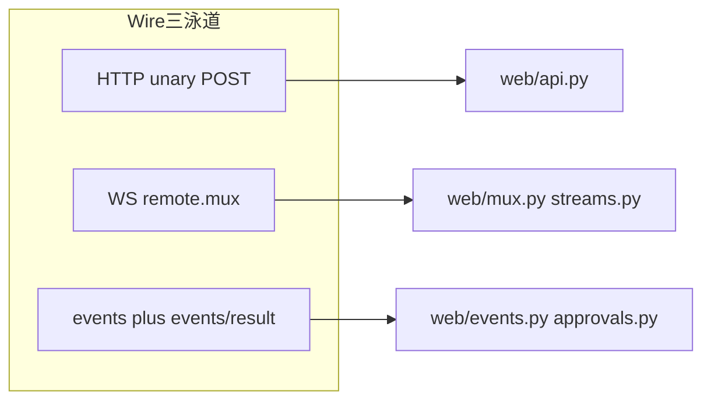
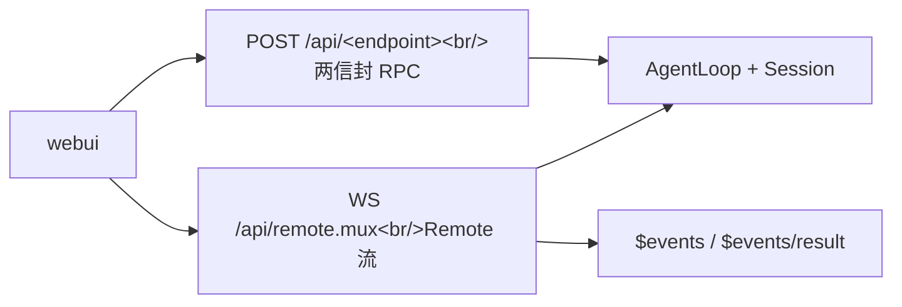

[← 第 7 章导读](07-external-entry-points.md)

入口组合：[Fig S5](../system-map.md#fig-s5)。

# 第 7 章 · §7.5 Web 传输层

## 7.5 Web 传输层（`miniharness/web/`） {#sec-7-5}



（详图与测试对照见 [wire-tour.md](../guides/wire-tour.md)。）




!!! tip "Wire 约定"
 本章按实现顺序讲 web 传输层。端点、帧形状与错误码以 [`interface-wire.md`](../interface-wire.md) 为准（当前 unary 101 条，列表见 `miniharness/web/api.py` 的 `WebApi.ROUTES`）。改 wire 时先改实现与该文件，再同步本章叙述。

> 对应 dsh 真实源码：`packages/client/connection`（两信封 RPC + HTTP 载体）+ `packages/api/gateway`（`stream-protocol.ts` + `stream-server.ts`：WS `/api/remote.mux` + `$events` 注册表）+ `packages/api/session-controller`（Typert Remote `session/*`）+ `packages/api/remotes`（Remote 事件瀑布 + `$events/result`）+ `packages/host/frontend-static`（SPA 静态载体）。上游把 web 面收拢为「typert 一元 RPC + 单 WebSocket mux」，mini 跟随这一形态。前端（`packages/bundle/web-app` + `packages/client`）mini 以独立 React 工程 `webui/` 承载产品面、vanilla SPA 作教学参照（§7.5.4）。
>
> 分层：`web/stream_protocol.py`（§7.5.1）→ `web/api.py`（§7.5.2）→ `web/uplink.py` + `web/mux.py` + `web/events.py` + `web/streams.py`（§7.5.3）→ `web/server.py` + `web/attachments.py` + `web/downloads.py` + `web/launcher.py`（§7.5.4）→ `web/approvals.py` + `web/frontend.py` + `web/static/`（§7.5.4）。

### 7.5.1 信封：两信封 RPC + Remote 流 wire 语法（`web/stream_protocol.py`）

上游把通信收拢为**单一两信封协议**（同 `packages/client/connection`）：

| 方向 | 形状 | 语义 |
|---|---|---|
| client → host | `client-request`（type/rpcId/method/payload）| 浏览器发起的调用 |
| host → client | `server-response`（type/rpcId/result/error）| 调用的回执 |

流式调用不走 SSE 专属宿主流，而是 WebSocket `/api/remote.mux` 上的一套**Remote 流帧协议**（`stream_protocol.py`，同 `stream-protocol.ts`）：

- 客户端 → 服务端：`open`（恰 `{streamId, endpoint, payload}`）、`item`（`{type, streamId}` 或加 `value`）、`end`（恰 `{streamId}`）、`cancel`（恰 `{streamId}`）。每型字段集合**精确匹配**（同 `exactKeys`），多一个键即拒并关 WS 1008——不投影丢弃未知键。
- 服务端 → 客户端：`item`（`{type:'item', streamId, value}`，**value 恒在**——null 是合法 wire 值，`JSON.stringify` 会丢 undefined，故 mini 显式补 null）、`error`（`{type:'error', streamId, error:{code, message, details}}`，**error 帧即终态、不再补 end**）、`end`（`{type:'end', streamId}`，纯终态帧；上游把 `{ok, error?}` 形状收敛为「独立 error 帧 + 纯 end」，失败路径不发 end）。
- 网关内部端点 `$events`（宿主→客户端事件线）与 `$events/result`（客户端→宿主把事件传回宿主）——`open_stream("$events")` 一旦打开即返回 `ready`，宿主 `api-session/*` 事件线逐帧转发；`$events/result` 是 unary 结算帧（`parse_remote_event_result_payload`），供 waterfall 审批等异步通道回投结果。

信封构造器（`client_request`/`server_response`/`rpc_result_ok/error`/`rpc_error`）同上游 `packages/client/connection`；传输层兜底错误投影 `transport_error` → `{code:'gateway/cancelled'}`（abort 语义）或 `{code:'gateway/internal'}`。互操作锚点：`tests/test_web_stream_protocol.py` 逐项断言 open/cancel/item/error/end 全形、多余键被拒与 `$events/result` payload 判定（含**无损 JSON 判定**）。

### 7.5.2 会话服务：unary 方法（`web/api.py`）

unary 端点全集与逐域说明以 [interface-wire.md](../interface-wire.md) 为准；实现侧权威列表是
`WebApi.ROUTES`（`miniharness/web/api.py`），不要在本章硬编码个数。

`WebApi(ctx, adapter, tools)` 持有会话注册表（`_agents`：sessionId → AgentLoop，create 时 attach 一个常驻 AgentLoop）。会话操作全为 **Typert Remote**（`packages/api/session-controller/src/index.ts`）：

| 方法 | 语义 |
|---|---|
| `session/list` | 按 updatedAt 倒序 + blank / lastPromptAt 折叠投影（unary）|
| `session/search` | 按关键字搜索（unary）|
| `session/create` | 会话 id 缺省 `session-<uuid4>`；workspaceId → workspace/not-found；重复 id + 同 cwd 幂等返回、异 cwd → session/conflict；create 即 attach |
| `session/selectModel` / `session/modelCatalog` / `session/canOpenWorkspacePath` / `session/openWorkspacePath` | 模型选择 / 目录打开（unary）|
| `session/rename` / `session/fork` / `session/cancel` / `session/updateQueue` | 会话维护（unary；cancel 保留 inbox + FIFO 恢复，`_parked` 驻留）|
| `session/prompt` | mode ∈ {queue, steer}；time zone 校验；`/` 开头单文本块 → 命令注册表；需 `requestId`（缺 → gateway/bad-request）|
| `session/attachment` | 附件投递（unary）|
| `session/page` | 取代旧的 `session/history`：throughSeq/beforeSeq/maxMessages 游标分页 |
| `session/follow` / `session/control` | 流式（见 §7.5.3）|

`api.dispatch` handlers 收**裸 args**（如 `{cwd:...}`）；`{args:{...}}` 包装与严格校验在 `web/server.py::_unwrap_args` 统一做（见 §7.5.4）。

### 7.5.3 流式：mux 单路径 + 有界上行 inbox + `$events` 注册表 + follow/control（`web/mux.py` + `web/uplink.py` + `web/events.py` + `web/streams.py`）

- **`web/mux.py`（`RemoteStreamMuxConnection`）**：单条 `/api/remote.mux` WebSocket 承载**全部** Remote 流。客户端 `open` 帧带 endpoint，`run` 循环泵帧、`_drive` 逐 open handler 协程、EOF 后发 `end` 结算、`cancel` 中断流。全部 Remote 流收敛到这一条 WS 路径，没有 `/api/events.mux`、`/api/events.host` 这类 SSE 线。
- **`web/uplink.py`（`UplinkInbox` + `UplinkItems`）**：每条 open 建一条**有界单消费者上行 inbox**（同 `stream-server.ts` UplinkInbox），按整帧 UTF-8 字节记账，上限 262144 字节（`create_app(stream_inbox_bytes=...)` 可调，同 `streamInboxBytes`）。`end` 是半关（缓冲里的 `item` 仍读得尽），`end` 后的 `item` → 该流以 `gateway/protocol` 中止，缓冲超限 → `gateway/uplink-overflow`（`details:{endpoint}`）；违例只杀本流并以终态 `error` 帧落地，socket 不关。`fail` 先到先得（流提前结束遮蔽缓冲），`release` 后一律丢帧。宿主已结束的流 id 收到的 `item`/`end`/`cancel` 直接丢弃（上游 mux `push` 对 closed 流早退），只有重复 `open` 关 socket。
 方法侧是 `UplinkItems`（同 `GatewayInvocation.uplink` 的 `UplinkDecoder`，index.ts）：每项先过该 endpoint 声明的 codec，未声明则走无损 JSON 校验（`NaN`/Infinity、`-0`、循环、Date、函数、symbol、不可枚举属性等拒），解码结果再校验一次；被拒项以 `gateway/input-invalid`（`details:{endpoint, field:'uplink'}`）中止整条逻辑流。每次调用只能取一次迭代器；方法停止读时 `close` 丢弃未读项。
- **`web/events.py`（`EventStreamRegistry`）**：`$events` 注册表——`ready` 首帧 + `api-session/*` 事件线转发 + `$events/result` 结算对拍。**跨堆线程安全唤醒**：TestClient/uvicorn 把 app 跑在 portal 线程，主线程 `ctx.emit` 广播不能直接调 `asyncio.Event.set`，`_ClientQueue._wake` 捕获运行 loop 用 `loop.call_soon_threadsafe(waiter)`（含 `loop.is_closed` 守卫）。
- **`web/streams.py`（`GatewayStreams`）**：`open_stream(endpoint, payload, uplink=..., signal=...)` 按 endpoint 分发，并**负责释放上行**——`$events` 这类网关自有流 open 即释放（其 `item` 帧被丢弃而不缓冲），其余流在整个流结束（含失败/取消/断连）时释放。每个流方法收到一个 `StreamInvocation`（同 `ctx.invocation`）：`uplink` 取本调用的上行项迭代器（一次），`close` 随下行结束释放；取消句柄在 `invocation.signal`。endpoint 声明了 codec 时走 `GatewayStreams.uplink_codecs`（出厂空表——全部 Remote 方法 `In` 皆为 `never`），未声明则走无损 JSON 校验：
 - `$events`：open 即 `ready`，随后事件帧转发。
 - `session/follow`：首帧 snapshot `{header, cursor, records, hasMore, projections}`，之后逐 event 帧（snapshot 后重投 cursor+1..end，同 `history.ts`）。lazy async 生成器错误时机——体部 `RemoteStreamError`（session/not-found/gateway/arguments-invalid）在首个 `await gen.__anext__` 处抛、非调用时，测试须迭代驱动。
 - `session/control`：首帧 baseline `{projections}`（上游已去 queues/jobs），之后 projection 替换帧（同 `control.ts`）。
 - `terminal/retain`：一帧 `{type:'retained'}` 后无帧保持到取消或该身份被关闭（不激活 Agent；mini 无空闲回收调度器，持有不改变清理时机）。逐帧契约见 `docs/interface-wire.md` §4.5。
 - `terminal/attach`：首帧 `snapshot`（整屏文本 + `info` + `writable` + 可选 `inputWindow`），随后有序 `output`/`state`/`ack` 帧（双工：上行 `TerminalInput` 的 write/resize 回 ack；`read-only`/`not-running` 折带 `refusal` 的 ack）；进程终态 `state` 帧投完后流才 `end`；超 `maxBufferedBytes` 的慢消费者以 `gateway/internal` 中止，重连从新 `snapshot` 恢复（逐帧契约见 `docs/interface-wire.md` §4.5）。
 - `workspace/follow`：首帧完整 baseline（`items`/`archivedSessionIds`/`pinnedSessionIds`），随后有序 upsert/remove/order/archived/pinned 增量（重连重发 baseline；逐帧契约见 `docs/interface-wire.md` §4.6）。
 - `workspaceFiles/changes`：见 `docs/interface-wire.md` §4（ready + change 帧）。
 - 未知 endpoint → 抛 `RemoteStreamError`（`gateway/invocation-unavailable`）。

**会话队列数据**：`session/control` 的 queue 帧（placement 三态快照）已在上游退役；队列改经 `inbox` 投影单元暴露——`agent/inbox/spliced` 事件 fold 出 `{next-turn,
next-step}` 双队列（`core/agent_loop/projections.py` `inbox_projection`），经 control 的
projection 替换帧（`web/api.py`）或 follow snapshot 的 projections 块广播给客户端。

### 7.5.4 HTTP/WS 载体 + 审批桥 + 静态服务 + 浏览器前端（`web/server.py` + `web/attachments.py` + `web/downloads.py` + `web/launcher.py` + `web/approvals.py` + `web/frontend.py` + `web/static/`）

`create_app(api, api.gateway)` 是一个 FastAPI 应用，路径判定镜像 `handler.ts` + `stream-server.ts`：

1. `POST /api/<endpoint>` → unary RPC：payload 恰为 `{args}` 单层 plain object（**严格解包**，多余键/缺 `/` 前缀拒绝；非法集 `{}` / `{"args":{},"x":1}` / `{"args":None}` / `{"args":[]}` / `{"key":"val"}` / `{"args":""}` 都不放行）；`CHANNEL_PATTERN=/^\/[A-Za-z0-9._~-]+$/`、`ENDPOINT_SEGMENT_PATTERN=/^[A-Za-z0-9_$.-]+$/`；`content-type` 非 `application/json` → 415（跨站写围栏）；body 非 JSON → 400。派发崩溃 → 500 纯文本；业务错误恒 200 + `server-response`（`result.ok=false`）。`session.*` 的 `$events/result` 特判返回完整 `server-response` 信封（内层 `rpc_result_ok/error`，rpcId 取 body 或哨兵 `invalid-request`）。结果值含 `bytes` 时（`workspaceFiles/readBytes` 的 `data`）改用 `multipart/form-data`（见下）。
2. `WS /api/remote.mux` → `RemoteStreamMuxConnection`（§7.5.3）。
3. `GET /api/session.export?sessionId=<id>` → 会话导出下载（`web/downloads.py`）：root + 子代理后代 + 被引用媒体打包 zip，200/400/404/501/500 状态码链，错误走私有信封外壳。
4. 非 `/api/` 路径 → SPA 静态服务（`web/frontend.py`，frontend-static 约定）：只服务 dist 根内文件；`..` 上跳 → 403；未命中 → `index.html` 200；MIME 按扩展名。dist 根默认 `web/static/`（教学 vanilla，旧 wire 不对新后端工作），经 `MINIHARNESS_WEBUI_DIST` 可指向产品化前端构建产物（`webui/dist/`），约定不变。

`web/launcher.py` 把 `WebApi + GatewayStreams + create_app` 组装成可监听应用；host/port 优先级：`cli/main` 透传的 `--host`/`--port` > `MINIHARNESS_WEB_HOST/PORT` env > 缺省（上游是组合配置节，简化标注）。host 须为具体地址：通配（`0.0.0.0`/`::`）由 `web/host.py` 加载期拒绝，非回环具体地址须配 token。

**审批桥（`web/approvals.py`，同 `packages/api/remotes` waterfall + `interaction/user-approval`）**：桥挂 async `tools/ask` 闸门（power check：`_arm_ask` 注册 `tools/pre-execute` 返回 `{"kind":"ask"}`）→ 落 `approval/asked` 审计 → `events.invoke('approval/request', {approval})` 以 `$events` waterfall 投递给所有客户端 → 首个 `$events/result` 经 `receive_result` 结算 → 落 `approval/decided` → 返回 bool 供管线放行/拒绝。outcome 映射：result∈APPROVAL_OUTCOMES（`allowed-once|rejected|cancelled|unavailable`，否则 unavailable **fail-closed**）/rejected→unavailable/next→await nxt/cancelled→cancelled；dispose 全 pending 'cancelled'（不悬挂）。

**二进制附件（`web/attachments.py`，同 gateway `encodeRpcResult` + Connection `fullResponse`）**：JSON 装不下 `bytes`，故运行期把结果里的字节叶子投影为 `null` 占位，并在响应顶层登记附件描述 `{path, codec:'bytes', part}`（`path` 段是对象键或数组下标，按发现顺序编号）。`result_response` 分帧：失败与纯 JSON 结果仍是 `200` + `application/json`；有附件则出 `multipart/form-data`——`metadata` 文本 part 装 `{type, rpcId, result, attachments}`，第 `i` 个二进制 part 名 `bytes-<i>`，流式出体（不整份复制）。结果值出现循环引用 → `200` + `gateway/internal`（`gateway: circular RPC result`）。客户端一侧在 `webui/src/wire/rpc.ts` 的 `parseBinaryResponse`：`content-type` 是 `multipart/form-data` 就重组——按 `path` 把 part 写回 `Uint8Array`，part 名重复 / 非 `bytes` codec / 路径走不通 / 槽位不是 `null` 占位 / 有 part 未被声明，一律 `TypeError`。这样 `workspaceFiles/readBytes` 在 wire 上是原生字节，与上游 `WorkspaceFileBytes.data: Uint8Array` 同型（`session/attachment` 的 `data` 例外，仍是 base64 字符串，同上游）。

**浏览器前端**：两个形态，都只依赖本层 wire 约定。
**产品化前端（`webui/`，仓库顶层独立 React+TS+Vite 工程）**：会话列表/新建（`session/list`/`session/create`）、Trajectory 折叠（选中会话 `session/follow` 拉 snapshot + 按 seq 去重增量）、审批面板（`$events` waterfall → Allow once / Reject → `$events/result` 结算，outcome∈APPROVAL_OUTCOMES 之外 fail-closed）、队列/作业面板（队列 = `session/control` 投影帧折叠出的 `inbox` 投影，作业 = `job/list` roster 流）。开发期 Vite dev server 把 `/api` 与 `/api/remote.mux` 代理到本地 Python 后端（`vite.config.ts`）；生产期 `vite build` → `MINIHARNESS_WEBUI_DIST=webui/dist` 让后端静态服务承载。`src/wire/` 是纯 TS 约定客户端（无 UI 依赖，vitest 单测 mock fetch/WS），`src/app/` 是 React 编排，`src/ui/` 是无状态展示组件。
**教学参照（`web/static/`）**：vanilla SPA（index.html + app.js + style.css，无构建步），消费的是上游重组前的旧 SSE wire（`events.mux`/`respond`/`host.describe`），对新后端不工作，仅作教学说明。

**教学简化**：心跳 = transport 级（`ws_ping_interval=2 / ws_ping_timeout=4`，同上游 gateway heartbeat：缺省 2s Ping + 连续 2 周期无 Pong terminate，`web/launcher.py` `uvicorn_options`）；认证门 = 可选 token（配置 `MINIHARNESS_WEB_TOKEN` 后 `/api/*` 全域强制、WS 升级拒绝写 HTTP 401 同上游 `rejectRemoteStreamUpgrade`，非回环具体地址无 token 启动即拒绝，通配地址一律拒绝；接口约定见 interface-wire §1.1）；`$events`/`follow`/`control` 无 `since` 恢复游标（重连重拉全量）；载荷 schema 校验在 `WebApi` 内做（上游先过 zod）；session 日志事件是 mappingproxy/tuple 冻结形态（`core/session/json.py` `deep_freeze`），序列化前经 `thaw` 还原；前端产品化工程 `webui/` 走新 wire 但不整体移植上游 `packages/client` 的 UI 模块——无 slot 组合；webui Trajectory 按上游概念提供 Overview 时间线、虚拟化窗口与全文搜索，`since` 游标则与后端 wire 一致（上游 wire 无该字段）；`web/static/` vanilla SPA 是旧 wire 教学参照。测试覆盖：`tests/test_web_{stream_protocol,uplink,events,mux,streams,approvals,server,attachments,export,frontend,auth}.py`（真实 uvicorn + httpx/websockets）+ `webui/` 的 vitest（wire 层含 multipart 重组 + trajectory 模型/搜索/组件，`pnpm test` / `pnpm typecheck` / `pnpm build`）。

运行方式：

```sh
python -m miniharness.cli --profile web # 走启动器（缺 key → adapter 构造不抛，启动后 describe 可用）
python -m miniharness --profile web --host 192.168.1.5 --port 8000 # 显式监听具体地址（非回环需配 MINIHARNESS_WEB_TOKEN；通配地址拒绝）
MINIHARNESS_WEB_PORT=8000 python -m miniharness --profile web
```

依赖是可选 extra：`pip install "miniharness[web]"`（fastapi + uvicorn + websockets）；测试 `tests/test_web_server.py` 用真实 uvicorn 线程 + httpx/websockets——WS mux 流式与跨线程唤醒依赖真实 transport，TestClient 的进程内缓冲无法覆盖。

