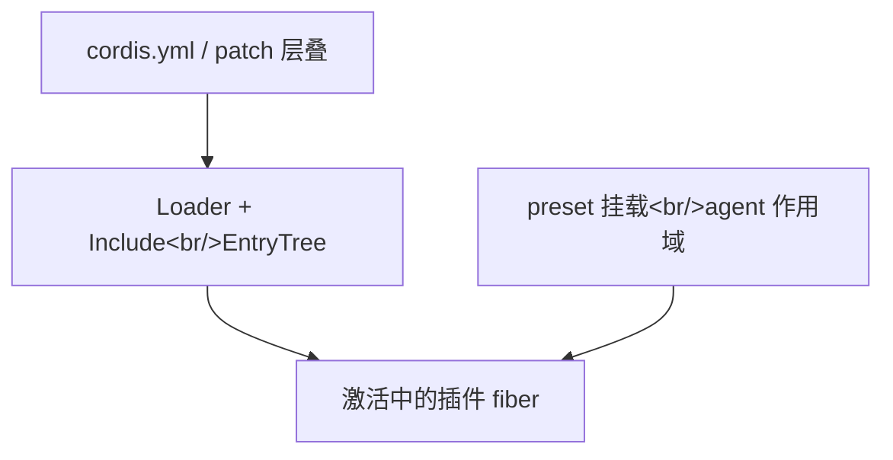

# 第 8 章：组合层深读——配置树、loader 与 preset

> 对应 dsh 真实源码：`vendor/cordis`（loader/组合结算）+ `packages/preset`（per-session agent composition）+ `packages/boot/app-boot`（profile 组合）。
> 前置：第 2、5 章。本章产出：`miniharness/loader/`、`miniharness/preset/presets.py`；测试 `tests/test_presets.py`、`tests/test_loader_tree.py`、`tests/test_loader_include.py`。

## 8.1 这一章要做什么

前几章的内核只回答"一个 agent 怎么跑"。dsh 的现实是：

- 一个进程要同时服务标准模式、极简模式等多个 agent，它们**工具目录不同、prompt 不同、还能各跑各的**；
- 工具的实现（bash、文件系统、web 搜索）是**进程级单例**，不应该每个会话复制一份；
- 所以要把"有什么实现"（host plane）和"这个会话用哪些"（preset）**分层**。

这一章读组合层的两件事：把 YAML 变成活的插件树（loader），和把一个进程里各 agent 用哪些工具与 prompt 定下来（preset roster）。

## 8.2 上游设计：三层归属与 roster

上游在 alpha.1 到基线 rc.2 之间改过 preset 的组织方式。alpha.1 用「目录发现」：roster 就是 `apps/cli/config/agent-presets/` 下的目录列表。

rc.2 改成「声明式注册」：`packages/preset/agent-preset-registry` 的 registry 显式声明不扫描目录、不接受 preset 路径，新增 preset 是往 profile 里插一条 `@deepseek-ai/dsh-agent-preset` 行（`agent-preset-registry/README.md`）。

mini 复现的是 alpha.1 的目录发现 roster（`miniharness/preset/presets.py`），因为 mini 的 preset 数据目录就是这个形态。两种形态共享的语义是：一个 preset 是一棵挂在 agent 作用域下的小组合树；跨会话设施留在 host；会话一旦开始就锁定选择。

### 8.2.1 组合树的三层归属

`agent.cordis.yml` 是 YAML 形式的 Cordis 组合描述，最终由 **loader** 结算成内存里的插件树。归属的判据是"这个插件属于进程还是属于某个 agent"：

- 跨会话设施（webserver、注册表、存储）是进程单例，留在 host 组合；
- preset 只携带"这一个 agent 贡献给它们的东西"（工具选择、prompt、skills）。

这条规则的执行处是挂载审计（`agent-preset-registry/src/mount.ts` 的 `leakedServices`）：被挂载的子树如果把服务发布进了 root realm（没放进 `isolate` realm），就算泄漏，挂载被拒绝。

落到结构上：

| 层 | 是什么 | 谁能用 |
|---|---|---|
| host plane | 进程级组合（bundle 底座、注册表、tokenMeter、jobs 注册表等） | 所有 agent |
| agent plane | 每个 agent 会话挂载的组合（preset 贡献的工具选择、prompt） | 该 agent 自己 |
| `isolate` realm | 带 `isolate` 的 group，服务行必须挂进去才能隔离 | 该 realm 内 |

realm 规则的直接后果：service 行不挂进 `isolate` realm 就会落到根 realm，第二个会话想再挂就冲突——所以**命名了进程级全局服务的行在挂载时被拒绝**，而不是让下个会话撞车。alpha.1 的标准 preset 组合注释（`apps/cli/config/agent-presets/standard/agent.cordis.yml:11-18`）写明了这条；rc.2 的声明式组合里 provider 与 consumer 仍须共处一个 `cordis:group` isolation realm。

### 8.2.2 loader：从 YAML 到插件树



loader 的 include 展开由 `@deepseek-ai/cordis-plugin-include` 实现（`packages/boot/app-boot/src/index.ts:16` 安装 `mountRootInclude`）。它做的核心事可压缩成三条：

1. **include 展开**：组合里 `include: 'file.yml'` 的行先被替换成目标文件的内容（递归），这是"一个 preset 引用共享片段"的做法；
2. **插件加载**：每条 entry 的 `plugin` 字段导入真实模块，取回 `inject`/`apply` 元数据（插件声明里的 `provides` 字段已废除——服务在 apply 期动态登记，与 §8.3.2 的 `Preset.provides` 不是一回事）；
3. **结算**：把整棵树交给插件管理器，按依赖激活——这正是 mini 第 2 章 `RegistryService` 做的事（`miniharness/core/scope.py`），只是上游还有 scope/fiber/carrier 的完整实现。

> **mini 对照**：这套 loader 已整件移植为 `miniharness/loader/`（对齐 `vendor/loader` + `vendor/include`），见 §8.3.1；`mount_root_include` 装 `cordis:include` / `cordis:group` 内建、补丁展开用 `loader.patch.apply_entry_patches`。

### 8.2.3 preset roster：名单从哪里来

alpha.1 的四种出厂 preset（`apps/cli/config/agent-presets/{standard,code,minimal,cordis}/`）名单不维护在代码里：预置名单就是那个目录的列举，目录里有什么就是什么，避免"代码里的名单"与"磁盘上的目录"两处漂移。rc.2 换成声明式后，名单来自 profile 里显式声明的 `@deepseek-ai/dsh-agent-preset` 行，registry 不再扫目录。

模式差异（前面报告 04 页议题 1 有完整版，这里只提组合视角）：

- **标准模式**：agent-plane 组合，每进程挂一次，会话经 scope parentage 加入；工具目录跨模式不变（为了请求缓存稳定）；
- **极简模式**：persona `complete: true`（系统提示即全部上下文）+ 双工具（bash + str_replace_editor），无运行时上下文、无压缩——换掉工具集就得到另一个产品形态。

## 8.3 mini 复现：preset roster 与挂载

mini 组合层有两块：**装载树**（`miniharness/loader/`，§8.3.1）把 YAML 变成活的插件 fiber；**preset roster**（`miniharness/preset/presets.py`，§8.3.2 起）决定一个进程里各 agent 用哪些工具与 prompt。组合层支持 YAML（`boot/composition.py`，pyyaml 硬依赖承载）；preset 清单用 JSON 承载（载体简化，约定与上游一致）。

roster 与上游 alpha.1 的多根分层一致：`shipped root`（随包分发的内置 preset，system trust、authoring 只读）→ 配置 roots → `harness-home`（user），同 id **first-root-wins**（同上游 discoverPresets 的 resolvedRoots 顺序）。

清单文件双读：`preset.json`，或上游形态 `agent.cordis.yml` 经 `translate_cordis_composition` 翻译。本章演示以仓库自带目录为例：

```
miniharness/preset/               # shipped root（system trust）
├── standard/preset.json    # 标准模式：8 工具 + 运行时上下文
└── minimal/preset.json     # 极简模式：2 工具 + fixed-prompt（complete: true）
```

### 8.3.1 装载：Loader 活树与根 Include（`miniharness/loader/`）

`boot()` 把 YAML 变成活的插件树，靠的是一套 cordis loader 的整件移植（对齐上游 `vendor/loader` + `vendor/include`）：

- **`EntryTree`**——条目树的载体：扁平 `store`（`id → Entry`）、`entries()` 递归子树、`resolve('include:candies')` 这类 `SEP` 下钻 id、`import_('cordis:include')` 取内建插件；
- **`Entry`**——一个可配置插件节点：`update()` 三态（已激活则 diff 后经 `internal/update` 重载、未激活则 `init()`、禁用则 dispose），`disabled` 沿 parent 链上溯并对 `!!js` 表达式求值；
- **`EntryGroup` / `Group`**——`group: true` 条目的子列表宿主（组载体）；
- **`Loader` 服务**——挂三个钩子：`internal/config`（树载体配置保持字面、普通条目激活期 interpolate）、`internal/update`（写回 `entry.options.config` 并持久化）、`internal/plugin`（插件自销毁时回写 `disabled: true`）；
- **`Include`**——文件背书子树：读/写目标文件、`initial` 首写、`apply_entry_patches` 展开补丁、YAML 回写时 `!!js` 原样保留。

`boot()` 的形态因此是：

```python
root = Context(name="root")
root.baseUrl = os.path.dirname(os.path.abspath(config_path))
root.plugin(Loader, {"baseUrl": root.baseUrl})                   # 装载服务
mount_root_include(root, os.path.abspath(config_path),
                   overlay_patches, bin_name)                   # 挂根 cordis:include 条目
loader = root.get("loader")
_settle_loader(loader)                                          # 排空在途转换
_assert_loader_activated(loader, bin_name)                      # 三态审计，未激活即 fail loud
```

组合的**依赖驱动激活**仍是第 2 章 `RegistryService` 的机制：每条 entry 的 `inject` 缺失即保持 `PENDING`，提供方在 apply 期 `provide` 后经依赖追踪唤醒到 `ACTIVE`；`_assert_loader_activated` 在启动末尾逐条检查——`ACTIVE` 通过、`FAILED` 重抛原错误、`PENDING` 点名缺失的注入服务。条目 YAML 用上游同款方言 `entryListSchema`（JSON_SCHEMA + `!!js`）解析：只有 JSON 标量与 `!!js` 节点，`yes`/日期等保持字符串。条目级 `isolate`/`intercept` 选项同样实现（`loader/isolate.py`：Local/Global realm + `loader/patch-context` 迁实现 + realm GC；`loader.await` 门控由 loader 服务的检查谓词承担）；Node ESM 的 `internal.ts` 在 Python 包系统里没有对应物，属架构不适用。

验证：`python -m unittest tests.test_loader_tree tests.test_loader_include -v`。

### 8.3.2 领域对象（`miniharness/preset/presets.py`）

```python
@dataclass(frozen=True)
class PersonaConfig:
    complete: bool = False                       # True = 系统提示即全部上下文
    include_runtime_context: bool = True
    system_prompt: str | None = None
    suffix: str | None = None                    # 尾节（complete 为真时压制）

@dataclass(frozen=True)
class Preset:
    id: str
    name: str
    description: str
    order: int
    tools: list[str] = field(default_factory=list)
    persona: PersonaConfig = field(default_factory=PersonaConfig)
    provides: list[str] = field(default_factory=list)   # 进程级服务声明（默认空）
    broken: str | None = None   # 发现期健康标记：缺 preset.json / 清单损坏 → 挂载期拒绝
    trust: PresetTrust = "user"  # 'system' = shipped 只读
    path: Path | None = None     # 组合文件路径（preset.json 或 agent.cordis.yml）
```

### 8.3.3 roster：目录列表即名单

```python
class PresetRoster:
    def _scan(self) -> dict[str, Preset]:
        by_id: dict[str, Preset] = {}
        self._source = {}
        for root in self.resolved_roots:
            for pid, preset in self._scan_root(root).items():
                if pid in by_id:
                    continue              # first-root-wins（上游同名取先）
                by_id[pid] = preset
                self._source[pid] = root
        return by_id

    def _scan_root(self, root: PresetRoot) -> dict[str, Preset]:
        presets: dict[str, Preset] = {}
        try:
            children = sorted(root.path.iterdir())
        except FileNotFoundError:
            return presets                # 根缺失 → 空（上游 ENOENT → []）
        for child in children:
            if not child.is_dir() or not PRESET_ID.match(child.name):
                continue                  # 只认合法 preset id 的目录
            if not self._has_composition(child):
                # 缺清单 → 占位 broken 行：目录仍占用 id，须删除目录或补齐文件
                presets[child.name] = Preset(
                    id=child.name, name=child.name, description="", order=0,
                    trust=root.trust,
                    broken="the composition file preset.json is missing — "
                           "the directory still occupies the id; "
                           "delete it or restore the file")
                continue
            try:
                p = load_preset(child, root.trust)
            except Exception as error:
                # 组合损坏 → 同样是 broken 占位行（上游 compositionProblem → broken）
                presets[child.name] = Preset(
                    id=child.name, name=child.name, description="", order=0,
                    trust=root.trust, broken=f"the composition is unloadable: {error}")
                continue
            presets[p.id] = p
        return presets
```

`ids()` 按 `order` 排序返回名单；`resolve(preset_id)` 未知 id → `KeyError`（fail loud）。已开 sessions 的 preset 选择在会话开始（首 turn/start）后锁定（`PresetLockedError`）。新增一个 preset = 新建一个目录，roster 代码一行不改。

### 8.3.4 挂载：只在 agent 作用域开视图

`Preset.mount` 是把"host 实现"与"会话选择"粘起来的关键，四条不变量逐条执行：

```python
def mount(self, ctx, agent_scope, host_tools) -> ToolRegistry:
    if self.broken is not None:
        raise PresetMountError(self.id, f"preset {self.id} is broken: {self.broken}")
    missing = [t for t in self.tools if host_tools.resolve(t) is None]
    if missing:
        raise PresetMountError(
            self.id,
            f"preset {self.id} 声明了 host 未提供的工具: {', '.join(missing)}")
    for key in self.provides:
        if ctx.get(key) is not None:
            raise PresetMountError(
                self.id,
                f"preset {self.id} 声明进程级服务 {key}，但 host 已提供"
                f"（拒绝挂载，避免与下个会话冲突）")
    if not agent_scope.is_scope():
        raise PresetMountError(
            self.id,
            "refusing to mount into a non-scoped context; "
            "its registrations would leak into every agent")
    agent_scope._isolate.setdefault("tools", object())
    view = ToolRegistry(agent_scope)
    for name in self.tools:
        view.register(host_tools.resolve(name), scope=agent_scope)
    return view
```

- **broken 先拒**：发现期标了 `broken` 的行在挂载期直接抛 `PresetMountError`，不让坏组合进入会话；
- **不造实现**：工具本体留在 host 的 `ToolRegistry`，preset 只把引用注册到 agent 作用域（`register(tool, scope=agent_scope)`，复用第 3 章的作用域化注册表）；
- **host 缺工具 → fail loud**：preset 声明了 host 没有的东西，就是组合坏了，立刻报错；
- **进程级冲突 → 拒绝挂载**：preset 声明 `provides` 命中 host 已有服务时拒绝——这就是上游"命名进程级全局服务的行在挂载时被拒绝"的 mini 版；
- **无作用域上下文 → 拒绝挂载**：直接挂进 root 会把工具漏进每个 agent（对齐上游 `mount.ts` 的作用域审计）。

### 8.3.5 与 loop 对接

挂载返回的 `ToolRegistry` 视图可直接喂给 `AgentLoop`：

```python
roster = builtin_roster()
agent_scope = host.create_scope("agent:1")
view = roster.resolve("minimal").mount(host, agent_scope, registry)
loop = AgentLoop(session, adapter, view, ctx,
                 system_prompt=roster.resolve("minimal").persona.system_prompt)
```

两个 preset 用同一个 host 注册表、两个 agent 作用域——一个进程同时跑标准与极简 agent 的形态就成立了。

## 8.4 硬性规定

1. **roster = 多根目录列表**：发现 = 依序扫描 shipped → 配置 roots → harness-home，跨 root 同名 id **first-root-wins**（同上游 discoverPresets 的 resolvedRoots；这是 alpha.1 的分层制，mini 跟随）；新增 preset 不碰代码。占位 broken 行的 `broken` 字段使该 preset 在**挂载期**被拒（`Preset.mount` 先检查 `self.broken` 再挂载）。
2. **挂载只开视图**：host 注册表不变，agent 作用域只看到 preset 声明的工具。
3. **host 缺工具 fail loud**：preset 声明了 host 没有的工具 → `PresetMountError`。
4. **进程级冲突拒绝挂载**：`provides` 命中 host 已有服务 → `PresetMountError`，而不是覆盖。
5. **未知 preset fail loud**：`resolve` 未知名 → `KeyError`。
6. **装载树按依赖激活**：`group: true` 条目成嵌套子树，`!!js` 在各自条目激活期求值；启动末尾未激活条目即 fail loud（`PENDING` 点名缺失的注入服务、`FAILED` 重抛原错误）。
7. **Include 回写保真**：`include` 目标文件里的 `!!js` 在回写时（`dump_js_expr_yaml`）原样保留、不被求值。

验证：`python -m unittest tests.test_presets tests.test_loader_tree tests.test_loader_include -v`。

## 8.5 检查点

1. 说出组合树三层归属，并解释"进程级服务挂载时被拒绝"为什么比"下个会话撞车"好。
2. 给 `PresetRoster` 新增一个 preset 目录，`ids()` 自动包含它（一行代码不改）。
3. 手动构造一个 `provides` 与 host 冲突的 preset，观察挂载被拒绝且 host 服务未被覆盖。
4. 说出 mini 相对上游的载体简化（YAML→JSON）与语义一致（组合选择语义不变）。
5. 画一棵含 `include` 与 `group` 的条目树，说出 `EntryTree.resolve('include:candies')` 如何下钻、`PENDING` 条目在启动审计时报什么。

> 下一章：Agent 干预面——宿主怎么唤醒、转向、取消一个运行中的 agent（steer/inject/cancel/whenIdle）。