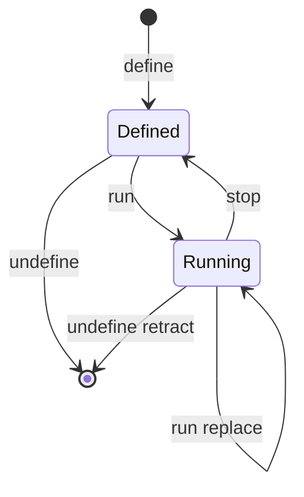

# 第 11 章：动态插件的进程内存生命周期

> 本章回答一个问题：agent 能给自己加插件吗？上游允许在运行中定义、运行、停止插件，但把这类临时插件限制在进程内存里：它们不写配置文件，重启后消失。mini 复现这套生命周期语义（define → run → stop → undefine 加检查族），模型侧调用与审批往返不做。
>
> 对应 dsh 真实源码：`packages/extensions/`（`tool-cordis` 七工具 + `cordis-host-runner` 宿主）。mini 复现于 `miniharness/extensions/dynamic.py`。

## 11.1 上游的边界设计

自我修改在上游不是"agent 任意改配置"。`cordis-host-runner` 的说明文档写明（`cordis-host-runner/README.md:12`：`process-local dynamic definitions`、`Definitions disappear on restart`；`:58`：`session-scoped and process-local`）：动态定义按会话隔离、只存在进程内存里，重启即清空；历史日志保留工具参数与回执，但不恢复注册表。

这是刻意的安全设计：模型可以在这个进程里定义、运行、停止插件（改"运行时"），但不允许改"启动配置"（改"持久状态"需要人工操作文件）。配套还有几层约束：

1. **工具分两族**：检查族（`inspect_list` / `inspect_query` / `inspect_self`）与修改族（`define` / `run` / `stop` / `undefine`）；
2. **kind 限定**：`define` 只支持 `kind new`，即铸造（mint，分配一个永不复用的唯一 id）一个新的动态包；
3. **宿主耦合**：一个动态包分两半。宿主半边（host half）跑在 Node 宿主的 `node:vm` 沙箱里；客户端半边（browser half）跑在浏览器页面、由 Client runner 与审批 UI 加载。客户端半边带审批往返，agent 不能单方面获得它的能力。web 的审批（第 09 章）管的是"模型要运行什么"，这里的宿主管线管的是"模型要定义什么"。



## 11.2 生命周期（对应 `runner.spec.ts:150-176` 的完整流程）

上游测试里的标准路径：

1. `define`（kind: new）→ mint `dyn-1` / `pkg-1`，**只登记，不生效**；
2. `run` → 立即 `status: 'running'`、mint `run-1`，插件 `apply` 执行、`ctx.provide` 生效；
3. `invoke` → 调用插件提供的服务，返回 `42`；
4. `stop` / `undefine` → 逆序回收。

这四步在 mini 里落到一个进程内注册表 `DynamicPluginRegistry`：

- `define` 把定义写进 `_defs`，分配 `pkg-N`，此时不注册任何服务；
- `run` 先按声明的 `provides` 检查祖先链冲突（`root.get(key)` 非空即拒绝），再经 `root.create_scope` 铸一个隔离作用域，在其中执行插件 `apply`（通常调 `ctx.provide`），然后把作用域记进 `_runs`、把 `pkg-N → run-N` 记进 `_pkg_runs`；
- `stop` / `undefine` 拆解该作用域，fiber 逆序回滚 `apply` 期间的每处注册，服务随之消失。

作用域隔离保证动态插件的副作用不会漏到根上下文；`run` 对已在运行的包先 `retract` 旧 run 再激活新 run，所以重复 `run` 是替换而非拒绝。

mini 复现的对应 API：

```python
registry = DynamicPluginRegistry(host_ctx)
pkg_id = registry.define("new", "演示插件", provides=["dynDoubler"],
                         apply=lambda ctx: ctx.provide("dynDoubler", lambda x: x * 2))
run = registry.run(pkg_id)                    # {"runId": "run-1", "status": "running", ...}
registry.invoke(run["runId"], "dynDoubler", 21)  # 42
registry.stop(run["runId"])
registry.undefine(pkg_id)
```

实现位于 `miniharness/extensions/dynamic.py`（`DynamicPluginRegistry`）。验收：`python -m unittest tests.test_dynamic -v`。

## 11.3 硬性规定

1. **define 只登记**：run 之前服务不可用（invoke 抛 KeyError）。
2. **运行中可重复 run / 可 undefine**：`run` = 若已运行先 `_retract` 旧 run 再激活新 run（**replace 语义，非拒绝**，同上游 `cordis-host-runner/index.ts:861` 的 `startFresh`——旧 run 的服务立即消失，test `test_run_twice_replaces_old_run` 固定）；`undefine` 对运行中包**自动 retract 后删除**并返回 `{ok: True, wasRunning}`（同上游 `index.ts:228-236`，test `test_undefine_auto_retracts_running` 固定）；只有缺失包才拒绝——`run` 对未定义包抛 `KeyError`，`undefine` 返回 `{ok: false, reason: 'plugin-missing'}`（不抛错）。
3. **进程级冲突 fail loud**：插件声明的 provides 若祖先链上已存在（如 host 的 `session-persistence`），run 直接拒绝，host 服务不被覆盖。
4. **只存进程内存**：新 registry = "重启"，定义与运行全部不恢复（`inspect_self` 快照为空）。
5. **kind 限定**：非 `new` 的 define 抛 ValueError。
6. **stop 逆序回收**：dispose 隔离 scope（副作用逆序回滚），服务消失。

检查族（`inspect_self` / `query` / `list`）只读注册表快照，与修改族严格分离——与上游 inspect_* 工具族的边界一致。

## 11.4 简化标注

- 上游经模型调用（tool-cordis 是被工具调用的入口），mini 直接操作注册表对象；
- 上游客户端半边（browser half）带审批往返，mini 不做（载体简化，语义不造假）；
- 上游 `run` 会同步配置钩子/挂载包，mini 以 `apply(ctx)` 钩子 + 隔离 scope 表达等价效果。

## 11.5 检查点练习

1. 说出"进程内存 + 不写配置文件"这个边界为什么重要（运行时与持久状态的分离）；
2. 手写一次完整生命周期，观察各阶段 `inspect_self` 快照的变化；
3. 构造一个进程级冲突场景，验证 fail loud 且 host 服务不被覆盖；
4. 说出 mini 相对上游的简化（模型侧入口、审批往返）。

## 11.6 收尾

动态插件的运行与持久配置严格分开：前者是进程内存里可回滚的隔离作用域，后者只能人工改文件。下一章把工具执行从串行推进到异步并行。
