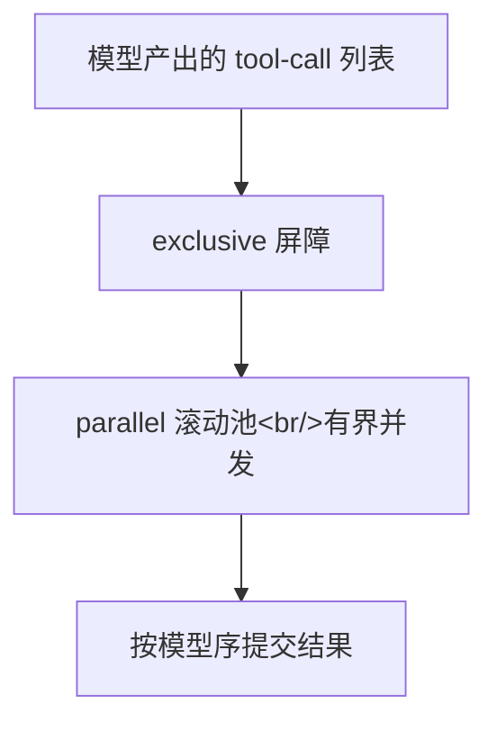

# 第 12 章：异步化与并行工具执行

> 对应 dsh 真实源码：`packages/core/agent-loop/src/tool-calls.ts`（并行调度器）+ `packages/core/tools/src/index.ts`（`executionMode` 分类器）+ `vendor/cordis`（Context 的异步派发）。上游从内到外都是 async（Node 事件循环），mini 前 11 章是同步近似。本章实现 asyncio 化的事件总线、并行工具调度与取消排干。

## 12.1 这一章要做什么

前 11 章里，工具是**串行**执行的：模型一次产出多个 tool-call，mini 逐个 `_run_tool`。上游不是——`dsh-agent-loop` 的 `executeToolCalls` 是真正的调度器：可以并发、有上限、可以取消、按模型序提交。差别很直观：一个"读三个文件"的回合，上游三个工具同时在跑，mini 逐个跑。

本章做三件事：

1. **事件总线 asyncio 化**：`aemit` / `awaterfall` / `aparallel`，同一语义的异步版本（监听器可以是 async 函数，也可以是同步函数）；
2. **并行调度器**：`schedule_tool_calls`——exclusive 屏障 + 有界滚动池 + 模型序提交 + abort 排干与合成错误，逐条同上游 `tool-calls.ts`；
3. **分类器**：`is_concurrency_safe` 从 bool 升级为"可调用（按参数判定）"，`execution_mode` 只有精确 `True` 才 parallel，其余 fail 到 exclusive。

## 12.2 概念：上游怎么调度的



### 执行模式（`execution_mode`）

上游 `packages/core/tools/src/index.ts:1311-1319`：

```ts
executionMode(exec: ToolExecutionInput): ToolExecutionMode {
  const tool = this.resolveExecution(exec.name, exec.agent, exec.parent !== undefined)
  if (!tool?.isConcurrencySafe) return { kind: 'exclusive' }
  try {
    const concurrencySafe: unknown = tool.isConcurrencySafe(exec.arguments)
    return concurrencySafe === true ? { kind: 'parallel' } : { kind: 'exclusive' }
  } catch {
    return { kind: 'exclusive' }
  }
}
```

（关键在 `try/catch`，位于 `index.ts:1314-1318`：分类器抛错同样 fail 到 exclusive。）

- `isConcurrencySafe` 是**函数**（按参数判定，比如"读模式可并行、写模式必须独占"）；
- 未声明 / `false` / **抛错** / **返回非布尔** → `exclusive`（fail 到独占，绝不冒险并行）；
- 分类器不进模型 schema（`execution-mode.spec.ts:124`：模型看到的定义里没有 `isConcurrencySafe`）。

### 调度器（`tool-calls.ts`）

`executeToolCalls` 的循环语义（见 12.5 的对照表）：

- 按模型序消费：第一个调用分类为 parallel → 后续全部作为**候选组**；exclusive → 单元素屏障；
- `runGroup` 维护一个有界滚动池（`maxParallelToolCalls`，默认 `DEFAULT_MAX_PARALLEL_TOOL_CALLS = 10`）：池没满就启动下一个，满了等排空；
- **pre-execute 有序，body 重叠**：`startCall` 里 `await prepare`（政策段）按模型序一个一个等；只有 dispatch/body 真并发；
- **结果按模型序提交**：`commitReady` 只推进连续槽位——先完成的工具不能插队；
- **重分类**：并行组内后序调用再次分类时变 exclusive → 停止补池，等当前池排空，留作下一个屏障；
- **abort**：停止启动，排干已启动的；未启动的按模型序补 `TOOL_ABORTED_BEFORE_DISPATCH` 合成错误（先 `tool/call` 再 `tool/result`，replay 才有效）；
- **调度器失败**：停止新派发，`Promise.allSettled` 排干，抛第一个错误，**不编造结果**（已记录的 `tool/call` 保留）。

## 12.3 实现：`core/scope.py`

### 1. `_maybe_await` 与 async 派发

```python
async def _maybe_await(value):
    while inspect.iscoroutine(value) or isinstance(value, Awaitable):
        value = await value
    return value
```

注意是**循环**而不是单次 `await`：中间件 `return nxt(p)` 会直接返回下一层的 coroutine（不展开），同步中间件包 async 中间件时可能叠两层。单层解包会在"async 中间件 return nxt()"时拿到未 await 的 coroutine 泄漏出去（第 12 章测试 `test_async_middleware_can_await_before_delegating` 固定的就是它）。

```python
async def awaterfall(self, event, payload=None, *, this_arg=None):
    listeners = self._hooks_for(event, this_arg)
    idx = 0
    async def step(cur):
        nonlocal idx
        if idx >= len(listeners):
            return cur
        fn = listeners[idx]
        idx += 1
        result = fn(cur, lambda new=cur: step(new))
        return await _maybe_await(result)
    return await step(payload)
```

`this_arg` 是派发目标，可以是一个**载波**（scope carrier）——第 14 章的身份路由对象，携带一个 scope 键，把事件只送给该键及其祖先上的监听器。传载波时走根扁平 hook 表 + 载波过滤：全局监听器无条件收到；**打标监听器**（注册时带了载波的监听器）按"载波键或键的祖先"接纳（admit，`_ScopeCarrier.admit` 的判定）。传 `None` 时回退祖先链 `_listeners_for`。完整路由模型见第 14 章（`scope.py:1412-1425` 的 `_hooks_for`、`1466-1487` 的 `awaterfall`）。

短路语义与同步 `waterfall` 完全一致：不调 `next()` 就停在当前中间件。`aparallel` 用 `asyncio.gather` 真并发，结果按注册序。

## 12.4 实现：`core/tools.py`

### 2. `Tool.is_concurrency_safe` 可调用化 + 分类器

```python
@dataclass
class Tool:
    ...
    is_concurrency_safe: Callable[[dict], bool] | bool = False

def execution_mode(tool, args) -> str:
    if tool is None:
        return "exclusive"
    declared = tool.is_concurrency_safe
    if isinstance(declared, bool):
        return "parallel" if declared else "exclusive"
    if callable(declared):
        try:
            safe = declared(dict(args))
        except Exception:
            return "exclusive"
        return "parallel" if safe is True else "exclusive"
    return "exclusive"
```

bool 兼容保留（旧写法 `is_concurrency_safe=True` 仍工作）；callable 的抛错与非法返回值全部 fail 到 exclusive。

### 3. 管线拆段

`run_pipeline` 重构为两段 + 规范化：

- `pipeline_policy`（同步）/ `pipeline_policy_async`（异步）：schema 校验 → `tools/pre-execute` → `tools/ask` → `tools/guards`，返回拒绝结果或 `None`；
- `pipeline_body`（同步）/ `pipeline_async_body`（异步）：execute + post-execute + 规范化；
- `run_pipeline` / `run_pipeline_async` = 物化 → policy → body。

拆段的理由就是"pre 有序、body 重叠"：调度器按模型序 `await pipeline_policy_async`，通过后才并发 `await` body（`asyncio.create_task(pipeline_async_body(...))`）。

`pipeline_async_body` 的超时语义与上游"已启动的 promise 必须排干到静止"一致：

```python
if tool.timeout_ms:
    task = asyncio.create_task(_execute_async(tool, frozen_args, exec_))
    try:
        raw = await asyncio.wait_for(asyncio.shield(task), tool.timeout_ms / 1000)
    except asyncio.TimeoutError:
        exec_.signal.set()
        try:
            await task      # 排干：工具观察到 signal 后自行中止
        except Exception:
            pass            # timer-wins：工具体的中止错误被下面的超时结果替换
        return tool_timeout_result(tool.timeout_ms)
```

`wait_for` 经 `shield` 包裹保证超时不取消底层任务。超时先置位 `exec_.signal`（工具协作中止，如子进程工具 `terminate`），再 `await task` 排干到静止点；无论工具体返回什么，一律替换为 `tool_timeout_result` 的 `TOOL_TIMEOUT` 结构化错误（timer-wins）。execute 返回普通值时 `_execute_async` 经 `_maybe_await` 原样透传；返回 coroutine 时直接 `await`。

`except asyncio.TimeoutError` 捕获的是 `wait_for` 到点抛出的超时。在 Python 3.11 及以上，`asyncio.TimeoutError` 就是内建 `TimeoutError` 的别名，此时工具自身抛出内建 `TimeoutError` 也会命中这个分支、按管线超时处理；Python 3.10 下两者是不同的类，只有 `wait_for` 自己的截止超时命中，工具抛出的 `TimeoutError` 走普通异常路径、规范化为错误结果。

## 12.5 实现：`core/agent_loop/tool_calls.py`

`schedule_tool_calls` 按模型序消费调用列表，一次处理一组：

1. 取当前游标 `next_` 处的调用，用 `execution_mode` 分类。分类为 `parallel` 时，把从游标到末尾的全部调用作为候选组；分类为 `exclusive` 时，组只有这一个调用（单元素屏障）。
2. `_run_group` 在一个有界滚动池里启动这一组。`fill_pool` 在池未满（`len(in_flight) < max_parallel`）且未中止时，按模型序取下一个调用交给 `start_call`。
3. `start_call` 先落 `tool/call`，再顺序 `await pipeline_policy_async`（政策段：schema 校验 → `tools/pre-execute` → `tools/ask` → `tools/guards`）。这一段按模型序逐个等待，不并发；拒绝则记下拒绝结果，通过则 `asyncio.create_task(pipeline_async_body(...))` 把执行体放进池并发跑。
4. 池满或组内启动完毕后，主循环用 `asyncio.wait(..., FIRST_COMPLETED)` 等任一任务完成，把结果写进对应槽位，再调 `commit_ready`：从最前面的未提交槽位开始，只要连续槽位都有结果，就按模型序落 `tool/result`。先完成的工具不能插队，结果顺序始终等于模型序。
5. 每次提交后若池有空间就回到 `fill_pool` 补下一个。并行组内若下一个调用被重新分类为 `exclusive`，`fill_pool` 立即停止补池，等当前池排空，把这个独占调用留作下一轮的屏障。
6. `signal` 置位（abort）时停止启动新调用、排干已启动的；组内未启动的调用按模型序补 `TOOL_ABORTED_BEFORE_DISPATCH` 合成错误（先 `tool/call` 再 `tool/result`）。调度器自身失败（如政策段抛错）则停止新派发、排干已在飞任务、抛第一个错误，不为未派发调用编造结果。

下面的表把这条控制流与上游 `tool-calls.ts` 的对应函数逐项对齐：

| 上游（tool-calls.ts） | mini（`core/agent_loop/tool_calls.py`） |
|---|---|
| `executeToolCalls` 外层循环：分类 → 组 | `schedule_tool_calls`：`execution_mode(first)` → `group = planned[next_:] if mode == "parallel" else [first]` |
| `runGroup` | `_run_group` |
| `appendToolCall` 先写日志返回 seq | `append_tool_call`（同） |
| `commitReady` 只推进连续槽位 | `commit_ready`（同） |
| `fillPool` 池满停补 | `fill_pool`（`len(in_flight) < max_parallel`） |
| 组内重分类 exclusive → break | `fill_pool` 里 `next_to_start > 0` 时重新 `execution_mode` |
| `prepare` 按序 await（pre-execute 有序） | `start_call` 顺序 `await pipeline_policy_async` |
| 通过后 `dispatch`（body 并发） | `asyncio.create_task(pipeline_async_body(...))` |
| abort：排干 + 未启动补合成 | `signal.signal.is_set()` → 同（`_aborted_result` + `TOOL_ABORTED_BEFORE_DISPATCH`） |
| scheduler failure：排干 + 抛第一个 | `scheduler_failure` 收集，`gather(return_exceptions=True)` 排干后 `raise` |
| `maxParallelToolCalls`（默认 10） | `max_parallel` 参数 + `DEFAULT_MAX_PARALLEL_TOOL_CALLS` |

合成错误结果的写入顺序与上游 `appendSkippedToolCall` 一致：先 `tool/call`（引用 seq），再 `tool/result`（`sourceEventSeqs=[seq]` + `error: {name: "AbortError", code: TOOL_ABORTED_BEFORE_DISPATCH}`）。

## 12.6 实现：`core/agent_loop/agent.py`

同步路径**一字未动**（第 4 章的 `_run_step` → `_stream_step` + `_execute_tools_sync`），新增异步路径：

- `run_async(content)` → `_pump_async` → `_run_step_async`：pre-step 走 `awaterfall`，工具走 `_execute_tools_async`；
- `_execute_tools_async` 构造共享 `ToolExec`（`self._step_signal`）传给调度器；
- `cancel()` 在 async 路径多一步：置位 `_step_signal.signal`——调度器检测后停止补池、排干已启动、未启动补合成错误。turn 仍以 `{kind:'aborted'}` 闭合（既有约定不变）；
- `AgentLoop(max_parallel_tool_calls=10)` 同上游配置项。

LLM 流式已原生异步（httpx 传输）：`adapter.stream` 是真 async 迭代器，与工具执行体共用同一事件循环；abort 置位即关闭连接（无遗留线程）。

## 12.7 硬性规定

1. **精确 True 才并行**：未声明 / False / callable 抛错 / 返回非布尔 → exclusive（`tests.test_parallel.TestExecutionMode`）；
2. **分类器不进模型 schema**：`_tool_definitions` 里没有 `isConcurrencySafe`；
3. **并行必须重叠**：两个 parallel 工具的 [start, end] 区间相交（时间戳断言）；
4. **结果按模型序提交**：先完成的后完成的都不能插队（`tool/result` 顺序 = 模型序）；
5. **exclusive 是屏障**：parallel → exclusive → parallel 三段两两不重叠；
6. **滚动池有界**：`max_parallel=2` 时峰值并发 ≤ 2；
7. **abort 排干 + 合成**：已启动的真实结果 + 未启动的 `TOOL_ABORTED_BEFORE_DISPATCH`（也按模型序），事件括号完整；
8. **调度器失败不编造结果**：policy 段抛错 → `tool/call` 保留、无 `tool/result`、抛第一个错误；
9. **超时排干**：`timeout_ms` 置位 signal，等执行体到静止点；
10. **同步路径回归不变**：`run` / `followup` 行为与第 4 章完全一致。

## 12.8 检查点练习

1. 说出 `execution_mode` 为什么"只有精确 True 才并行"（失败方向必须是独占）；
2. 解释"pre-execute 有序、body 重叠"与 `pipeline_policy_async` / `pipeline_async_body` 拆段的关系；
3. 用 `max_parallel=2` 跑 4 个并行工具，观察 `fill_pool` 的补池节奏；
4. 构造一次中途取消：哪些结果真实、哪些合成，顺序如何；
5. 说出 mini 相对上游的简化：schemastery 引擎已在 mini 移植（`core/schema.py`，17 类 resolver 加 builder、序列化/i18n/simplify，见第 15 章；载体差异是 callback 不做字符串求值，只收 callable）；重试等待以多信号竞速 `asyncio.Event` 近似上游 `AbortSignal.any`；`asyncio.subprocess` 尚未接入工具执行。

## 12.9 收尾

两条路径共用一套日志与管线：同步路径保持第 4 章的行为不变，异步路径把 pre-step 与工具调度都换到 `awaterfall` 与滚动池上。并行的收益落在执行体上，政策段、日志提交与结果顺序仍然严格按模型序。
