# Super-agent 设计抽象

DeepSeek Harness 团队提出的 Super-agent，是把「常在线、多任务、少占人注意力」做成可运行的系统结构；下文从论文与公开 prototype 归纳设计抽象，供 mini 在<strong>显式采纳</strong>原则时对照，不构成 wire 对齐义务。

材料来源：工程文《Exploring Super-agent Design》（[出处](sources.md)）、旁路仓库 `dsh-superagent-prototype`。公开 prototype 窄于论文（无 Watchdog、云算力分离等完整交付）；文中标注「prototype」处为学习归纳，权威行为仍以 A 线 `deepseek-harness/` 为准。

---

## 1. 单 Session 为何撑不住多任务 {#sec-1-motivation}

编码类 agent 已经能把单条任务推得很远，但常见产品仍以一个 Session 为边界：并行开三五个会话时，人要自己记「哪条上下文在哪」。单任务上限主要看模型；**多任务上限主要看注意力**。外挂 CLI、MCP 只能把外部消息接进来，解决不了同一条 ReAct 链上的阻塞、多任务上下文缠在一起、本机离线即停。

Super-agent 要的是：**对用户像一个连续体**，底层可以用多个 Session，但不应把 Session 管理甩给用户。

| 特征 | 对用户意味着什么 | 系统上典型代价 |
|------|------------------|----------------|
| 连续（Continuity） | IM、GitHub 上是同一个 agent，改口风能跟上 | 需要跨入口的全局协调与记忆 |
| 高效（Efficiency） | 不必等上一工做完才接新指令 | 并行 Worker、异步工具 |
| 主动（Proactivity） | 环境有值得动的事才动 | 事件驱动 + 过滤，否则噪声吞没团队 |
| 持久（Persistence） | 长跑、断线可恢复 | 状态与算力分离；外环监测（论文层） |

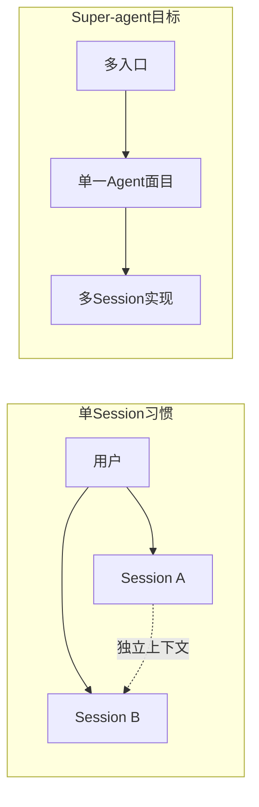

---

## 2. 五块结构：论文 [2]–[6] {#sec-2-modules}

论文把实现拆成五块，对应后面各节；不是五个必做 microservice，而是**职责切分**，避免一个 Session 又协调又写代码又对外刷屏。

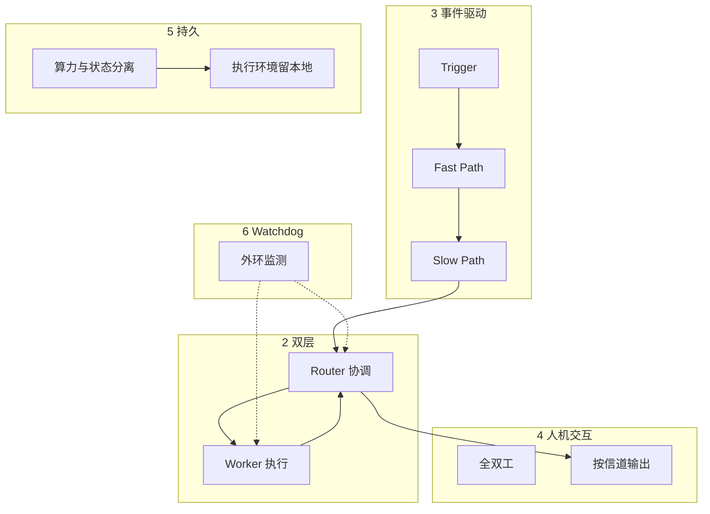

上图是**职责地图**，不是每条 Trigger 的严格时序：Thread 已订阅 Worker 时，后续事件可走 **Fast Path 直送 Worker**（§4），不必再经 Router 上的 Slow Path 评估。

| 模块 | 核心问题 | 延伸译文（逐句核对用） |
|------|----------|------------------------|
| [2] 双层 | 连续 vs 吞吐 | [paper-02](paper-02-two-layer.md) |
| [3] 事件驱动 | 噪声、路由、上下文窗口 | [paper-03](paper-03-event-driven.md) |
| [4] 人机交互 | 阻塞、信道带宽 | [paper-04](paper-04-human-interaction.md) |
| [5]–[6] 持久与外环 | 云/本机、长跑可靠 | [paper-05](paper-05-persistence.md) |
| 实验与开放问题 | 消融、长期记忆、安全 | [paper-06](paper-06-experiments-and-open.md) |

动机与四特征原文：[paper-01](paper-01-motivation-and-four-traits.md)。表中「实验与开放问题」对应论文 **§7–9**，不属于架构模块 [2]–[6] 编号，见 [paper-06](paper-06-experiments-and-open.md) 与下文 [§9](design-abstract.md#sec-9-principles)。

---

## 3. 双层：Router 与 Worker {#sec-3-two-layer}

**若所有事件进同一 Session**：上下文最连续，但一条 ReAct 串行，吞吐差，多任务细节互污染。**若每事件一新 Session**：吞吐高，全局断档，多个 Session 同时回复用户会乱。

切法：**Router** 持久，负责人机交互、任务间关系、对外统一出口；**Worker** 隔离上下文、带完整工具，专注一件活。理想情况下 Router **不扛重执行**（甚至可以没有 Bash）。这和 Agent Team 不同：Team Lead 常在**单任务内部**拆步协调；Router 只管**任务之间**的分派。论文消融里，单 Session 靠 prompt 决定是否委派子 agent，极不稳定；双层在**系统层**固定角色，Worker 只收订阅 Thread 上的后续事件。

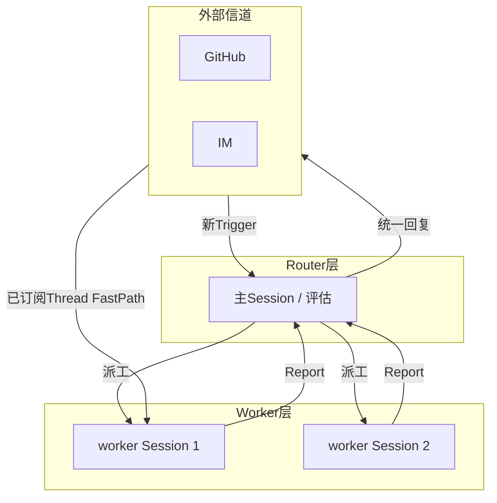

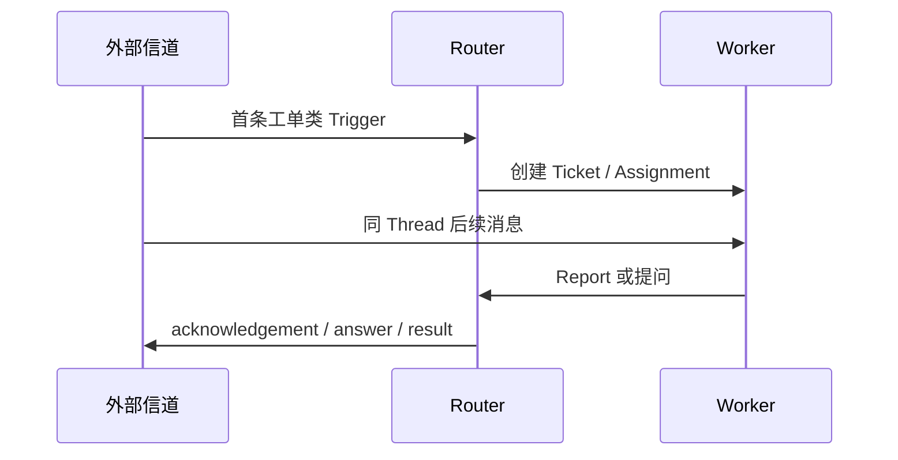

| 对比 | Agent Team（单任务内） | Super-agent Router |
|------|------------------------|------------------|
| 协调粒度 | 子步骤、角色 | 任务与任务 |
| 推理负载 | Lead 常要深读任务 | 多为轻量分派与对外话术 |
| 对外声音 | 可能多成员 | **单一出口**（候选原则 SA-A-05） |

**Prototype 落点**：主 Session + `dsh-superagent-router` preset；每 Ticket 一个 `worker-<id>` Session + `dsh-superagent-worker` preset（5 秒前台 shell 转后台，步边界可接新消息）。领域写进 [Engine](proto-007-architecture.md)，执行细则见 [proto-003](proto-003-execution.md)。

---

## 4. 事件驱动：从 Trigger 到 Worker {#sec-4-events}

驱动从「人一条条 prompt」变成环境里的 **Trigger**（群聊、CR、CI…）。真实接入后流是**高噪声、低行动率**；每条都上大模型会拖垮延迟与成本。做法借 **Fast Path / Slow Path**：代码做来源、范围、白名单等确定性过滤（Fast）；剩候选再给模型 + Policy（Slow）。

**路由**同样分快慢：Router 负责**新任务**与跨任务协调；归属建立后，同 **Thread**（同一 PR、同一 IM 话题）的后续事件由**代码直送**已订阅 Worker（Fast），不必每条经 Router 再转发。Thread 与 Worker **多对多**；同 Thread 上新事件到达所有订阅者，Worker 可据此自行化解冲突，要点仍经 Router 汇总对外。

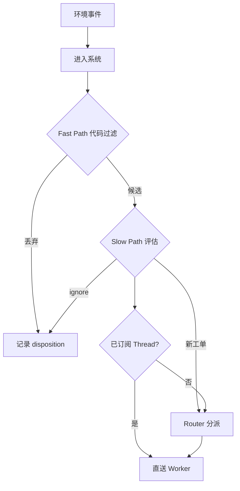

**上下文**按「窗口即 cache」组织：**Inline** 把近期要用的放进窗口；**Spill** 把超长正文留在外面，窗口里留 ID 与摘要；按引用 **Chain of Recall** 多跳找回旧任务——Router 不可能永远塞满全历史。

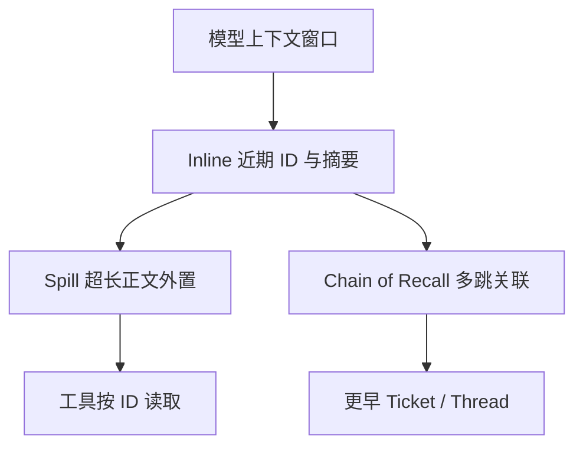

**推测执行**：在不确定结果是否有人用之前，后台先试（例如静默复现）；有价值才对外说话，否则全程安静——与 [000 哲学](proto-000-philosophy.md)「少占注意力」同向。

**Prototype：Trigger 走 Eval 还是订阅扇出**（[002](proto-002-authorization.md) 与论文 §3.2 同构）：

| 路径 | 何时 | 权限含义 |
|------|------|----------|
| **Eval** | 消息未作为「已有 Ticket 的 Thread 上下文」扇出 | 门控 + Policy → 可能产生新 Mandate / Ticket |
| **Subscription 扇出** | Thread 已被 live Ticket 订阅 | 只追加上下文，**不**经 Eval 授予新权限；仍受既有 Mandate 约束 |

Eval 对一批 Trigger 产出 **Decision**（领域常量，见 [001](proto-001-domain.md)）：

| Decision | 含义（prototype） |
|----------|-------------------|
| accept | 创建 Ticket + Mandate，进入执行 |
| stop | 撤销或结束授权（含人显式 stop） |
| ignore | 不行动，记录 disposition |
| unavailable | 评估超时或无法完成（重试策略见 002） |

| 阶段 | 谁处理 | 典型机制（prototype） |
|------|--------|------------------------|
| 准入 | Source + Policy gate | [proto-002](proto-002-authorization.md) |
| 是否新工单 | Eval / 主 Session | [proto-001](proto-001-domain.md) |
| 扇出上下文 | Subscription | 001 |
| 执行 | Executor Session | 003 |
| 对外写 | Outbox / Channel | 007 |

Trigger 从进入到落地的**领域流**（prototype 术语）：

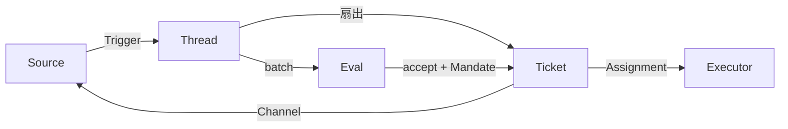

accept 之后 **Ticket 阶段**（003，自上而下首条匹配）决定面板「待人」与 slot 占用，与 Executor Session 存活**解耦**（SA-R-01）：

| 阶段前缀 | 典型含义 |
|----------|----------|
| `person/*` | 需人：投递失败、待答、待 review、blocked/failed |
| `working/*` | 执行中：queued 或 idle（仍有后台 job 时占 slot） |

---

## 5. 交互：别在群聊里刷终端 {#sec-5-interaction}

经典 ReAct 里，同步 `run()` 会占满循环，期间接不了新话。Super-agent 需要 **start/stop 式异步**：慢命令后台跑，当前步结束后仍可处理新 Trigger。DeepSeek Harness 已有类似能力（jobs、shell 提升）；是否默认打开是产品/policy 问题，属 A 线能力面。

对外输出要匹配**信道带宽**：Worker 内长推理不直灌群聊；Router 统一出口。IM 宜短（团队实测过「约百词」级硬限）；GitHub PR、邮件宜结构化长文。

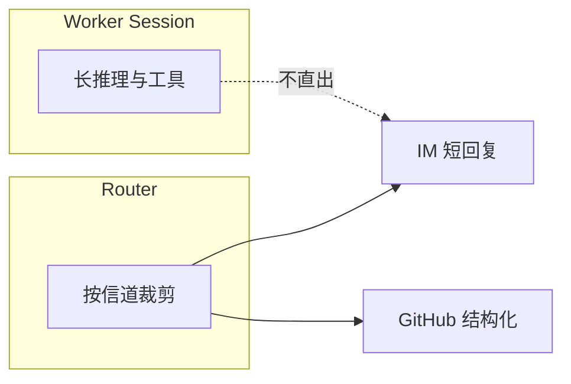

**Prompt 与面板**（prototype 产品化层，非 A 线 wire）：[004](proto-004-prompts.md) 把 Router 不写长文、IM **约百词**、Executor 交还超范围消息等写进可版本化 prompt；[005](proto-005-panel.md) 用 Ticket 阶段驱动「只展示需要人的项」，健康态不占屏。mini 的 `webui/` 是通用客户端，**没有** superagent 面板域；若采纳 SA-P-01 / SA-A-07，UX 参考这两份 upstream 文档而非复刻 wire。

---

## 6. 持久化：论文方向 vs 当前 prototype {#sec-6-persistence}

论文第二层解耦：**Agent Loop 与状态可上云**；**重状态的执行环境**（未提交改动、内网、凭据）留在本机，用轻 daemon 按需执行——「脑手分离」。再加 **Watchdog Session**：不只 ping 进程，还要判断 Worker 是否在**推进任务**、是否偏离目标；维护者可用自然语言查因、改 prompt 规则。

公开 prototype 以 **stateDir + 本机执行 + tmux 启停** 为主（[proto-006](proto-006-deployment.md)），**不等同**论文的云 + BYOM + Watchdog 全套。读 B 线时把本节当**方向**，不当 mini 必做清单。

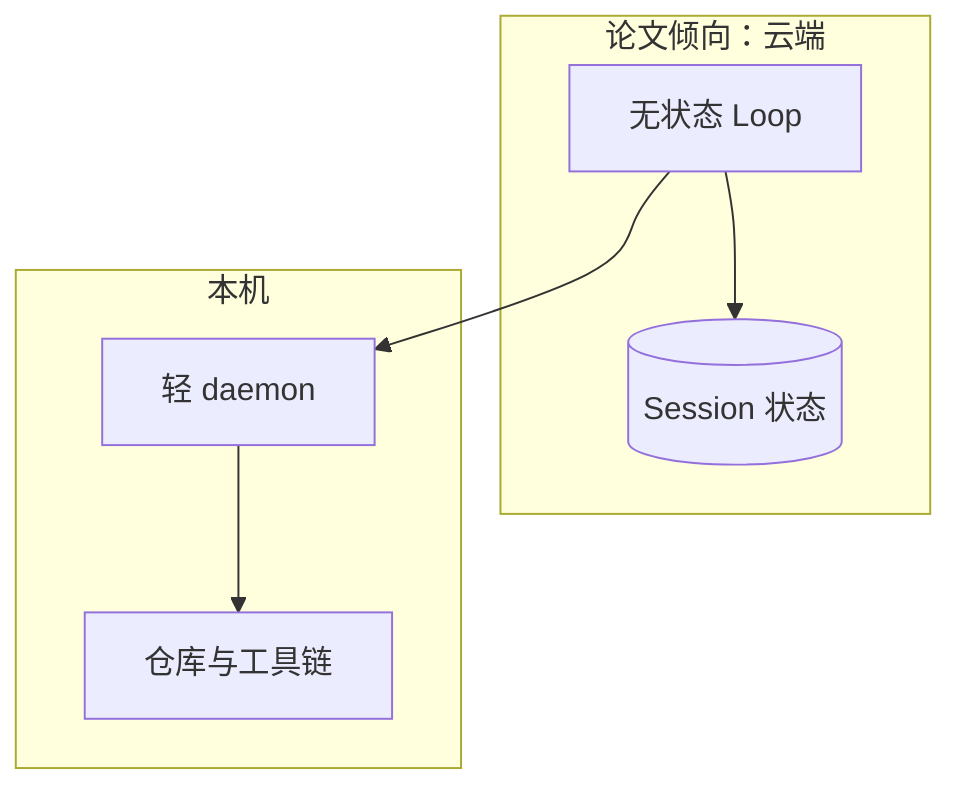

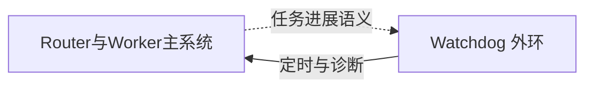

| 能力 | 论文 | 公开 prototype |
|------|------|----------------|
| 多 Session 编排 | 是 | 是（Engine） |
| 订阅直送 | 是 | 是 |
| 5s 异步 shell | 是 | 是 |
| 云算力 / BYOM daemon | 是 | 未作交付重点 |
| Watchdog | 是 | 未实现 |

---

## 7. Prototype 实现骨架（与论文对照） {#sec-7-prototype}

Runtime 锁 stateDir、开 Store；**Engine** 同步、事务式地写 Trigger / Thread / Ticket / Assignment；**Passes** 周期跑 effects 与 `evaluateDue`；**Outbox** 唯一写对外 receipt。主 Session 工具面向路由；Worker 面向仓库与 shell。

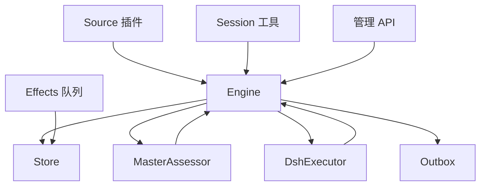

Engine 内五块（依赖单向）：**Intake → Evals → Tickets → Assignments → Replies**。API 按角色暴露不同 Pick（Sources / MainSession / People / Executor）。细节与测试索引：[proto-007](proto-007-architecture.md)。自定义 Source 扩展步骤：[proto-008 Cookbook](proto-008-cookbook.md)。

| 论文概念 | Prototype 锚点 |
|----------|----------------|
| Router | 主 Session + Eval + `dsh-superagent-router` |
| Worker | `DshExecutor` + worker Session |
| Fast Path 过滤 | Source 丢弃 + Policy gate（002） |
| Thread 直送 | Subscription + Input 投递（003） |
| 统一对外 | Outbox + Replies（007） |
| 注意力伦理 | 000、004、005 |

---

## 8. 与 mini（A 线）的边界 {#sec-8-mini}

mini 复现的是 DSH **内核与 wire**（[architecture §2](../../architecture.md#sec-2)）。Super-agent 是**产品编排层**叙事：Ticket、Engine、GitHub Source 整包**不是**对齐义务；下列仅为「若讨论采纳某原则，可能碰到的域」。

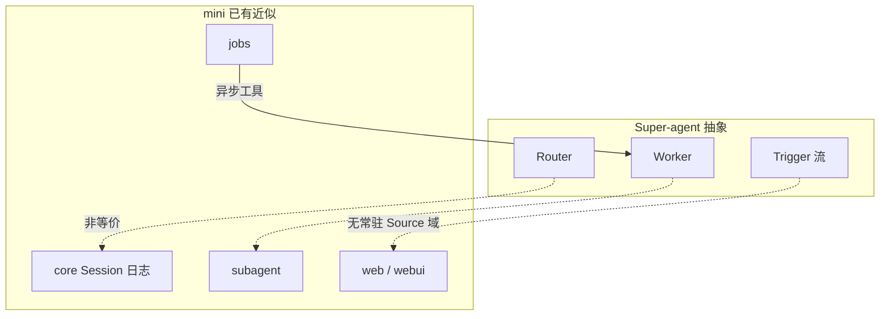

| Super-agent 思想 | mini 域 | 说明 |
|------------------|---------|------|
| Worker 隔离 Session | subagent、独立 session 目录 | 无 Ticket 生命周期机 |
| 异步 / 后台工具 | jobs、shell promote | A 线已有 |
| Session 持久化 | persistence | A 线已有 |
| Policy / Source gate | hooks、web 入口 | 无 superagent Policy 表 |
| Thread 直送 | — | 无 Subscription 域 |
| 待人 Panel | webui | 非 superagent 面板 |
| Watchdog / 云分离 | — | 未立项 |

---

## 9. 实验、开放方向与候选原则 {#sec-9-principles}

### 论文 §7 消融（摘要）

论文在合成负载下对比调度方案（非 mini 基准测试）。双层 + 订阅直送在尾延迟上明显优于「单 Session + Subagent 工具 + 中性 prompt」——中性 prompt 下模型常不委派，工作挤在同一 Session 并被新消息打断。去掉 Thread 直送时完成时间几乎不变，但 Router 决策量与 cache-read token 显著上升，说明直送主要**省 Router 负载**而非单纯提速。完整数据与 7.2 Router 批处理见 [paper-06](paper-06-experiments-and-open.md)。

| 方案（论文 7.1） | 完成时间 p50（约） | p95（约） |
|------------------|-------------------|-----------|
| Super-agent | 12.4 分钟 | 15.7 分钟 |
| 单 Session + Subagent，中性 prompt | — | 29.5 分钟 |

### 论文 §8 开放方向（摘要）

下列为论文自陈未闭合项，**默认不构成** mini 或 B 线采纳义务；单独立项前可登记 [rejected.md](rejected.md) 或 tasks。

| 主题 | 论文关切 |
|------|----------|
| 规模与拓扑 | 单 Router 何时分片、Worker 是否可对外直连、多 Worker 协作形态 |
| 记忆 | Chain of Recall 偏近期；月级长期记忆成瓶颈 |
| 产品 UX | Session 对用户隐藏后，任务如何呈现；Issue/PR 界面 vs 聊天中心 |
| 多实例 | 组织扩大后的上下文共享/隔离；实例间 **A2A** 与权限边界 |
| 安全 | 事件驱动扩大不可信输入；云 Loop + 本机 daemon 互信下的注入与凭据不进上下文 |

### 候选原则与采纳

设计抽象可提炼为一组 **SA-*** 陈述（默认**未采纳**）。完整 ID、**检验口径**见 [principles.md](principles.md)；**仅**写入 [adopted.md](adopted.md) 并在 tasks / ROADMAP 链出后，才在对应范围内约束 mini。与 A 线冲突时以 `deepseek-harness` 为准。

| ID | 抽象表述（一句） |
|----|------------------|
| SA-A-01 | 用户侧一个连续 Agent，Session 为实现细节 |
| SA-A-02 | 协调层不扛重执行 |
| SA-A-03 | 事件先代码过滤再模型评估 |
| SA-A-04 | 归属建立后同 Thread 后续事件优先直送 Worker |
| SA-A-05 | 对外单一出口 |
| SA-A-06 | 长耗时工具异步化，步边界可接新输入 |
| SA-A-07 | 输出匹配信道带宽 |
| SA-A-08 | 主动行为无把握则安静 |
| SA-P-01 | 占注意力的一切须净收益为正 |
| SA-P-02 | 领域概念极简 |
| SA-R-01 | 工单状态不随 Executor Session 机械绑定 |
| SA-S-01 | 系统级双层分派优于单 Session 内 prompt 委派 |

采纳流程：[00-governance.md](00-governance.md)。双轨说明：[index.md](index.md#sec-dual-track)。延伸译文粒度：[sources.md](sources.md#sec-translation-granularity)。
