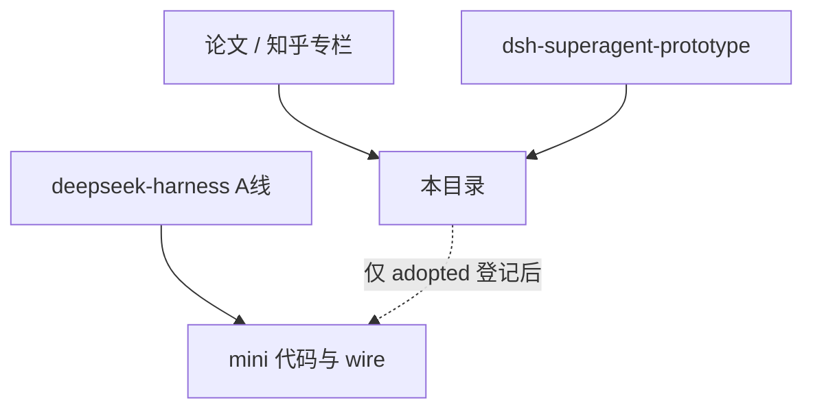

# Super-agent 设计参照

本目录与 <a href="../../architecture.md">architecture.md</a> 所代表的 DeepSeek Harness 内核复现（A 线）并行：此处整理 Super-agent 论文与 <code>dsh-superagent-prototype</code> 的设计抽象、候选原则与忠实译文，<strong>默认对 mini 开发无约束力</strong>。

## 双轨关系 {#sec-dual-track}

| 轨道 | 权威来源 | mini 中的位置 | 默认是否约束实现 |
|------|----------|---------------|------------------|
| **A 线** | `deepseek-harness/` 包与 wire | 章节、映射表、测试 | 是 |
| **B 线** | 论文 + superagent 旁路仓库 | 本目录 | **否**（见 <a href="adopted.md">adopted.md</a>） |

A 线回答「与上游约定是否一致」；B 线回答「若团队显式采纳某条设计原则，产品/编排/体验向何处倾斜」。二者冲突时以 A 线为准。

## 三源关系

论文描述的目标架构 **宽于** 公开 prototype；prototype README 声明与论文及内版不完全一致。出处见 [sources.md](sources.md)。

## 阅读顺序

1. **[设计抽象（主文）](design-abstract.md)** — 流程与架构图、对照表、与 mini 边界；系统解读的单一事实源  
2. [出处与治理](sources.md) — 原文链接、旁路上游 commit、[译文粒度说明](sources.md#sec-translation-granularity)、[00-governance.md](00-governance.md) 采纳规则  
3. [候选原则总表](principles.md) 与 [adopted.md](adopted.md) — 全部 `SA-*`；**生效 subset 仅见 adopted**  
4. **延伸阅读（译文）** — 需要逐句核对英文时打开论文卷 / Prototype 卷；页首指向主文对应节，不在延伸页重复维护解读  

| 卷 | 入口 |
|----|------|
| 论文 | [01 动机与四特征](paper-01-motivation-and-four-traits.md) → … → [06](paper-06-experiments-and-open.md) |
| Prototype | [000 哲学](proto-000-philosophy.md) → … → [007 架构](proto-007-architecture.md) → [008 Cookbook](proto-008-cookbook.md) |

## 与 A 线文档的链接

- 模块归属与简化标注：[architecture.md §2](../../architecture.md#sec-2)  
- 内核教程：[docs/index.md](../../index.md) 章节表  
- 产品面（上游 preset、入口）：[report/04-product-surface.md](../../report/04-product-surface.md)
