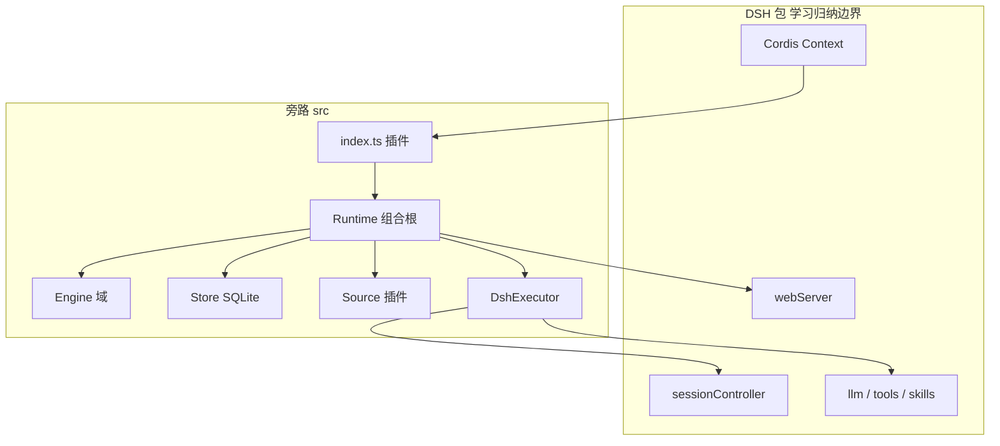

# 运行容器：边界与组合根

旁路原型在 DeepSeek Harness（DSH）之上多了一层「编排域」：外部事件变成 Trigger，经 Engine 决策后驱动 worker Session 与 Source 回写。读七条生命周期章节之前，先弄清哪些代码属于这一层、Runtime 如何把持久化与异步挂到 Engine 上。

## 两层运行时

DSH npm 包提供 Cordis 插件上下文、Session 控制器、LLM/工具/skills 与 web 服务；`dsh-superagent-prototype/src` 则是 Super-agent 插件与域实现。插件不重新实现 Session 回合或工具 wire——那些行为以 A 线 `deepseek-harness/` 为准。走读只描述 **DshExecutor、MasterAssessor、Sessions 如何回调 Engine**，不断言 mini 的 `miniharness` 已等价实现 DSH。

**走读锚点**（论断须能指向 `dsh-superagent-prototype/src/...` @ `6337fc8`）：`Engine` 及五段、`Store` 事务、`Effects` / `Passes` / `Outbox`、`Policy` 模式、`SourceRegistry` 与 Trigger 摄入。涉及 `@deepseek-ai/dsh-*` 包内部时标注为学习归纳，不写入 mini 的 A 线差异账本。

产品级抽象仍见 [design-abstract](../design-abstract.md)；英文方法全集见旁路 `docs/007-architecture.md` 与 [proto-007](../proto-007-architecture.md) 译文。

## 插件入口

`index.ts` 在 Cordis 上 `apply` 时做三件事：关闭 DSH 自动设置页（管理面板自带 UI）；用 `Machine` 与 `restart` 构造 `Runtime(ctx, machine, restart)`，并把 `SourceHost` 注册为 `orchestrator`；在 `await runtime.ready` 之后记录就绪。账户或部署级配置变更通过 `restart` 重读，避免半初始化状态下对外服务。

Python 参照没有 Cordis：`superagent.app.runtime.Runtime` 直接组装 Store、Engine、Passes、Effects、Outbox，可选 SQLite 路径。见 [superagent-framework.md](../superagent-framework.md) 与仓库 `superagent/README.md`。

## Runtime 不含域规则

`app/runtime.ts` 是组合根：加锁 `stateDir`、打开 SQLite Store、构造带端口的 `Engine`、注册 Effects 处理器、挂 Outbox 适配器、启动 Passes 定时泵，并暴露 `SourceHost.context(kind)` 给 Source 插件。域不变量（例如 accept 是否原子建 Ticket）全部在 `core/*`，Runtime 只做装配与生命周期。

构造顺序在概念上是：独占 stateDir 锁 → 打开/迁移数据库 → `new Engine(repositories, ports)` → `Effects.register(launch, delivery, assessment, relay, notice, reply)` → Outbox 绑定 Store 与 Registry → Passes 绑定 `receive` 与 `evaluateDue` → Setup/Settings/Prompts/Sessions/Assessor/Executor 注入 → `ready` 解析（主 Session、Policy 同步、恢复中断 Assignment）。

**启动完成时**：HTTP 路由可用、Setup 问题已处理或挂起、主 Session 存在、Policy 与 Settings 一致、Effects/Passes 在跑，DshExecutor 会对未完成的 launch/delivery 重排队。**关闭时**：取消进行中的 turn、drain Effects 与 Passes、关闭 Store、释放目录锁。Worker 的 `stop` 经 `Store.afterCommit` 触发，避免域事务回滚后误停 Session。

## 与生命周期主轴的关系

外部 Trigger 进入系统时，几乎总是 **Source → `Passes.receive` → `Engine.receive`**（见 [第 1 章 Trigger 摄入](lifecycle/01-trigger-receive.md)）。Pass 每约 2 秒还会调用 `Engine.evaluateDue`，与 Effects 的 kick 同批执行（见 [第 5 章 evaluateDue](lifecycle/05-evaluate-due.md)）。Engine 的每个公开命令（除 `evaluateDue` 的特殊多 atomic 结构）包在 `repo.atomic()` 里；端口在事务内 **enqueue** 副作用，handler 在 commit 之后才真正调 Session 或 Source API（见 [reference-semantics.md](reference-semantics.md) Store/Effects 一节）。

读完本篇后，按 [走读首页](index.md) 从第 1 章顺读至第 7 章，再读 [侧路径](side-paths.md) 补齐路由与 hand-back；模块索引与谓词表在 [reference-semantics.md](reference-semantics.md)，部署细节与管理面在 [侧链](sidechain.md)。
