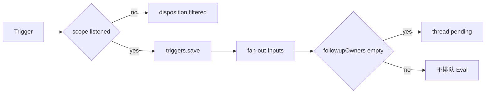

# 1. Trigger 摄入（receive）

外部世界的一次事件先变成不可变 `Trigger`，再决定是丢弃、只存档、fan-out 给已有 Ticket，还是进入 Thread 上的 Eval 队列。整条 Super-agent 主线从这里开始。

## 在主线中的位置

尚未有 Ticket 时，人的新消息通常要走 Eval → accept 才会建票；已有 open Ticket 订阅的 Thread 上，同一 Trigger 可能直接变成 Input，不再排队 Eval。读下一章 [Eval 与 accept](02-eval-decide-accept.md) 前，需要弄清 **Intake 如何把一条 Trigger 拆成 disposition、Input 与 pending**。

## 为什么不是 Source 直接写 Ticket

Source 插件（GitHub、飞书等）掌握 channel API、Thread 元数据与读指针，但 **Ticket / Thread 域状态的唯一写者是 Engine**（`core/intake.ts` 等）。Source 通过 `SourceContext.receive(trigger)` 把事件交给主机；主机经 `Passes.receive` 合并泵请求后调用 `Engine.receive`。这样 duplicate 检测、Policy 过滤、fan-out 与 Eval 排队都在同一套 `atomic` 事务里完成，Source 侧不必理解 Mandate 或 Assignment。

若把 `scope` 设成「未监听」，Trigger 仍会 **persist**（便于审计与面板展示），但 disposition 记为 `filtered`，不会 fan-out 也不会进 Eval——这是「记录但不行动」与「根本没收」的区别。

## 从 Source 到 Intake 的步骤

1. **构造 Trigger**（Source 侧，如 `github-trigger.ts` / `feishu-trigger.ts`）：填充 `id`、`threads`（首元素为 Eval 主 Thread）、`channel`、`actor`、`text` 等；`meta` 由 Source 解释，core 不读语义。
2. **`SourceContext.receive`** → **`Passes.receive(stored)`**：Pass 层合并并发 receive，并在 setup 未完成时拒绝 pump（见 [运行容器](../container.md)）。
3. **`Engine.receive` → Intake**（单事务）：
   - **duplicate**：同 `trigger.id` 已存在 → 返回 `duplicate`，不重复写。
   - **filter**：`SourceScope` 对该 Thread 未 `listen` → 存 Trigger + `disposition.filtered` → 返回 `filtered`。
   - **correlate**：多 Thread 关联时写 `correlated`、更新 `lastAt`。
   - **fan-out**：对订阅了相关 Thread 的 **open Ticket** 调用 `Tickets.addInput`；context 线程上的 Input 可标 `context: true`。
   - **Eval 排队**：仅当 `followupOwners(trigger)` 为空时，对 **primary Thread**（`threads[0]`）执行 `queueForEval`，把 trigger id 推入 `thread.pending`。
   - **wake**：fan-out 之后尝试 `Tickets.wake`（例如 Policy 变更后 ended Ticket 因新消息复活——与 [Policy 变更](06-policy-changed.md) 交叉）。
4. **Pass 继续 `pumpOnce`**：在同一轮或下一轮调用 `Engine.evaluateDue`，可能 `Evals.start` 并 `assessor.request`（见 [evaluateDue](05-evaluate-due.md) 与下一章）。

`followupOwners` 是核心分叉：若人的 follow-up 仍由某 Ticket 的 worker「占有」，Trigger **不会**进入 Eval，主 Session 对该 Thread 通常只能 `stop` 而非 accept 新票。否则 Eval 会与已有 worker 并行决策，破坏「一张票一个 mandate」的模型。

## GitHub：多 Thread 与 PR

Issue/PR 评论可能携带多个 Thread 引用。`github-trigger.ts` 把 number、isPr 等写入 **meta**（core 不解析）；`threads[0]` 通常是仓库内主 Thread key。Intake **correlate** 后，fan-out 只影响已订阅 Ticket；Eval 队列只看 primary Thread 的 `pending`。

**具象路径（评论进域）**：

1. poll/webhook → `github-read` 拉取 → `github-trigger` 构造 Trigger（actor、text、channel 指向 GitHub comment API）。
2. `SourceContext.receive` → 与假 Source 测试相同：`Passes.receive` → Intake。
3. 若 scope **listen** 且无人 owner → pending → 第 2 章 Eval；若已有 PR 绑定 Ticket → 可能只 **fan-out Input** 给 worker。
4. accept 后 worker 可用 `claimPull` / `readPull`（Executor 工具，经 SourceContext）；PR **merged/closed** 时 `github-pull` → `threadClosed`（[第 7 章](07-thread-close-github.md)）。

## Feishu：IM 与 intake 同一套 Intake

飞书不走 PR follows，但 **进入 Engine 之后与 GitHub 相同**：仍是 `receive` → Intake 五段逻辑（duplicate、filter、correlate、fan-out、Eval 排队）。

**具象路径（群聊/私聊）**：

1. `feishu-loops` 收事件 → `feishu-read` / `feishu-image` → `feishu-trigger.ts` 构造 Trigger。
2. **mention** 或 **direct** 消息决定是否 admissible（与 Policy gate、准入表配合，见 `policy.ts` / `admission.ts`）；未 listen 的 scope 仍 **存 Trigger + filtered**。
3. `actor` 标识 bot 或人；**人的** follow-up 在 `followupOwners` 非空时不进 Eval（[侧路径 attach/handback](../side-paths.md) 常在此介入）。
4. 出站回复经 Outbox → `feishu-channel`；发送前 `infra/text.ts` 校验 IM 长度（[第 4 章](04-outbox-reply.md)）。

GitHub 与 Feishu 文件族对照见 [reference § Sources](../reference-semantics.md#sec-sources)。Python 仅有 `fake_source`，不测真 API。

## 路由与 hand-back（不在 receive 内完成）

主 Session **attach** 或 worker **handback** 会改变「这条 Trigger 下一步进 Eval 还是留在 worker」，发生在 receive **之后**。见 [侧路径](../side-paths.md)，避免与本章 intake 混淆。

## 涉及模块

| 路径 | 职责 |
|------|------|
| `sources/*-trigger.ts` | 外部事件 → Trigger |
| `sources/host.ts`, `registry.ts` | SourceHost / SourceContext |
| `app/passes.ts` | `receive` 合并与 pump |
| `core/intake.ts` | 过滤、fan-out、Eval 排队 |
| `core/tickets.ts` | `addInput`、`wake`（fan-out 与 wake 路径） |
| `core/model.ts` | `followupOwners`、`reached` 等谓词 |

## 写者与不变量

- Trigger / Thread / disposition 行：**Engine（Intake）** 在 `atomic` 内写入。
- Source 仅更新 Thread `meta`、读指针（经 `SourceContext`），**不**直接改 Ticket。
- filtered Trigger 仍保存，避免「面板看不到被拒消息」。

## 边界与反例

| 情况 | 行为 |
|------|------|
| 重复 `trigger.id` | `duplicate`，无副作用 |
| scope 未 listen | `filtered`，有存档无 Eval |
| 有 followup owner | 不 `queueForEval`；可能仅 fan-out Input |
| 多 Ticket 订阅同 Thread | fan-out 给每个订阅者；Eval 仍按 Thread 单 pending 批 |
| setup 未完成 | Passes 不 pump，Eval 暂不 start |

为什么不把 filtered Trigger 完全不存？面板与 Reason 需要引用已拒绝事件；审计也需要 id 幂等。

## 测试

- 旁路：`tests/core-engine.spec.ts` 中 intake 相关 describe；`tests/sources.spec.ts` 构造 Trigger。
- Python：`tests/superagent/test_intake.py`；端到端 `tests/superagent/test_flows.py` → `test_flow_trigger_receive`（receive + pump 后 assessor 收到一次 request）。

谓词与阶段表的完整说明见 [reference-semantics.md](../reference-semantics.md) 域模型一节；Store/Pass 泵细节见同文 Store/Effects/Passes 一节。
