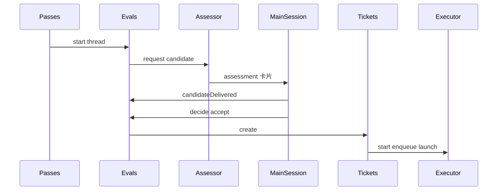

# 2. Eval 与 accept

Thread 上积压的 Trigger id 合并成一次 Evaluation；主 Session 看到 candidate 卡片后 `decide(accept)`，域在 **单事务** 里创建 Ticket、Mandate、首 Assignment、订阅与 acknowledgement Outbox，并 enqueue worker launch。

## 在主线中的位置

上一章把无 owner 的人的 Trigger 放进 `thread.pending`。本章从 Pass 驱动 `Evals.start` 起，到 accept 完成、Outbox 出现 pending ack、Effects 排队 launch 止。之后 worker 生命周期见 [Assignment](03-assignment-lifecycle.md)。

## Eval 批次如何形成

`Evals.start`（在 `evaluateDue` 路径中被调用）读取某 Thread 的 `pending` trigger id 列表，合并为 **一批** Evaluation。Policy `gate` 在候选 Trigger 上选出 **strongest admissible** 子集；若全体 inadmissible，后续会走向 `ignore` Decision 而非建 Ticket。

批次创建后 Engine 通过 Assessor 端口 **enqueue** `assessment` effect（不在事务外调 LLM）。MasterAssessor 向主 Session 推送 candidate；主 Session 工具回调 `candidateDelivered`，再 `decide`。在 candidate 送达之前，Eval 的 expire/requeue 逻辑不会把该 Eval 当作超时（见 [evaluateDue](05-evaluate-due.md)）。

## accept 事务里发生什么

`decide(accept)` 校验 `evalId`、Policy 版本与 inferred 规则（inferred accept 需要 `admitsInferred`，否则 `UserError notExplicit`）。进入 `Evals.accept` 后，`Tickets.create` 在同一 `atomic` 中 typically：

1. 冻结 **Mandate**（`strength`、`policyVersion`、`basis`、`actor`、`scope`）。
2. 创建 **Ticket**，订阅相关 Thread 与 channel。
3. 写 **Decision** 与 Trigger disposition（accept / fan-out 记录）。
4. 创建首个 **Assignment**（pending）。
5. 调用 **Replies** 路径准备 acknowledgement（经 Outbox port）。
6. 调用 **Executor.start**，在 Effects 表 enqueue **launch**（commit 后 DshExecutor 才真正开 worker Session）。

若 `prepareTicket` 在 accept 路径抛错，整笔 accept **回滚**，不会留下半开 Ticket——旁路 `core-engine.spec.ts` 对原子性有专门用例。

**幂等**：Trigger 已被 accept 过则返回既有 Decision，不会双建 Ticket。

## 与 Assessor、主 Session 的交界

Assessor 不是 Engine 的一部分，但 `assessment` effect 的 handler（MasterAssessor）在 commit 后运行，把结构化 candidate 推到主 Session。主 Session 上的工具绑定 `Engine` 的 MainSession Pick：`candidateDelivered`、`decide(accept|ignore|stop|…)`。Domain 不解析自然语言，只认 typed Decision。

Policy 在 assessment 进行中变更时，Eval 可能被 reassess 或标记 unavailable（与 [Policy 变更](06-policy-changed.md) 重叠）；accept 路径会校验 mandate 与当前 Policy 一致。

## Outcome 类型

| Outcome | 含义 | 典型后续 |
|---------|------|----------|
| `ignore` | gate 全拒或明确 ignore | 无 Ticket |
| `unavailable` | 超时 requeue 用尽等 | 无 Ticket，Trigger 可能 requeue |
| `accept` | 建票 | Assignment + launch |
| `stop` | 主 Session 终止 Eval | 无新 Ticket |

## 涉及模块

| 路径 | 职责 |
|------|------|
| `core/evals.ts` | start、decide、accept、expire |
| `core/tickets.ts` | create、订阅、disposition |
| `core/replies.ts` | acknowledgement 规则 |
| `app/assessment.ts` | MasterAssessor effect |
| `executor/dsh.ts` | launch handler（commit 后） |
| `app/effects.ts` | assessment / launch enqueue |

## 写者与不变量

- Evaluation / Decision / Ticket / Assignment：**Engine**。
- Outbox receipt：**Outbox 适配器**在 `send` 时与 enqueue reply effect 同事务。
- launch/delivery：**Effects** 在 commit 后执行；Engine 事务内仅 enqueue。

## 边界与失败

| 情况 | 结果 |
|------|------|
| gate 全 inadmissible | `ignore`，无 Ticket |
| `prepareTicket` 失败 | accept 整笔回滚 |
| Policy 版本变 mid-assessment | reassess / unavailable |
| inferred accept 无规则 | `UserError notExplicit` |
| 重复 accept 同一 Trigger | 返回旧 Decision |

为什么不把 accept 拆成多事务？Ticket 与 Decision、首 Assignment、ack 必须同时可见，否则 Pass 可能在 launch 前看到无 Assignment 的 Ticket，或 Outbox 与域状态不一致。

## 测试

- 旁路：`core-engine.spec.ts`（accept creates ticket、原子性、policyChanged during assessment）。
- Python：`tests/superagent/test_flows.py` → `test_flow_eval_decide_accept`；细粒度用例分散在 `test_eval.py`、`test_core_engine*.py` 等。

Engine 五段方法表与 Mandate 谓词见 [reference-semantics.md](../reference-semantics.md)。
