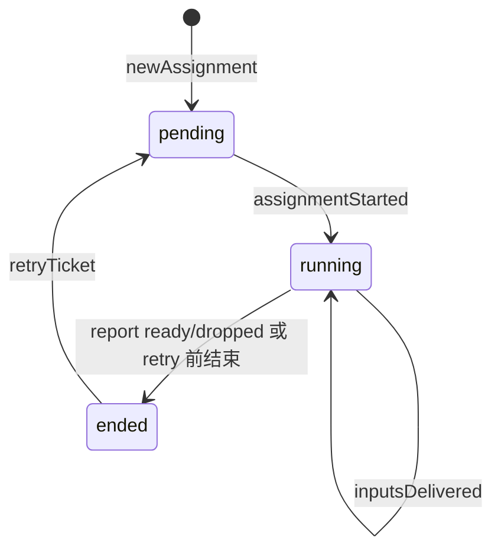

# 3. Assignment 生命周期

accept 之后，Ticket 上的 work 由 **Assignment** 表示：Effects 驱动 DshExecutor 开 worker Session，投递 Input，收集 `report`，直到 ready、dropped、blocked 或随 Thread 关闭而结束。

## 在主线中的位置

accept 已 enqueue **launch** 并通常已有 pending **ack** Outbox（见 [Outbox 回复](04-outbox-reply.md)）。本章从 launch effect 执行到 Ticket `ended` 或进入 `waitsForPerson` 等人状态。PR merge/close 对 follows 的影响在 [Thread 关闭](07-thread-close-github.md)。

## Launch：从 effect 到 assignmentStarted

commit 之后，`effects` 表中 `launch` 行被 kick。DshExecutor（`executor/dsh.ts`）在 worker 槽允许时：

1. **prepare** Ticket 工作目录、short name、环境（`prepareTicket` hook 在 accept 时已参与；目录失败类错误 **不** 自动无限重试 launch）。
2. **ensure** worker Session（每 Ticket 一个 `worker-<ticketId>`）。
3. 发送 assignment 首条 prompt 消息。
4. 回调 **`Engine.assignmentStarted`**（单事务）：Assignment → running；对 undelivered Input enqueue **delivery**。

槽位满时 handler 抛 `Later`，约 5s 后重试；人的 wake 路径可优先占槽（见 reference 中 DshExecutor）。

## Delivery、read 与 turn

**delivery** effect 把未送达 Input 渲染成 Session 消息（`inputMessage` 依赖 Ticket 状态、Trigger 文本、policy、resumed 标记等）。成功后 **`inputsDelivered`**，Session step 结束后 **`inputsRead`**，清除 delivery 失败标记。

Turn 结束默认可能 report `waiting`，除非 worker 已报 ready、attention 等。后台 shell/subagent 在 turn 结束后仍可能运行，超时后 stop 并 report waiting（`background.ts`）。

## report 如何改变 Ticket

`Assignments.report` 在 Engine 内更新最新 report，并可能：

| report.state | 典型域效果 |
|--------------|------------|
| `progress` / `waiting` | 阶段表显示 working/idle |
| `blocked` / `failed` | `waitsForPerson` 为真时 held 自动 Input；阶段表 person/blocked 或 failed |
| `ready` | 无未关闭 follows → `Tickets.end` completed；有 follows → 等 `followsDone` |
| `dropped` | 结束 Ticket；outcome 可能继承 PR close |
| question + askedBy | 打开 `attention`；可能 enqueue attention reply |

`assignmentInterrupted`（主机重启）：对比 latest report 与 post-report Input 的 `deliveredAt`，决定 restart+recovery 或仅 flush undelivered（`executor/dsh.ts` resume 路径）。

## 状态机（Assignment 视角）

Ticket 级 `stage`（面板用）由 `stage.ts` 对 Ticket+Assignment+report **首条匹配** 规则计算，见 reference 域模型一节。

## 涉及模块

| 路径 | 职责 |
|------|------|
| `executor/dsh.ts` | launch、delivery、Session 订阅 |
| `executor/background.ts` | 后台 job 超时 |
| `core/assignments.ts` | started/delivered/read/report/interrupted |
| `core/tickets.ts` | end、attention、follows |
| `app/effects.ts` | launch/delivery 队列 |
| `app/sessions.ts` | relay/notice（主 Session 侧） |

## 写者与不变量

- Assignment 状态与 report：**Engine**（Executor **回调** 命令式接口）。
- Session 内工具调用 → Executor Pick → 同上。
- `stop` worker 在 **`afterCommit`**，避免域回滚后误杀 Session。

## 边界

- **blocked/failed + waitsForPerson**：自动 Input 不投递，等人或主 Session 操作。
- **ready + open follows**：Ticket 不立即 end，等 GitHub PR merged/closed 等（下一章 Thread 关闭）。
- **PrepareFailed**：launch 不盲目重试，避免半创建目录。

## 测试

- 旁路：`core-engine.spec.ts` assignment/report；`queue.spec.ts` 全栈；`background.spec.ts`。
- Python：`test_flows.test_flow_assignment_lifecycle`（progress → ready → ticket ended）；域细测在 `test_assignments.py` 等；`ScriptedExecutor` + SQLite 见 `test_flows.test_runtime_scripted_executor_with_sqlite`。

DshExecutor 槽位与恢复策略见 [reference-semantics.md](../reference-semantics.md) DshExecutor 一节。
