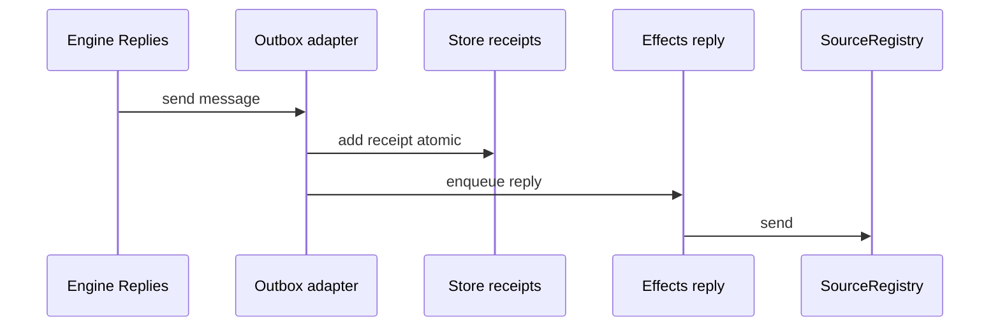

# 4. Outbox 回复

域内 `reply` 决定「能否发、发什么 purpose」；**Outbox 适配器**是唯一写 receipt 的地方，把消息排进 Effects，再调用 Source 的 channel API。ack、answer、result、attention 都走这条链。

## 在主线中的位置

accept 通常会产出一笔 **acknowledgement** pending receipt。worker ready 后可能 **result**；attention 路径有 **answer**。本章不重复 Intake，只描述 **Replies → Outbox port → Store receipt → reply effect → Source.send**。

## 一步事务里做什么

`Engine.reply`（`core/replies.ts`）校验 purpose 与 Ticket 状态，例如：

- **acknowledgement**：需 human actor、channel，且 Trigger `reaches` Ticket；可能 `takeUp` disposition。
- **answer**：Ticket 的 `answers` 须含相关 trigger 或已有 outbox 记录。
- **result**：Ticket 须 ready/completed/merged/dropped，或 live Ticket 且最新 report 为 ready。
- **attention**：question 须匹配 `ticket.attention`。

通过后调用 **Outbox port** 的 `send`（`app/outbox.ts`）：

1. 渠道侧校验（如飞书 reply 长度，`infra/text.ts`）。
2. **`receipts.add`** 写入 SQLite `outbox` 表（pending）。
3. **enqueue `reply` effect**（与域行同一 `atomic`）。

commit 后 Outbox handler **`deliver`**：检查同 ticket+conversation **前序 pending**（有则 `Later`）；调用 `SourceRegistry.send`；成功则 receipt → sent，Source 消失/忽略则 gone/ignored；连续失败可 settle 为 dropped（旁路 `outbox.spec.ts` 覆盖behind 与重试）。

Outbox id 常由 `ids.ts` 内容派生，如 `key('ack', triggerId)`，保证幂等与去重。

## 为什么 Engine 不直接调 GitHub/飞书

Source 插件各自实现 send；Registry 按 channel 路由。Engine 只认 **Outbox 端口**，适配器持有 Store 与 Registry，保证 **receipt 与 enqueue 同事务**，避免「域认为已 ack 但库中无 receipt」或反之。

## 涉及模块

| 路径 | 职责 |
|------|------|
| `core/replies.ts` | reply 规则 |
| `app/outbox.ts` | send/deliver、receipt 写者 |
| `app/effects.ts` | reply kind、kick |
| `sources/*-channel.ts` | 实际 API send |
| `app/store.ts` | outbox.pending 工作集 |

## 写者与不变量

- **Receipt 行**：仅 Outbox 适配器（Engine 只调 port）。
- **Effect 行**：Engine 事务内 enqueue；handler 删行或退避。

## 边界

| 情况 | 行为 |
|------|------|
| 同 conversation 前序 pending | `Later`，保持顺序 |
| Source 未安装 | `Later`，等待注册 |
| 三次失败（非 delivery 类） | health error；reply 可能 dropped |
| Feishu 超长 | send 前 UserError / 校验失败 |

## 测试

- 旁路：`outbox.spec.ts`。
- Python：`test_flows.test_flow_outbox_reply`（accept → report ready → `engine.reply` result → reply 含 id）；accept 路径常断言 outbox 含 pending ack。

Sources 发送与 GitHub/飞书文件族见 [reference-semantics.md](../reference-semantics.md) Sources 一节。
