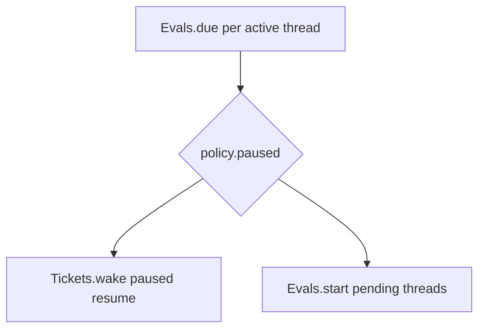

# 5. evaluateDue（Pass 驱动）

除 Source 触发的 `receive` 外，系统 heart 是 **Passes**：约每 2 秒 `pumpOnce` 先 kick Effects，再调 `Engine.evaluateDue`，处理 Eval 超时、Policy 暂停、Thread 上新的 pending 与 paused Ticket 的 wake。

## 在主线中的位置

贯穿第 1–2 章：receive 之后往往同一 pump 就会 `Evals.start`；Assessment 进行中则本章的 **due/expire/requeue** 与 Policy **pause** 会改变 Eval 命运。与 [Policy 变更](06-policy-changed.md) 叠加时，Eval 可能被 reassess。

## pumpOnce 顺序

`app/passes.ts` 中一次 pump 典型为：

1. **`effects.kick()`** — 按 kind 限制并发处理最老的 due effect（launch、delivery、assessment、relay、notice、reply）。
2. **`engine.evaluateDue()`** — 非单一大事务；对 **active Thread** 与相关 Ticket **多次** `atomic`：
   - **`Evals.due`**：对已 `candidateDelivered` 且过 deadline 的 Eval 做 expire/requeue；连续 requeue 达 `REQUEUES=2` 后 **`unavailable`** Decision。
   - **Policy paused**：推移 deadline（`pausedAt`），不当作超时。
   - **`Evals.start`**：pending 非空的 Thread 开新批 Eval。
   - **`Tickets.wake`**：ended Ticket 在 Policy revalidate 通过且有人 Trigger 待投递时复活 Assignment。

未 `candidateDelivered` 的 Eval **不会** 被 expire——避免主 Session 还没看到卡片就被判超时。

## 与 receive 的协作

`Passes.receive` 在存入 Trigger 后会 **request** 额外 pump（合并并发请求为一次 follow-up）。因此典型测试路径是：`receive` → `pump()` → assessor 收到 request；或 `tick(61)` 模拟 61s 后 pump 触发 requeue（Python `test_flow_evaluate_due`）。

`configured()` 为 false 时 Pass 不跑，Eval 不会 silently 超时空转。

## 涉及模块

| 路径 | 职责 |
|------|------|
| `app/passes.ts` | 定时 pump、receive 合并 |
| `core/engine.ts` | evaluateDue 编排 |
| `core/evals.ts` | due、start、expire、pause |
| `core/tickets.ts` | wake |
| `app/effects.ts` | kick 与 Eval 并行推进 |

## 写者与不变量

- Eval Thread pending、Eval 状态：**Engine**。
- Effect 行：**Effects** handler 在 commit 后删/退避；enqueue 仍在 Engine 事务内。

## 边界

| 情况 | 行为 |
|------|------|
| 未 delivered 的 Eval | 不参与 expire |
| REQUEUES 用尽 | unavailable，无 Ticket |
| Policy pause | deadline 顺延 |
| pump 失败 | runtime health error；下次成功清除 |

## 测试

- 旁路：`core-engine.spec.ts` timeout/requeue 段；`passes.spec.ts`。
- Python：`test_flows.test_flow_evaluate_due`（candidateDelivered 后 tick 61s + pump → assessor released 非空）。

Store 工作集（active thread/ticket）与 Effects 表语义见 [reference-semantics.md](../reference-semantics.md)。
