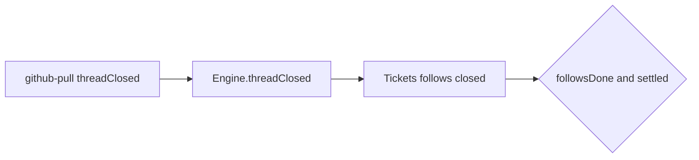

# 7. Thread 关闭（GitHub PR）

GitHub Source 在 PR merged/closed 时调用 `Engine.threadClosed`；Tickets 更新 **follows** 与关闭 outcome，在 worker 已 ready 且 **followsDone** 时结束 Ticket。这是「外部线程生命周期」约束「工单何时算完成」的路径。

## 在主线中的位置

假设第 3 章 worker 已 report **ready**，但 Ticket 仍订阅 PR Thread 作为 **follow**。本章描述 PR 关闭如何把 `merged`/`closed` 写入域，以及何时调用 `Tickets.end`。Feishu 为主的场景可能没有 follows，ready 后可直接 end（第 3 章表）。

## Source 侧到 Engine

GitHub 文件族（`github-pull.ts`、`github.ts`）在观察到 PR 状态变化时：

1. 经 **SourceContext** 调 **`threadClosed(thread, outcome, at)`**（非直接改 Ticket 行）。
2. Engine **`Tickets.threadClosed`** 标记 follows 中对应 Thread closed、记录 outcome 与时间。
3. 若 **`followsDone`**（自有 Thread 全 closed，或无自有则 follows 全 closed）且工作已 settled（例如 report 已 ready、无未完成 delivery），则 **`Tickets.end`**，outcome 可能为 merged/closed/dropped 组合。

**bindThread**（accept 后或 worker claim PR）把 PR 绑到 Ticket follows；规则包括：started 时 origin 即 PR Trigger；opened 时 agent 账号与分支末段匹配 ticket execution name；一 PR 至多一个 open Ticket owner（`github-pull.ts`）。

## 与 report dropped 的交互

worker report **dropped** 时 end 的 outcome 可能 **继承** PR close 结果，避免面板显示与 GitHub 状态矛盾。关闭后若仍有未 ready 的 resume 工作，end 可能延迟直到 report 或 follows 一致。

## 涉及模块

| 路径 | 职责 |
|------|------|
| `sources/github-pull.ts` | claim/observe/close、bind 规则 |
| `sources/github.ts` | poll、装配 |
| `app/source-context.ts` | threadClosed 转发 Engine |
| `core/tickets.ts` | bind、threadClosed、followsDone、end |

## 写者与不变量

- Ticket follows / ended：**Engine**（Source 仅发起命令）。
- Thread meta / 读指针：**Source**。

## 边界

| 情况 | 行为 |
|------|------|
| ready 但 follows 未 closed | Ticket 保持 open |
| close 后 worker 仍 running | 延迟 end 直至 settled |
| 无 follows 的 Ticket | 本章路径不触发；ready 即可 end |

## 测试

- 旁路：`sources.spec.ts` PR 规则；`core-engine.spec.ts` thread 相关。
- Python：`test_flows.test_flow_thread_close_github`（accept → bind_thread → thread_closed → ticket ended）。

执行阶段产品语义见 [proto-003 执行](../../proto-003-execution.md)；GitHub 文件职责表见 [reference-semantics.md](../reference-semantics.md) Sources 一节。

