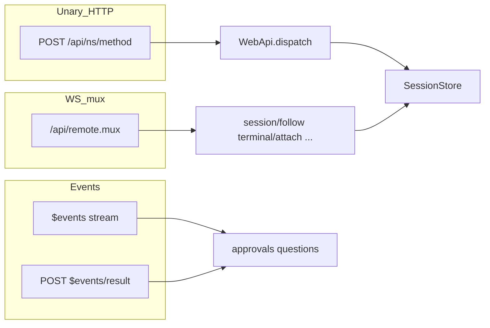
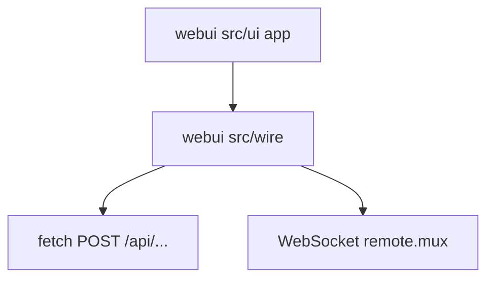

# Wire 导读

按阅读顺序理解 <a href="../interface-wire.md">interface-wire.md</a>（端点与字段的唯一定义长表），不在此复制全集。产品前端只依赖 wire，见仓库根 <code>webui/README.md</code>。

## 三泳道总览

| 泳道 | 用途 | wire 章节 | 测试族 |
|---|---|---|---|
| Unary | 请求-响应 RPC | §1～§3、§5、§7～§9 | `tests/test_web_server.py` |
| Mux | 长流 Remote | §4 | `tests/test_web_mux.py`、`test_web_streams.py` |
| Events | 瀑布 + 结算 | §4.3、§5、§6 | `tests/test_web_events.py`、`test_web_approvals.py` |

## 建议阅读顺序

1. [interface-wire §1](../interface-wire.md#wire-1) — 通道、认证、HTTP/WS 状态码  
2. [§2 信封](../interface-wire.md#wire-2) — 两信封、`RPC_ERROR_CODES`（80 码，以 `envelope.py` 为准）  
3. [§3 session unary](../interface-wire.md#wire-3) — `session/list|create|page|…`  
4. [§4 Remote](../interface-wire.md#wire-4) — follow、control、terminal、schedule…  
5. [§6 审批桥](../interface-wire.md#wire-6) — 与 [T4 走查](traces/web-follow-approval.md) 对照  

## webui 消费侧

`src/wire/` 无 React 依赖，可用 vitest mock fetch/WS（`webui/tests/wire*.ts`）。

## 落地走查

- Unary：[traces/web-unary-session.md](traces/web-unary-session.md)  
- 审批：[traces/web-follow-approval.md](traces/web-follow-approval.md)  
- 系统地图：[system-map.md](../system-map.md) Fig S4  
