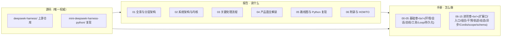
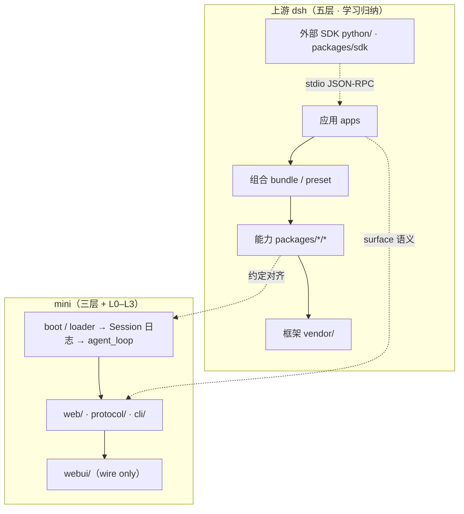

# DeepSeek Harness 解读报告

六个主题子页解读上游 dsh：全景、内核、流程、产品面、复现路线与附录。mini 功能模块与章节验收见 <a href="../system-map.md">system-map.md</a>；落地走查见 <a href="../guides/traces/headless-one-task.md">guides/traces</a>。下文 Mermaid 与<b>四维对照表</b>（上游包 ↔ mini 模块 ↔ 手册章节 ↔ 报告页面）便于跳转——<b>手册章号行级单源</b>见 <a href="../architecture.md#sec-2">architecture §2</a>。

  everything is a plugin
  event-sourcing
  capability seams
  TypeScript strict
  Cordis vendored
  Python SDK 存在

## 报告结构

图 A：三层阅读结构——源码是唯一权威，报告回答"是什么/为什么"，手册回答"怎么亲手做出来"。基础章沿主线把核心约定立起来；进阶章每章独立，可按需选读。

## 上游 monorepo 与 mini 仓库对照

上游 [01 全景](01-overview.md) 用五层（应用 / 组合 / 能力 / 框架 / 外部 SDK）描述 **dsh** monorepo；mini 用 **core + web + webui** 三层组织可运行产物，并用 L0–L3 约束 Python 包依赖（[architecture.md](../architecture.md) §1.0、§3）。读法：先在上游建立全景，再在 mini 里找对应模块与 wire。

图 B：左侧是上游仓库分层（报告 01）；右侧是 mini 运行时主链与传输/前端边界（architecture §1.0）。产品面细节不在此展开，见 [04 产品面](04-product-surface.md) 与 [architecture 映射表](../architecture.md#sec-2)。

| 子页 | 内容 |
|---|---|
| [01 项目全景与分层架构](01-overview.md) | 仓库构成、五层架构（应用/组合/能力/框架/外部 SDK） |
| [02 系统架构与内核](02-architecture.md) | 核心包脊柱、ctx 服务地图、事件体系、外围接入面；技术核心六节（Cordis 模型/事件溯源/扩展口/类型/作用域/门禁） |
| [03 关键处理流程](03-flows.md) | Turn/Step、工具管线、持久化、LLM 流式、启动组合五条时序 |
| [04 产品面全解读](04-product-surface.md) | **十大议题**：模式设计、外部入口、Trajectory、干预面、审批、自我修改、resume、plan/goal、压缩与后台、skills |
| [05 路线图与 Python 复现](05-roadmap.md) | 学习路线、概念映射表、迷你复现清单、实操资源索引 |
| [06 附录与 HOWTO](06-appendix.md) | Python SDK、添加插件、HOWTO、参考表、结语 |

## 四维对照表

每一行是一个解读主题；mini 模块列给出对应实现位置。**手册章号行级单源**见 [architecture §2](../architecture.md#sec-2)（§2.0 前缀对照 + 主映射表「手册章」列）；此处不重复章号，只链报告页。

| 上游包 / 文件（唯一权威） | mini 模块 | 手册（链 architecture 第 2 节） | 报告页面 |
|---|---|---|---|
| `packages/core/session` | `core/session/` | [§2](../architecture.md#sec-2) | 02 §3-4 |
| `packages/context + vendor/cordis(core)` | `core/scope.py` | [§2](../architecture.md#sec-2) | 02 §4.1 |
| `packages/core/tools`（含 `when` / `resolve_activation`） | `core/tools.py` | [§2](../architecture.md#sec-2) | 03 §5.2 |
| `packages/llm/pi-ai`（`llm-pi-ai/request-headers`） | `llm/pi_ai.py` | [§2](../architecture.md#sec-2) | — |
| `packages/ptc-runtime/*` + `packages/workflow/workflow-ptc`（sandboxMode / confine） | `ptc_runtime/` + `workflow_ptc/` + `ptc/run_code.py` | [§2](../architecture.md#sec-2) | [architecture.md](../architecture.md) 映射表 |
| `packages/workflow/{workflow,tool-workflow}` | `workflow/` + `tool_workflow/` | [§2](../architecture.md#sec-2) | — |
| `packages/boot/plugin-manager` + `packages/host/plugin-inventory` | `boot/plugin_manager.py` + `web/api.py` Remote | [§2](../architecture.md#sec-2) | 04 议题 2 |
| `packages/boot/plugin-market` | `boot/plugin_market.py` + `cli/plugins/plugin_market.py` | [§2](../architecture.md#sec-2) | [interface-wire.md](../interface-wire.md) §4.15 |
| `packages/experimental/action-cards`（opt-in） | `experimental/action_cards/` + `cli/plugins/action_cards.py` | [§2](../architecture.md#sec-2) | — |
| `packages/schedule/schedule` + `schedule/tool-schedule` | `schedule/` + `web/api.py` `schedule/*` | [§2](../architecture.md#sec-2) | 04 议题 8 |
| `packages/llm/llm + llm-deepseek` | `llm/` | [§2](../architecture.md#sec-2) | 02 §3 + 03 §5.4 |
| `packages/core/agent-loop` | `core/agent_loop/agent.py` | [§2](../architecture.md#sec-2) | 03 §5.1 |
| `packages/session/session-persistence` | `core/session/persistence.py` | [§2](../architecture.md#sec-2) | 03 §5.3 |
| `packages/extensions/cordis-host-runner + packages/boot` | `boot/boot.py` | [§2](../architecture.md#sec-2) | 03 §5.5 |
| `vendor/loader + vendor/include` | `loader/`（EntryTree + Entry + Group + Loader + Include + patch） | [§2](../architecture.md#sec-2) | 03 §5.5 |
| `packages/bundle/headless + apps/cli/src` | `cli/headless.py + cli/main.py` | [§2](../architecture.md#sec-2) | 04 议题 2 |
| `apps/cli/config/agent-presets/*` | `preset/presets.py` | [§2](../architecture.md#sec-2) | 04 议题 1 |
| `packages/core/agent（runtime-types）` | `core/agent_loop/agent.py（干预面）` | [§2](../architecture.md#sec-2) | 04 议题 4 |
| `packages/interaction/user-approval` | `interaction/approval.py` | [§2](../architecture.md#sec-2) | 04 议题 5 |
| `packages/client/ui-trajectory` | `client/trajectory.py` | [§2](../architecture.md#sec-2) | 04 议题 3 |
| `packages/extensions（tool-cordis 等）` | `extensions/dynamic.py` | [§2](../architecture.md#sec-2) | 04 议题 6 |
| `packages/sdk/protocol（transport + types）` | `protocol/sdk.py` | [§2](../architecture.md#sec-2) | 04 议题 2 |
| `packages/acp/acp` | `protocol/acp.py` | [§2](../architecture.md#sec-2) | 04 议题 2 |
| `packages/hooks（hook-protocol + hooks-claude-code）` | `protocol/hooks.py` | [§2](../architecture.md#sec-2) | 04 议题 2 |
| `core/agent-loop 并行编排 + core/context 并发模型` | `core/agent_loop/tool_calls.py + core/scope.py` | [§2](../architecture.md#sec-2) | 03 §5.1 |
| `packages/sandbox/sandbox + sandbox-local + sandbox-windows-acl + native/landlock-run` | `seams/sandbox_local.py + seams/landlock_run.py + seams/sandbox_windows_acl/` | [§2](../architecture.md#sec-2) | — |
| `packages/sandbox/sandbox-policy` | `seams/sandbox_policy.py` | [§2](../architecture.md#sec-2) | — |
| `packages/shell/shell + bash-local + bash-sandbox` | `shell/`（bash_local + bash_sandbox + helpers） | [§2](../architecture.md#sec-2) | — |
| `packages/credentials/credentials-local` | `seams/credentials_local.py` | [§2](../architecture.md#sec-2) | — |
| `packages/subprocess/subprocess（环境清洗）` | `seams/subprocess_env.py` | [§2](../architecture.md#sec-2) | — |
| `packages/subagent/*（subagent + 三通道 provider + in-process-driver + control/report 工具）` | `seams/subagent/`（descriptor + providers + worker + continuation + tool） | [§2](../architecture.md#sec-2) | — |
| `packages/llm/llm-retry + llm/llm（retry-policy）+ core/agent（agent/request-error）` | `llm/retry.py + llm/retry_policy.py（+ core/agent_loop/agent.py 接线）` | [§2](../architecture.md#sec-2) | — |
| `packages/boot/app-boot（loadOverlayPatches / loadEnv / config-dump）+ apps/cli/src/args.ts` | `boot/composition.py + cli/main.py` | [§2](../architecture.md#sec-2) | 03 §5.5 |
| `web 表面会话管理（上游无 CLI）` | `cli/session_cmds.py` | [§2](../architecture.md#sec-2) | 04 议题 2 |
| （工程化） | `.github/workflows/ci.yml + tests/test_real_api.py` | [§2](../architecture.md#sec-2) | — |
| `packages/client/connection + packages/api/gateway + packages/api/session-controller + packages/api/remotes + host/frontend-static + host/webserver` | `web/`（envelope + stream_protocol + mux + events + streams + api + approvals + server + frontend + launcher） | [§2](../architecture.md#sec-2) | 04 议题 2 |
| （wire 约定，非上游包） | `docs/interface-wire.md`（与 `WebApi.ROUTES` 同步） | [§2](../architecture.md#sec-2) | — |
| （模块映射，非上游包） | `docs/architecture.md` | [§2](../architecture.md#sec-2) | 05 |
| `packages/session-query/session-log-export（导出域）+ api/session-controller（端点约定面）` | `web/downloads.py` | [§2](../architecture.md#sec-2) | — |
| `packages/bundle/web-app` + `packages/client` | `webui/`（产品化 React+TS+Vite 独立工程，只依赖 wire 约定）+ `web/static/`（vanilla SPA 教学参照，旧 SSE wire 不对新后端工作） | [§2](../architecture.md#sec-2) | 04 议题 2 |
| `packages/skill/（skill + skill-filesystem + tool-skill + skill-badge）` | `skills/`（registry + filesystem + tool_skill） | [§2](../architecture.md#sec-2) | 04 议题 10 |
| `vendor/schemastery/src/index.ts` | `core/schema.py` | [§2](../architecture.md#sec-2) | — |
| `packages/core/scope（dsh-scope 协议原语）` | `core/dsh_scope.py` | [§2](../architecture.md#sec-2) | 02 §4.5 |
| `vendor/hmr + packages/boot/app-boot（watchUserPatches）` | `core/hmr.py + boot/boot.py（watch_user_patches）` | [§2](../architecture.md#sec-2) | 02 §4.1 |
| `packages/core/session（SessionStore 服务层）` | `core/session_store.py` | [§2](../architecture.md#sec-2) | 04 议题 7 |
| `packages/attachment/（attachment + attachment-local）` | `attachment/`（types + error + image + store + file_store——verbatim 文件附件对应上游 alpha.1 新增面） | [§2](../architecture.md#sec-2) | — |
| `packages/token-meter` | `llm/token_meter.py` | [§2](../architecture.md#sec-2) | 04 议题 9 |
| `packages/compaction/（compaction-basic + compaction-tool-result-pruner）` | `compaction/`（config + region + summarizer + engine + tool_result_pruner） | [§2](../architecture.md#sec-2) | 04 议题 9 |
| `packages/jobs/（jobs-local + tool-jobs）` | `jobs/`（types + registry + tools） | [§2](../architecture.md#sec-2) | 04 议题 9 |
| `packages/plan/plan-mode` | `plan/`（config + mode + review + projection） | [§2](../architecture.md#sec-2) | 04 议题 8 |
| `packages/goal/（goal + goal-round-driver + tool-goal + command-goal）` | `goal/`（domain + service + prompt + driver + tools + commands） | [§2](../architecture.md#sec-2) | 04 议题 8 |
| `packages/interaction/commands` | `commands/`（CommandRegistry + command/run|done 配对） | [§2](../architecture.md#sec-2) | 04 议题 8 |

## 与教程手册的关系

**报告**讲上游与 mini 的设计：是什么、为什么、产品面与流程；按主题阅读，图在 MkDocs 中渲染。[04 产品面](04-product-surface.md) 各议题的 wire 字段与模块归属以 [interface-wire.md](../interface-wire.md)、[architecture.md](../architecture.md) 映射表为准，避免在本页重复第二份长清单。

**手册**带你在 Python 里逐步实现，章节与 `miniharness/` 代码对应；章节目录见 [docs/index.md](../index.md)。

手册入口：站点首页 [docs/index.md](../index.md)。章节 08-11 与报告 04 页议题一一对应（08 组合层↔议题 1，09 干预面↔议题 4，10 轨迹↔议题 3，11 动态插件↔议题 6）。

---

配套教程手册：docs/chapters/（从 0 到 1 实现核心系统）· 图表由 Mermaid.js 渲染。
