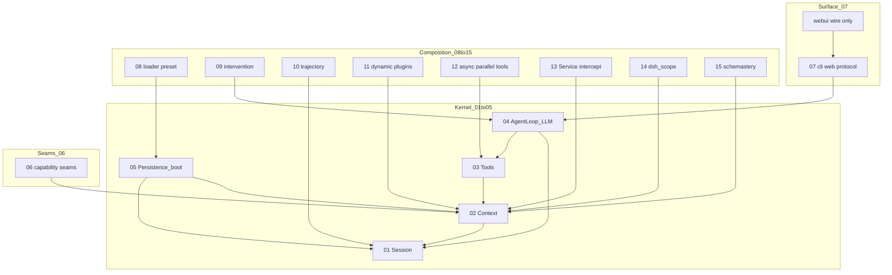
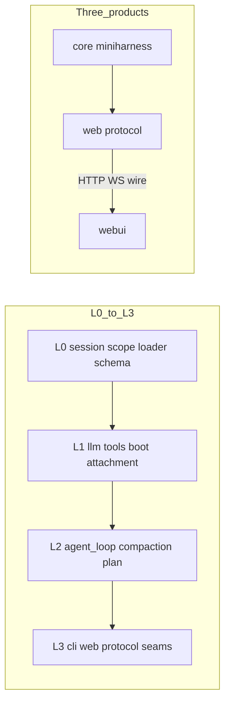
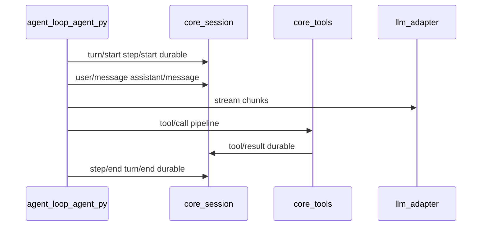
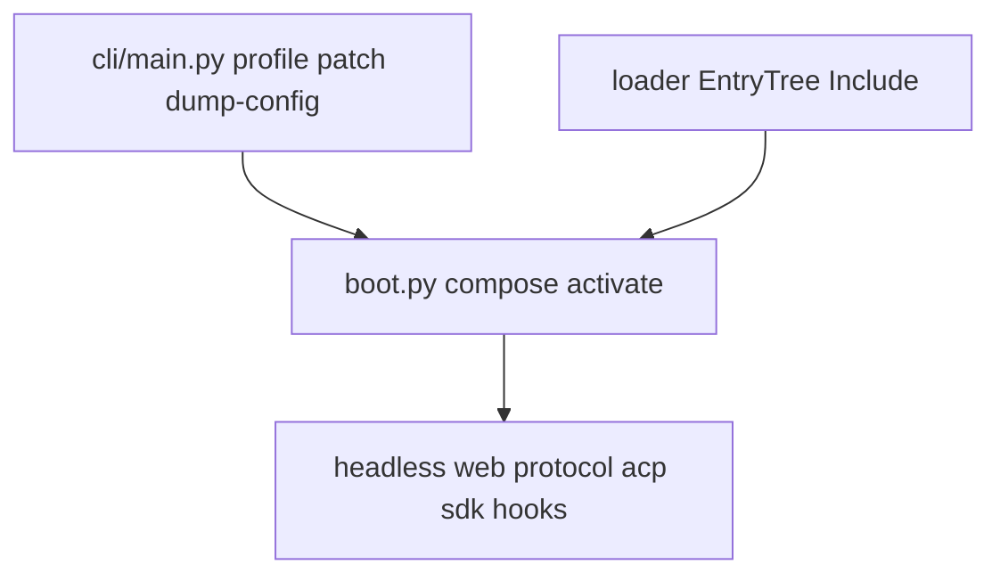
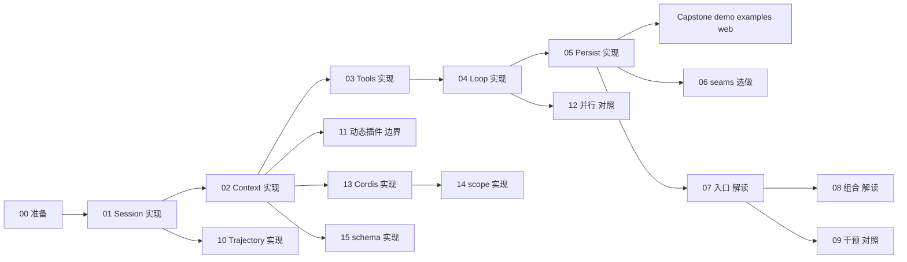

# 系统地图

<p class="lead">MiniHarness 是「一条 Session 事件日志 + 一个 Cordis 式 Context」上生长的功能模块树；分章教程每章对应一块可独立验收的能力，不是十六个互不相关的子项目。详表与依赖规则见 <a href="architecture.md">architecture.md</a>；上游解读见 <a href="report/index.md">report/index.md</a>。</p>

## 定位（三句）

1. **数据面**：模型可见 ⟺ Session 已记录事件；对话历史由投影算出，不另存第二份真相源。
2. **控制面**：Context 派发、inbox、干预、审批、wire Remote 帧是控制与观测通道，不另存产品状态。
3. **模块观**：手册每章闭合一块行为，验收以 `tests/`（及 `webui/` vitest）为准；克隆仓库默认走 **走读对照**（见 [guides/learning-paths.md](guides/learning-paths.md)）。

图示编号：**Fig S1～S6** 在本页定义；报告 [03 关键流程](report/03-flows.md) 保留完整 Turn/Step 时序（图 11 等），此处不重复全文。

---

## Fig S1 · 功能模块总图 {#fig-s1}



**怎么读 Fig S1**

- **Kernel（01～05）**：同一条 Session 日志 + Context 上的闭合内核——先能持久化事件（01），再挂插件与总线（02）、工具管线（03）、Agent loop 与 LLM（04），最后 boot/持久化组合（05）。05 之后即可跑 Capstone（demo / headless）。
- **Seams（06）**：可替换 Provider（沙箱、凭据、子 agent 等）；Consumer 只依赖接口，换实现不换调用方。
- **Surface（07 + webui）**：CLI、web wire、SDK/ACP/hooks；`webui/` 只消费 HTTP/WS 约定，不 import Python。
- **Composition（08～15）**：loader/preset（08）、干预与审批（09）、Trajectory（10）、动态插件（11）、并行工具（12）、Cordis/scope/schema（13～15）。边表示**启动或数据依赖**：例如 loop（04）读写 Session（01），web（07）驱动 loop，08 的 boot 树在 05 之后生效。
- **验收**：每块能力对应 [功能模块表](#module-chapter-verify) 一行与主测试；改代码时先在此定位模块，再查 [architecture §2](architecture.md#sec-2) 上游归属。

---

## Fig S2 · core / web / webui 与 L0～L3 {#fig-s2}

产品与代码按三层组织；Python 包内再用 L0（地基）～ L3（入口）约束 import 方向（完整规则见 [architecture.md 第 3 节](architecture.md#sec-3)）。



| 边界 | 路径 | 读者入口 |
|---|---|---|
| 核心能力 | `miniharness/core/`、`llm/`、`boot/`、`loader/` 等 | 章节 01～06 |
| 后端 web | `miniharness/web/`、`protocol/` | 章节 07、[interface-wire.md](interface-wire.md) |
| 前端 | 顶层 `webui/` | 仓库根 `webui/README.md`、[wire-tour.md](guides/wire-tour.md) |

**怎么读 Fig S2**

- **L0～L3** 是 Python 包内的 import 纪律：地基（session/scope/schema）→ 领域（llm/tools）→ 编排（agent_loop）→ 入口（cli/web）。违反层序的 import 会被测试或 review 拦下，见 [architecture §3](architecture.md#sec-3)。
- **三个产品边界**：`core` 不感知 HTTP；`web/` 只消费 core 并发布 wire；`webui/` 只消费 wire，禁止 import Python。改 bug 时先判定落在哪一层，再查 [architecture §2](architecture.md#sec-2) 手册章列。
- **读者路径**：读内核走章节 01～06；接浏览器走 07 + interface-wire + wire-tour；只改 UI 走 `webui/` README。

---

## Fig S3 · Turn/Step 数据面（缩略） {#fig-s3}

完整 sequence 与 reject / turn-stopping 分支见 [report/03 §5.1](report/03-flows.md#flows-51)。缩略图对应的 mini 主路径：

| 角色 | 路径 |
|---|---|
| 泵与 turn/step | `miniharness/core/agent_loop/agent.py` |
| 工具执行 | `miniharness/core/tools.py` |
| 事件日志 | `miniharness/core/session/`（append / repair / 投影） |
| LLM 适配 | `miniharness/llm/`（`StreamChunk`、适配器、重试见章节 04 §4.9） |



**怎么读 Fig S3**

- 纵轴是**时间**：每个 `turn/start`～`turn/end` 内可有多个 step；所有 durable 事件进 Session，模型可见历史由此投影，不另存副本。
- 横轴是**责任**：`agent.py` 驱动节拍；`tools.py` 在 step 内执行 tool/call→tool/result；LLM 流在 attempt 内嵌于 `assistant/message`（V4 细节见章节 04）。
- 本图省略 reject、turn-stopping、并行 tool、审批闸门；分支与时序全文见 [report/03 §5.1](report/03-flows.md#flows-51)。改 loop 或持久化事件类型时，须同步本图或 [T1 headless 走查](guides/traces/headless-one-task.md)。

---

## Fig S4 · 控制面（干预与审批） {#fig-s4}

干预写入 loop 与 Session；浏览器审批经 wire 瀑布与 `$events/result` 结算（详 [interface-wire.md §6](interface-wire.md#wire-6) 与 [章节 09](chapters/09-agent-intervention.md)）。

```mermaid
sequenceDiagram
  participant UI as webui_or_cli
  participant Web as web_approvals
  participant Loop as agent_loop
  participant Sess as session_log
  UI->>Loop: steer cancel followup
  Loop->>Sess: agent events approval/asked
  Web->>UI: events waterfall
  UI->>Web: POST events/result
  Web->>Loop: resume or deny tool
```

端到端走查：[guides/traces/web-follow-approval.md](guides/traces/web-follow-approval.md)。

**怎么读 Fig S4**

- **左侧 UI**：`webui/` 或 CLI 通过 wire 发 steer/cancel/followup，不绕过 Session 直写模型上下文。
- **中间 web**：`web/approvals.py`、`web/questions.py` 把工具闸门与 `$events` 瀑布接到浏览器；结算帧走 `$events/result`（字段单源 [interface-wire §6](interface-wire.md#wire-6)）。
- **右侧 loop + 日志**：干预改变 pump 行为并追加 `agent/*`、`approval/*` 等事件；审计事件 turn-enclosed，见章节 09。
- mini 教学简化：部分审批监听挂在 `tools/ask` 而非上游 `approval/request` 命名点，wire 语义仍对齐——对照 [章节 09](chapters/09-agent-intervention.md) 与 report/04 审批小节。

---

## Fig S5 · 入口组合 {#fig-s5}

上游 profile → bundle → boot → surface；mini 用 `cli/main.py`、`boot/`、`loader/` 表达同一语义（解读见 [章节 07](chapters/07-external-entry-points.md)）。



| 入口 | mini |
|---|---|
| headless 任务 | `cli/headless.py` |
| web | `web/launcher.py` + `webui/` |
| SDK / ACP / hooks | `protocol/sdk.py` · `acp.py` · `hooks.py` |

**怎么读 Fig S5**

- **自上而下**：用户只碰 CLI 子命令或 profile；`boot()` 激活 Loader 条目树；最终暴露 headless / web / protocol 之一。上游差异在 bundle 名，mini 用 `cli/plugins/*` 条目 + YAML 组合文件表达同一语义。
- **Loader 与 Boot 分工**：Loader 解析 Include/补丁/组；Boot 按序 activate fiber。持久化与 session store 在 base 层，各 surface 共享，见章节 05、08。
- **验证**：dump 组合 `--dump-config`；跑 web 见 [T3](guides/traces/web-unary-session.md)；headless 见 [T1](guides/traces/headless-one-task.md)。

---

## Fig S6 · 章节依赖与 Capstone {#fig-s6}

节点标签：**实现** = 按章实现或走读内核；**解读** = 对照已实现代码与上游；**选做** = 可按目标跳过。



**Capstone（五章后任选）**：`python -m miniharness.demo` · `examples/chat_demo.py` · `examples/plan_goal_demo.py --approve` · `python -m miniharness.cli --profile web`（需 `[web]` extra）· 构建 `webui/` 见仓库根 `webui/README.md`。

**怎么读 Fig S6**

- **实线依赖**：02 依赖 01 的事件模型；04 依赖 03 工具管线；05 闭合 01～04 的可持久化运行。00 是环境门，不挡后续箭头。
- **Capstone 分叉**：05 之后可以只跑 demo/examples，也可以并行读 06（扩展口）、07（入口）、10（Trajectory）等；**解读**章（07、08）不要求再写内核，**对照**章（09、12）假设代码已在仓库。
- **13→14→15**：Cordis Service 与 intercept（13）后接 dsh_scope 载波（14）与 schema 校验（15）；可与 02 交叉阅读，但验收测试独立见下表。

---

## 功能模块 · 章节 · 验收 {#module-chapter-verify}

与 [index.md 章节表](index.md#chapter-table) 同步；上游包归属见 [architecture.md §2](architecture.md#sec-2)（**手册章号以映射表为准**）。

| 章 | 功能模块 | 体裁 | 主验收 |
|---|---|---|---|
| 00 | 环境与纪律 | 准备 | 全量 `python -m unittest discover -s tests -t .` + `demo` |
| 01 | Session 日志与投影 | 实现 | `tests/test_session.py` |
| 02 | Context / 事件总线 | 实现 | `tests/test_bus.py` |
| 03 | 工具管线 | 实现 | `tests/test_tools.py` |
| 04 | Agent loop + LLM | 实现 | `tests/test_loop.py` |
| 05 | 持久化 + boot | 实现 | `tests/test_persistence_boot.py` |
| 06 | 能力扩展口 | 实现+延伸 | `tests/test_seams.py` |
| 07 | 外部入口 + web + 协议 | 解读 | `tests/test_web_*.py` |
| 08 | loader + preset | 解读 | `tests/test_composition.py`、`tests/test_loader_*.py` |
| 09 | 干预 + 审批 | 对照 | loop + `tests/test_web_approvals.py` 等 |
| 10 | Trajectory 折叠 | 实现 | `tests/test_trajectory.py` |
| 11 | 动态插件 | 边界 | `tests/test_dynamic.py` |
| 12 | 异步 / 并行工具 | 对照 | `tests/test_loop.py`、tool_calls 相关 |
| 13 | Cordis Service / intercept | 实现 | `tests/test_bus.py`（Service/Logger 与第 02 章共测） |
| 14 | dsh_scope 载波 | 实现 | `tests/test_dsh_scope.py` |
| 15 | schemastery | 实现 | `tests/test_schema_full.py` |

## 落地走查

| 场景 | 文档 |
|---|---|
| headless 一条任务 | [traces/headless-one-task.md](guides/traces/headless-one-task.md) |
| 持久化与恢复 | [traces/persistence-kill-resume.md](guides/traces/persistence-kill-resume.md) |
| Web unary | [traces/web-unary-session.md](guides/traces/web-unary-session.md) |
| Web 审批流 | [traces/web-follow-approval.md](guides/traces/web-follow-approval.md) |
| SDK stdio | [traces/sdk-stdio.md](guides/traces/sdk-stdio.md) |
| wire 阅读顺序 | [guides/wire-tour.md](guides/wire-tour.md) |

## 图示维护

变更 `core/agent_loop`、`web/api.py`、`web/mux.py` 或审批语义时，须同步更新 Fig S3/S4 或 [guides/traces](guides/traces/headless-one-task.md) 中对应走查之一；过程说明写入工作区 `status/mini-harness/docs-review/ledger-docs-system-map.md`。
